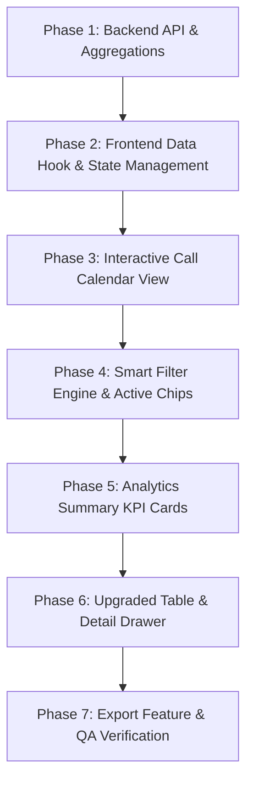

# AOTMS Telecom CRM — Combined Documentation

> This file consolidates every Markdown document that lived in `frontend/` and `backend/`. The original files are untouched — this is a single-file mirror for review, search and sharing.
>
> **Sources:** 13 files · 232.1 KB total · merged 2026-11-09

## Contents

### Part 1 — Frontend

1. [`frontend/README.MD`](#doc-1)
2. [`frontend/calls.md`](#doc-2)
3. [`frontend/data.md`](#doc-3)
4. [`frontend/n8n.md`](#doc-4)
5. [`frontend/implement.md`](#doc-5)
6. [`frontend/signup.md`](#doc-6)
7. [`frontend/todo.md`](#doc-7)
8. [`frontend/Hosting.md`](#doc-8)

### Part 2 — Backend

9. [`backend/README.md`](#doc-9)
10. [`backend/Backendstructure.md`](#doc-10)
11. [`backend/docs/api/index.md`](#doc-11)
12. [`backend/docs/architecture/index.md`](#doc-12)
13. [`backend/docs/workflows/index.md`](#doc-13)

---

<a id="doc-1"></a>

## 1. `frontend/README.MD`

*Source: `frontend/README.MD` · 78.9 KB · last modified 2026-10-26*

File Structure
Is there a recommended way to structure React projects?
React doesn’t have opinions on how you put files into folders. That said there are a few common approaches popular in the ecosystem you may want to consider.

Grouping by features or routes
One common way to structure projects is to locate CSS, JS, and tests together inside folders grouped by feature or route.

common/
  Avatar.js
  Avatar.css
  APIUtils.js
  APIUtils.test.js
feed/
  index.js
  Feed.js
  Feed.css
  FeedStory.js
  FeedStory.test.js
  FeedAPI.js
profile/
  index.js
  Profile.js
  ProfileHeader.js
  ProfileHeader.css
  ProfileAPI.js
The definition of a “feature” is not universal, and it is up to you to choose the granularity. If you can’t come up with a list of top-level folders, you can ask the users of your product what major parts it consists of, and use their mental model as a blueprint.

Grouping by file type
Another popular way to structure projects is to group similar files together, for example:

api/
  APIUtils.js
  APIUtils.test.js
  ProfileAPI.js
  UserAPI.js
components/
  Avatar.js
  Avatar.css
  Feed.js
  Feed.css
  FeedStory.js
  FeedStory.test.js
  Profile.js
  ProfileHeader.js
  ProfileHeader.css
Some people also prefer to go further, and separate components into different folders depending on their role in the application. For example, Atomic Design is a design methodology built on this principle. Remember that it’s often more productive to treat such methodologies as helpful examples rather than strict rules to follow.

Avoid too much nesting
There are many pain points associated with deep directory nesting in JavaScript projects. It becomes harder to write relative imports between them, or to update those imports when the files are moved. Unless you have a very compelling reason to use a deep folder structure, consider limiting yourself to a maximum of three or four nested folders within a single project. Of course, this is only a recommendation, and it may not be relevant to your project.

Don’t overthink it
If you’re just starting a project, don’t spend more than five minutes on choosing a file structure. Pick any of the above approaches (or come up with your own) and start writing code! You’ll likely want to rethink it anyway after you’ve written some real code.

If you feel completely stuck, start by keeping all files in a single folder. Eventually it will grow large enough that you will want to separate some files from the rest. By that time you’ll have enough knowledge to tell which files you edit together most often. In general, it is a good idea to keep files that often change together close to each other. This principle is called “colocation”.

As projects grow larger, they often use a mix of both of the above approaches in practice. So choosing the “right” one in the beginning isn’t very important.

React JS Advance-Level Folder Structure
How to run the project

npm i
and

npm start
Before using This project install latest versions of following packages

Axios
Bootstrap - React Strap - MUI - AntD - Tailwind
React Icons
React Router Dom Latest React Router v6
Other Required packages
In the project I have just set Up most used folder structure:

React JS Advanced Folder Structure
.
├── public
|     └── index.html
├── src
    ├── assets
    |     ├── audios
    |     ├── icons
    |     ├── images
    |     └── videos
    ├── components
    |     ├── Button
    |     |     ├── index.jsx
    |     |     └── button.module.css
    |	  ├── inputs
    |     |     ├── index.jsx
    |     |     └── inputs.module.css
    |	  ├── Modal
    |     |     ├── index.jsx
    |     |     └── modal.module.css
    |	  └── Tooltip
    |           ├── index.jsx
    |           └── tooltip.module.css
    |     └── index.js
    ├──  db
    |     ├── productsData.js
    |     └── userData.js
    ├── layout
    |     ├── Header
    |     |     ├── index.jsx
    |     |     └── header.module.css
    |     ├── Navbar.jsx
    |     |     ├── index.jsx
    |     |     └── navbar.module.css
    |     ├── Breadcrumbs.jsx
    |     |     ├── index.jsx
    |     |     └── breadcrumbs.module.css
    |     └── Footer.jsx
    |           ├── index.jsx
    |           └── footer.module.css
    |     └── index.js
    ├── pages
    |     ├── Home
    |     |     ├── index.jsx
    |     |     └── home.module.css
    |     ├── Login
    |     |     ├── index.jsx
    |     |     └── login.module.css
    |     ├── Signup
    |     |     ├── index.jsx
    |     |     └── signup.module.css
    |     └── About
    |           ├── index.jsx
    |           └── about.module.css
    |     └── index.js
    ├── Routers
    |     └── Routers.js
    ├── store
    |     ├── action.js  
    |     ├── reducers.js  
    |     └── store.js
    ├── services
    |     ├── api.js          // API request functions
    |     └── dataUtils.js    // Data manipulation functions
    ├── utils
    |     ├── constants
    |     |     ├── Strapi.js
    |     |     └── Firebase.js
    |     ├── helpers
    |     |     ├── arrays.js
    |     |     └── helpers.js
    |     └── hooks  
    |           └── useIsMobile.js  
    ├── .env
    ├── app.js
    ├── index.css
    ├── index.js
|
├── .gitignore
├── package-lock.json
├── package.json
└── README.md
Folders include
Public
Assests
Components
db
layout
Pages
Routes
services
store
utils
Constants
helpers
hooks
.env.example / .env.development
.eslintrc.cjs
.prettierrc.cjs
.jsonconfig.json
.gitignore
package.json
.vite.config.js
Public
Public mainly contain root file index.html which help to run react project.

Assests
In Assets folder you can put following things.

Images
Video
Icons
CSS
Components
Component will have all the components which are reuseable anywhere in website. Like - Button - Cards - DropDownBtn - inputs - Modal - Popups - Toast - Tooltip - Text/Heading/Title - Skeleton - Spiner/Loader

Constants
Constants folder have Tokens, logins, and those details which we don't want to share with public. Like Env files are used to store sensitive credentials such as API keys. An environment variable supports storing the API link at one location so that we do not need to change the Link in each file manually.

const API_BASE_URL = 'https://api.example.com';
const MAX_ITEMS_PER_PAGE = 10;
db
Here we provide JSON Formate of data in frontend in React APP.

products data
users data
Helpers
Helpers used to store utility functions and modules that provide various helper functionalities. These functions are usually small, reusable, and not directly tied to the main business logic of your application.

Array to Object
Object to Array
Date Formatting
Number Formatting
Validation
Api Request
Helper Functions Details

Layout
This is just a special folder for placing any layout based components.

Header
Footer
Breadcrumbs
Navbar
Sidebar
Pages
Pages will have all the pages which we will use in website.

Routes
Router will have all the Routes in website. Where we are going and where we want to go.

Services
In Services we put configuration file, like when you are using google firebase then your firebase config file will be in services folder.

The "services" folder is often used to contain code related to making *API requests and managing data from external sources. This folder helps separate the concerns of your application by isolating data fetching and manipulation logic from the components that render the UI.

// services/apiService.js
import axios from 'axios';

export function fetchUserData(userId) {
  return axios.get(`/api/users/${userId}`);
}
Store
"store" folder in a React application typically refers to a directory where you manage your application's state using state management libraries like

Redux
Redux Toolkit
Zustand
Context Api
Mobx
|-- store/
|   |-- actions.js        // Redux action creators
|   |-- reducers.js       // Redux reducers
|   |-- store.js          // Redux store configuration
Utils
Utils folder is a common convention in many software projects, including React applications, for storing utility functions and helper modules that provide general-purpose functionality across different parts of the application.

constants
helpers
hooks
Example:

// utils/stringUtils.js
export function capitalizeFirstLetter(str) {
  return str.charAt(0).toUpperCase() + str.slice(1);
}

// utils/dateUtils.js
export function formatDate(date) {
  const options = { year: 'numeric', month: 'long', day: 'numeric' };
  return new Date(date).toLocaleDateString(undefined, options);
}
.env.development
Env files are used to store sensitive credentials such as API keys.

REACT_APP_API_URL=http://localhost:3001
REACT_APP_DEBUG_MODE=true
.env.example
Env files are used to store sensitive credentials such as API keys.

REACT_APP_API_KEY=
REACT_APP_API_URL=
.eslintrc.cjs
ESLint, which is a popular tool for linting and enforcing coding style and best practices in JavaScript code. The .eslintrc.cjs file is written in CommonJS module format and is used to configure ESLint for your project.

.gitignore
.gitignore file contain all those files,folders name which user want to skip to push online. If you don't want to push any specific file/folder then you should put their name in .gitignore

.prettierrc.cjs
.prettierrc.cjs file is a configuration file used for Prettier, which is a widely used code formatting tool. Prettier helps ensure consistent and automatic code formatting across your codebase. The .prettierrc.cjs file is written in CommonJS module format and is used to configure Prettier's behavior for your project.

File Format & Naming
Configuration Setup
Export Configuration
module.exports = {
  printWidth: 80,
  tabWidth: 2,
  singleQuote: true,
  trailingComma: 'es5',
};
jscongig.json
File Purpose
Configuration Setup:
JSON Format
{
  "compilerOptions": {
    "baseUrl": "./",
    "paths": {
      "@/*": ["src/*"]
    }
  }
}
package.json
package.json file is core to the Nodejs ecosystem and is a fundamental part of understanding and working with Node. js , npm , and even modern JavaScript . This file is used as a manifest, storing information about applications, modules, packages, and more.

vite.config.js
File Purpose: The vite.config.js file allows you to customize various aspects of your Vite project, including configuration options for the development server, build process, and plugin settings.

Configuration Setup: Inside the vite.config.js file, you export an object containing the configuration options for your Vite project. This object can include settings related to the development server, build process, plugins, and more.

JavaScript Format: The vite.config.js file is written in JavaScript, and it's named vite.config.js. It should be placed in the root directory of your Vite project.

// vite.config.js
export default {
  server: {
    port: 3000
  },
  build: {
    minify: true
  },
  plugins: [/* your plugins here */]
};
@import

export default defineConfig({
  resolve: {
    alias: {
      '@': '/src',
      '@page': '/src/page'
    }
  },
  plugins: [react()],
})
2nd Method

import { defineConfig } from 'vite'
import react from '@vitejs/plugin-react'
import { resolve } from 'path';

const alias = {
  // eslint-disable-next-line no-undef
  '@': resolve(__dirname, './src'),
};

export default defineConfig({
  plugins: [react()],
  resolve: {
    alias,
  },
})


### Frontend Architecture & File Structure

This document details the standardized folder layout, import aliases, and modular architecture implemented across `frontend/src/` adhering to the React enterprise guidelines defined in `FileStructure.md`.

---

#### 1. Directory Tree Overview

```
frontend/
├── jsconfig.json               # Path alias mapping (@/* -> src/*)
├── vite.config.js              # Vite bundler configuration & @ alias
├── package.json
├── tailwind.config.js
└── src/
    ├── app/                    # Application root composition
    │   ├── App.jsx             # Main App layout & route provider wrapper
    │   ├── config.js           # App-level environment & runtime configs
    │   ├── guards.jsx          # Auth & Role routing guards
    │   ├── providers.jsx       # Global context providers tree
    │   └── routes.jsx          # Route definitions
    │
    ├── assets/                 # Static images, media, branding & styles
    │   ├── styles/             # Global CSS stylesheets (variables.css, utilities.css, globals.css)
    │   ├── CRM.png
    │   ├── aotms-global-logo.png
    │   └── ...
    │
    ├── components/             # Reusable UI & shared widgets
    │   ├── ui/                 # Atomic UI primitives (Button, Card, Modal, Slider)
    │   │   └── index.js        # Barrel export for @/components/ui
    │   ├── common/             # Common shared elements (e.g. StatusBadge)
    │   ├── dashboard/          # Dashboard sub-components
    │   ├── Attendance/         # Attendance modal components
    │   ├── LeadDetails/        # Lead details view components
    │   ├── Finance/            # Invoice / PDF / A4 templates
    │   ├── tracking/           # Live tracking map component
    │   └── index.js            # Unified barrel export for @/components
    │
    ├── layouts/                # Role-based & view layouts
    │   ├── AdminLayout/        # Administrator layout wrapper
    │   ├── EmployeeLayout/     # Employee layout wrapper
    │   ├── ManagerLayout/      # Manager layout wrapper
    │   ├── AuthLayout/         # Authentication views layout
    │   ├── PublicLayout/       # Marketing & public layout
    │   ├── components/         # Shared layout parts (Sidebar, Header, Topbar, Breadcrumbs)
    │   └── index.js            # Barrel export for @/layouts
    │
    ├── modules/                # Feature-driven business modules
    │   ├── communication/      # Call recordings, Email CRM, Blast
    │   ├── dashboard/          # Role-based dashboard views
    │   ├── developer/          # Access tokens, API integrations, Maps showcase
    │   │   └── maps/           # Map showcase & controls dashboard (moved from src/Maps)
    │   ├── finance/            # Fee receipts, Invoices, Offer letters, Payslips, Quotations
    │   ├── management/         # Attendance records, Departments, Live Employee Tracking
    │   ├── marketing/          # Campaigns, Digital calendar, Leads, Reports, Leaderboard
    │   └── tasks/              # Tasks management
    │
    ├── pages/                  # Page-level route views
    │   ├── auth/               # Login, Sign up, Reset password, Verification
    │   ├── landing/            # Landing page hero, pricing, features, footer
    │   ├── errors/             # 403, 404, 500 pages
    │   ├── Billing.jsx
    │   ├── CustomActions.jsx
    │   ├── Fields.jsx
    │   ├── MyPreferences.jsx
    │   ├── PermissionTemplates.jsx
    │   ├── Profile.jsx
    │   ├── WorkspacePreferences.jsx
    │   └── index.js            # Barrel export for @/pages
    │
    ├── services/               # External APIs, sockets, and data clients
    │   ├── api/                # Axios client, endpoints, interceptors, error handling
    │   ├── auth/               # Authentication service functions
    │   ├── notifications/      # Real-time and push notifications
    │   ├── storage/            # Local/session storage utilities
    │   ├── api.js              # Central API gateway
    │   ├── geoTracker.js       # Geolocation tracking engine
    │   ├── trackingSocketClient.js # Live tracking web socket
    │   └── index.js            # Barrel export for @/services
    │
    ├── permissions/            # RBAC definitions & Route guards
    │   ├── roles.js            # Core roles: ADMIN, MANAGER, EMPLOYEE
    │   ├── permissions.js      # Granular permission flags
    │   ├── routePermissions.js # Route permission mapping
    │   ├── permissionGuard.jsx # Declarative permission guard component
    │   └── index.js            # Barrel export for @/permissions
    │
    ├── hooks/                  # Custom React hooks
    │   ├── useBreakpoint.js
    │   ├── useDebounce.js
    │   ├── usePagination.js
    │   ├── usePermissions.js
    │   ├── useTheme.js
    │   └── index.js            # Barrel export for @/hooks
    │
    ├── context/                # React Contexts
    │   ├── AuthContext.jsx
    │   ├── SidebarContext.jsx
    │   └── index.js            # Barrel export for @/context
    │
    ├── constants/              # System constants and enum maps
    │   ├── routes.js
    │   ├── status.js
    │   ├── trackingConfig.js   # Geolocation & office coordinates config (moved from src/config)
    │   └── index.js            # Barrel export for @/constants
    │
    ├── utils/                  # Helper utilities and data transforms
    │   ├── cn.js               # Tailwind class merger utility (clsx + twMerge, moved from src/lib)
    │   ├── dateFormat.js
    │   ├── emailTemplateUtils.js
    │   ├── excelTemplate.js
    │   ├── numberToWords.js
    │   ├── permissions.js
    │   └── index.js            # Barrel export for @/utils
    │
    └── types/                  # Data structures & mock schema definitions
        ├── api.js
        ├── auth.js
        ├── common.js
        └── user.js
```

---

#### 2. Standardized Import Conventions

With the addition of `jsconfig.json` and barrel exports, imports can be written concisely and clearly:

```javascript
// Components & UI
import { Button, Card, ConfirmModal } from '@/components/ui';
import { StatusBadge, LiveMap } from '@/components';

// Layouts
import { AdminLayout, Breadcrumbs, Topbar } from '@/layouts';

// Hooks & Context
import { useAuth, useSidebar } from '@/context';
import { useDebounce, usePagination } from '@/hooks';

// Services & Utils
import { api, getEmployees } from '@/services';
import { formatDate, numberToWords } from '@/utils';
import { ROLES, PermissionGuard } from '@/permissions';
```


### Implementation Plan: Meta Leads Module & Dynamic Google Sheets n8n Integration

---

#### 1. Executive Summary & Goals

* **Module Name:** `Meta_Leads`
* **Parent Section:** Marketing (`Marketing` → `Meta Leads`)
* **Primary Objective:** 
  1. Add a dedicated **Meta Leads** module in the Marketing navigation bar.
  2. Implement an interactive **Campaign Headings** bar where clicking any campaign immediately filters and displays its corresponding leads.
  3. **Zero Column Alteration / No Loss of Headers:** Dynamically render the exact Google Sheet column headers as they exist in each tab, without stripping, renaming, or hardcoding fields.
  4. Provide a refined, production-ready **n8n Workflow** that solves the data mixing and field-loss flaws in the previous version.

---

#### 2. Architecture & Data Flow

```
[ Google Spreadsheet ]
   ├── Tab: Digital Marketing_Leads (Custom Headers: e.g. Ad Name, City, Phone...)
   ├── Tab: SAP_Leads               (Custom Headers: e.g. SAP Module, Experience...)
   ├── Tab: Python_Leads            (Custom Headers: e.g. College, Batch Timing...)
   └── Tab: CyberSecurity_Leads     (Custom Headers: e.g. Qualification, Domain...)
             │
             ▼
   [ n8n Automation Engine ]
   ├── Step 1: Webhook Trigger (`/webhook/Meta_Leads`)
   ├── Step 2: Read each Tab (A:ZZ)
   ├── Step 3: Tag each stream with its `campaign` name while preserving all row fields
   ├── Step 4: Merge 4 streams (`Combine All Tabs`, 4 inputs)
   └── Step 5: HTTP POST to CRM (`/api/meta-leads`) with full dynamic payload
             │
             ▼
   [ CRM Backend API & Database ]
   ├── Route: `/api/meta-leads`
   ├── Storage: `campaign`, `source`, `createdAt`, `rawData` (flexible key-value container)
             │
             ▼
   [ Frontend: Meta Leads UI ]
   ├── Top: Interactive Campaign Navigation Bar (Tabs/Pills with lead counts)
   └── Bottom: Dynamic-Header Table (renders exact Google Sheet columns per campaign)
```

---

#### 3. Implementation Form (Step-by-Step Checklist)

##### Phase 1: n8n Workflow Configuration
- [ ] Import the updated n8n workflow JSON below into your n8n workspace.
- [ ] Connect your active Google Sheets OAuth2 credential to each of the 4 Read nodes.
- [ ] Verify that each tab name matches your Google Sheet tabs exactly.
- [ ] Set your CRM API token in the HTTP Request node headers.
- [ ] Test the workflow with test execution to verify incoming payloads retain all custom columns.

##### Phase 2: Backend API & Database Schema
- [ ] **Data Model:** Create a flexible schema for Meta Leads:
  - `campaign`: String (e.g. `SAP_Leads`, `Python_Leads`)
  - `source`: String (default: `google_sheets_meta`)
  - `rawData`: Mixed / Flexible Object (stores all original sheet column names and values dynamically)
  - `status`: String (default: `New`)
  - `createdAt`: Date
- [ ] **Routes:**
  - `POST /api/meta-leads` — Bulk or single lead ingestion endpoint (used by n8n).
  - `GET /api/meta-leads/campaigns` — Returns list of distinct campaign names with lead counts.
  - `GET /api/meta-leads?campaign=...` — Returns leads filtered by selected campaign.

##### Phase 3: Frontend Navigation & UI Assembly
- [ ] **Navbar Integration:** Add `Meta Leads` to the Marketing section dropdown/sidebar in the application navigation.
- [ ] **Campaign Selector Bar:** Build interactive campaign selector cards/tabs across the top:
  - `All Campaigns`
  - `Digital Marketing_Leads`
  - `SAP_Leads`
  - `Python_Leads`
  - `CyberSecurity_Leads`
- [ ] **Dynamic Table Engine:**
  - Read object keys from the active campaign's `rawData`.
  - Dynamically generate table `<th />` headers matching the exact sheet columns.
  - Implement horizontal scroll, keyword search, and pagination.

---

#### 4. Production-Ready n8n Workflow Specification

This workflow resolves all previous flaws:
1. **Preserves Tab Identity:** Each tab branch has a tagging node adding `campaign: "<Tab_Name>"` before merging.
2. **Zero Loss of Column Headings:** Transmits the full `$json` object inside `rawData` instead of cherry-picking fields.
3. **Correct Merge Sizing:** Merge node inputs adjusted to 4 inputs.
4. **Target Endpoint:** Configured for `/api/meta-leads`.

```json
{
  "name": "Meta Leads - Multi-Campaign Google Sheets Sync",
  "nodes": [
    {
      "parameters": {
        "httpMethod": "POST",
        "path": "Meta_Leads",
        "options": {}
      },
      "id": "37674129-7e79-400e-8c48-3557dc2b920a",
      "name": "Webhook Trigger",
      "type": "n8n-nodes-base.webhook",
      "typeVersion": 2.2,
      "position": [-160, 416]
    },
    {
      "parameters": {
        "authentication": "oAuth2",
        "sheetId": "1NK3yVkkKxAOjgTCL46nEaC1lzpOxnn1vCeTAY9nX2Jg",
        "range": "'Digital Marketing_Leads'!A:ZZ",
        "options": {}
      },
      "id": "c3b18d95-cc93-46f2-a8fb-f0795feb6270",
      "name": "Read - Digital Marketing",
      "type": "n8n-nodes-base.googleSheets",
      "typeVersion": 1,
      "position": [160, 160],
      "credentials": {
        "googleSheetsOAuth2Api": {
          "id": "Z78t7YLL8GqHco4o",
          "name": "Google Sheets account"
        }
      }
    },
    {
      "parameters": {
        "assignments": {
          "assignments": [
            {
              "id": "campaign_tag_dm",
              "name": "campaign",
              "value": "Digital Marketing_Leads",
              "type": "string"
            }
          ]
        },
        "options": {}
      },
      "id": "a1111111-1111-1111-1111-111111111111",
      "name": "Tag - Digital Marketing",
      "type": "n8n-nodes-base.set",
      "typeVersion": 3.4,
      "position": [440, 160]
    },
    {
      "parameters": {
        "authentication": "oAuth2",
        "sheetId": "1NK3yVkkKxAOjgTCL46nEaC1lzpOxnn1vCeTAY9nX2Jg",
        "range": "'SAP_Leads'!A:ZZ",
        "options": {}
      },
      "id": "feccae78-fda0-41f7-9149-a0f876e2c5c6",
      "name": "Read - SAP Leads",
      "type": "n8n-nodes-base.googleSheets",
      "typeVersion": 1,
      "position": [160, 320],
      "credentials": {
        "googleSheetsOAuth2Api": {
          "id": "Z78t7YLL8GqHco4o",
          "name": "Google Sheets account"
        }
      }
    },
    {
      "parameters": {
        "assignments": {
          "assignments": [
            {
              "id": "campaign_tag_sap",
              "name": "campaign",
              "value": "SAP_Leads",
              "type": "string"
            }
          ]
        },
        "options": {}
      },
      "id": "a2222222-2222-2222-2222-222222222222",
      "name": "Tag - SAP Leads",
      "type": "n8n-nodes-base.set",
      "typeVersion": 3.4,
      "position": [440, 320]
    },
    {
      "parameters": {
        "authentication": "oAuth2",
        "sheetId": "1NK3yVkkKxAOjgTCL46nEaC1lzpOxnn1vCeTAY9nX2Jg",
        "range": "'Python_Leads'!A:ZZ",
        "options": {}
      },
      "id": "bed451e4-c0ec-4e74-9c82-d94e19961d91",
      "name": "Read - Python Leads",
      "type": "n8n-nodes-base.googleSheets",
      "typeVersion": 1,
      "position": [160, 480],
      "credentials": {
        "googleSheetsOAuth2Api": {
          "id": "Z78t7YLL8GqHco4o",
          "name": "Google Sheets account"
        }
      }
    },
    {
      "parameters": {
        "assignments": {
          "assignments": [
            {
              "id": "campaign_tag_python",
              "name": "campaign",
              "value": "Python_Leads",
              "type": "string"
            }
          ]
        },
        "options": {}
      },
      "id": "a3333333-3333-3333-3333-333333333333",
      "name": "Tag - Python Leads",
      "type": "n8n-nodes-base.set",
      "typeVersion": 3.4,
      "position": [440, 480]
    },
    {
      "parameters": {
        "authentication": "oAuth2",
        "sheetId": "1NK3yVkkKxAOjgTCL46nEaC1lzpOxnn1vCeTAY9nX2Jg",
        "range": "'CyberSecurity_Leads'!A:ZZ",
        "options": {}
      },
      "id": "5c281f54-6337-4d67-bada-c9081624078d",
      "name": "Read - CyberSecurity Leads",
      "type": "n8n-nodes-base.googleSheets",
      "typeVersion": 1,
      "position": [160, 640],
      "credentials": {
        "googleSheetsOAuth2Api": {
          "id": "Z78t7YLL8GqHco4o",
          "name": "Google Sheets account"
        }
      }
    },
    {
      "parameters": {
        "assignments": {
          "assignments": [
            {
              "id": "campaign_tag_cyber",
              "name": "campaign",
              "value": "CyberSecurity_Leads",
              "type": "string"
            }
          ]
        },
        "options": {}
      },
      "id": "a4444444-4444-4444-4444-444444444444",
      "name": "Tag - CyberSecurity Leads",
      "type": "n8n-nodes-base.set",
      "typeVersion": 3.4,
      "position": [440, 640]
    },
    {
      "parameters": {
        "numberInputs": 4
      },
      "id": "78b5c18c-9a0c-450e-92eb-21273ef53882",
      "name": "Combine All Tabs",
      "type": "n8n-nodes-base.merge",
      "typeVersion": 3.2,
      "position": [780, 400]
    },
    {
      "parameters": {
        "method": "POST",
        "url": "https://telecommunication-l3oz.onrender.com/api/meta-leads",
        "sendHeaders": true,
        "headerParameters": {
          "parameters": [
            {
              "name": "Authorization",
              "value": "Bearer YOUR_CRM_TOKEN_HERE"
            },
            {
              "name": "Content-Type",
              "value": "application/json"
            }
          ]
        },
        "sendBody": true,
        "specifyBody": "json",
        "jsonBody": "={{ { campaign: $json.campaign, source: 'google_sheets_meta', rawData: $json } }}",
        "options": {}
      },
      "id": "676b1d29-9d7e-45e0-bd4e-5a230216587a",
      "name": "Sync Lead to CRM",
      "type": "n8n-nodes-base.httpRequest",
      "typeVersion": 4.2,
      "position": [1080, 400],
      "disabled": false
    }
  ],
  "connections": {
    "Webhook Trigger": {
      "main": [
        [
          { "node": "Read - Digital Marketing", "type": "main", "index": 0 },
          { "node": "Read - SAP Leads", "type": "main", "index": 0 },
          { "node": "Read - Python Leads", "type": "main", "index": 0 },
          { "node": "Read - CyberSecurity Leads", "type": "main", "index": 0 }
        ]
      ]
    },
    "Read - Digital Marketing": {
      "main": [[{ "node": "Tag - Digital Marketing", "type": "main", "index": 0 }]]
    },
    "Tag - Digital Marketing": {
      "main": [[{ "node": "Combine All Tabs", "type": "main", "index": 0 }]]
    },
    "Read - SAP Leads": {
      "main": [[{ "node": "Tag - SAP Leads", "type": "main", "index": 0 }]]
    },
    "Tag - SAP Leads": {
      "main": [[{ "node": "Combine All Tabs", "type": "main", "index": 1 }]]
    },
    "Read - Python Leads": {
      "main": [[{ "node": "Tag - Python Leads", "type": "main", "index": 0 }]]
    },
    "Tag - Python Leads": {
      "main": [[{ "node": "Combine All Tabs", "type": "main", "index": 2 }]]
    },
    "Read - CyberSecurity Leads": {
      "main": [[{ "node": "Tag - CyberSecurity Leads", "type": "main", "index": 0 }]]
    },
    "Tag - CyberSecurity Leads": {
      "main": [[{ "node": "Combine All Tabs", "type": "main", "index": 3 }]]
    },
    "Combine All Tabs": {
      "main": [[{ "node": "Sync Lead to CRM", "type": "main", "index": 0 }]]
    }
  },
  "settings": {
    "executionOrder": "v1"
  }
}
```

---

#### 5. Frontend UI/UX Design Specification: Meta Leads Module
---

##### A. Design System Tokens (Harmonized with Existing `Campaigns.jsx`)

The Meta Leads module directly shares the **White, Blue, Orange & Emerald** design token system (`T`) established in the core Campaigns module:

```
Theme Tokens:
├── Base Surfaces:
│   ├── T.white: '#ffffff'
│   ├── T.bg: '#f8fafc'              (Page canvas background)
│   ├── T.bgCard: '#ffffff'          (Card and table background)
│   ├── T.border: '#e2e8f0'          (Standard card/table borders)
│   └── T.borderSoft: '#f1f5f9'      (Subtle dividers)
│
├── Typography & Contrast:
│   ├── T.text: '#1e293b'            (Primary dark slate)
│   ├── T.textSecondary: '#475569'   (Body text)
│   ├── T.muted: '#64748b'           (Secondary labels & captions)
│   └── T.subtle: '#94a3b8'          (Placeholder & helper text)
│
├── Brand Accents & Interactive:
│   ├── Blue Accent (Primary Sync & Navigation):
│   │   ├── T.blue: '#2563eb'        (Primary buttons, active tabs, links)
│   │   ├── T.blueHover: '#1d4ed8'   (Button hover states)
│   │   ├── T.blueLight: '#eff6ff'   (Active tab background & badges)
│   │   └── T.blueBorder: '#bfdbfe'  (Active tab border outline)
│   │
│   ├── Orange Accent (Action & Alerts):
│   │   ├── T.orange: '#ea580c'      (Highlight indicators, callouts)
│   │   ├── T.orangeLight: '#fff7ed' (Tag background)
│   │   └── T.orangeBorder: '#fed7aa'
│   │
│   ├── Emerald Accent (Live Sync & Success):
│   │   ├── T.emerald: '#10b981'     (Live sync status, WhatsApp action)
│   │   ├── T.emeraldLight: '#ecfdf5'
│   │   └── T.emeraldBorder: '#a7f3d0'
│   │
│   └── Amber & Rose (Warnings & Errors):
│       ├── T.amber: '#f59e0b' / T.amberLight: '#fffbeb'
│       └── T.rose: '#f43f5e' / T.roseLight: '#fff1f2'
```

---

##### B. React Icons Catalog

Every UI element is assigned a designated icon from standard React Icon packages (`react-icons/fi`, `react-icons/ri`, `react-icons/fa`, `react-icons/si`):

| UI Component | React Icon Symbol | Package | Visual Purpose |
| :--- | :--- | :--- | :--- |
| **Page Title Badge** | `<RiMegaphoneLine />` | `react-icons/ri` | Campaign header badge |
| **Module Hub Icon** | `<RiFolderChartLine />` | `react-icons/ri` | Meta Leads marketing icon |
| **Meta Platform Icon** | `<SiMeta />` / `<SiFacebook />` | `react-icons/si` | Meta source badge |
| **All Campaigns Tab** | `<FiTarget />` | `react-icons/fi` | Comprehensive view pill |
| **Campaign Heading Tab** | `<FiLayers />` | `react-icons/fi` | Individual category tabs |
| **Active Selection** | `<FiCheck />` | `react-icons/fi` | Checkmark on active pill/dropdown |
| **Global Search** | `<FiSearch />` | `react-icons/fi` | Search input adornment |
| **Live Sync Button** | `<FiRefreshCw />` | `react-icons/fi` | Spin animation during live Google Sheets pull |
| **Export Data** | `<FiDownload />` | `react-icons/fi` | CSV/Excel export trigger |
| **Column Manager** | `<FiFilter />` / `<FiColumns />` | `react-icons/fi` | Dynamic column visibility toggle |
| **Sort Glyph** | `<FiChevronDown />` | `react-icons/fi` | Table column sort indicator |
| **WhatsApp Action** | `<FaWhatsapp />` | `react-icons/fa` | Direct green WhatsApp blast/chat |
| **Direct Call Action** | `<FiPhoneCall />` | `react-icons/fi` | Primary blue tele-caller trigger |
| **Direct Email Action** | `<FiMail />` | `react-icons/fi` | Mailto client trigger |
| **Deep Inspect / View** | `<FiEye />` | `react-icons/fi` | Open row in slide-over drawer |
| **Google Sheet Link** | `<FiArrowUpRight />` | `react-icons/fi` | Jump directly to origin Google Sheet |
| **Time & Ingestion** | `<FiClock />` | `react-icons/fi` | Ingestion timestamp marker |
| **Total Inflow** | `<FiUsers />` | `react-icons/fi` | Lead count counter icon |

---

##### C. Visual Layout Wireframe (Same Existing Campaign Style)

```
┌────────────────────────────────────────────────────────────────────────────────────────────────────────┐
│  Navbar: CRM Telecommunication  |  Dashboard  |  [Marketing ▾]  |  Sales  |  Finance  |  👤 Profile     │
└────────────────────────────────────────────────────────────────────────────────────────────────────────┘
  Marketing  /  Campaigns  /  Meta Leads Hub (Google Sheets Dynamic Sync)
  
┌────────────────────────────────────────────────────────────────────────────────────────────────────────┐
│ 📢 HEADER SECTION (Matching Campaigns.jsx Header Layout)                                               │
│                                                                                                        │
│  [<RiFolderChartLine />]  Meta Leads Ingestion Hub                       [ ⟳ FiRefreshCw Sync Now ]    │
│  Multi-tab Google Sheets sync with dynamic zero-loss column mapping     [ ⤓ FiDownload Export CSV ]   │
└────────────────────────────────────────────────────────────────────────────────────────────────────────┘

┌────────────────────────────────────────────────────────────────────────────────────────────────────────┐
│ 📊 TOP METRIC CARDS (White Cards, T.border, Circular Progress / Accented Badges)                       │
│ ┌────────────────────────┐  ┌────────────────────────┐  ┌────────────────────────┐  ┌────────────────┐│
│ │ [<FiUsers />] Total    │  │ [<FiLayers />] Active   │  │ [<FiActivity />] Today │  │ [<FiClock />]  ││
│ │ 1,248 Leads            │  │ 4 Campaign Tabs         │  │ +84 Ingested           │  │ 5 mins ago 🟢  ││
│ │ (T.blue Light Badge)   │  │ (T.orange Light Badge)  │  │ (T.emerald Light Badge)│  │ Live & Synced  ││
│ └────────────────────────┘  └────────────────────────┘  └────────────────────────┘  └────────────────┘│
└────────────────────────────────────────────────────────────────────────────────────────────────────────┘

┌────────────────────────────────────────────────────────────────────────────────────────────────────────┐
│ 🗂️ INTERACTIVE CAMPAIGN HEADINGS (Same Pill Filter Styling as Campaigns.jsx)                           │
│                                                                                                        │
│  [ <FiTarget /> All Campaigns (1,248) ]                                                                │
│  [ <FiLayers /> Digital Marketing_Leads (342) ]  ◄── ACTIVE (T.blue bg, T.blueBorder, T.blue text)    │
│  [ <FiLayers /> SAP_Leads (184) ]                                                                      │
│  [ <FiLayers /> Python_Leads (420) ]                                                                   │
│  [ <FiLayers /> CyberSecurity_Leads (302) ]                                                            │
└────────────────────────────────────────────────────────────────────────────────────────────────────────┘

┌────────────────────────────────────────────────────────────────────────────────────────────────────────┐
│ 🛠️ TOOLBAR (Search, Columns Filter, Actions)                                                          │
│  [ <FiSearch /> Search any lead, mobile, city, or custom sheet attribute... ]                         │
│  [ <FiFilter /> Columns (All) <FiChevronDown /> ]   [ Clear Filter ]                                   │
└────────────────────────────────────────────────────────────────────────────────────────────────────────┘

┌────────────────────────────────────────────────────────────────────────────────────────────────────────┐
│ 📋 DYNAMIC ZERO-LOSS TABLE (White bg, T.border, Crisp Typography, Row Actions)                         │
│                                                                                                        │
│  [#] │ [Sheet Column 1 <FiChevronDown />] │ [Sheet Column 2]  │ [Sheet Column 3]  │ Quick Actions      │
│ ─────┼────────────────────────────────────┼───────────────────┼───────────────────┼────────────────────│
│  01  │ John Doe                           │ +91 98765 43210   │ Cloud SAP-MM      │ [WhatsApp] [Call]  │
│      │                                    │                   │                   │ [<FiEye /> View]   │
│  02  │ Sarah Smith                        │ +91 91234 56789   │ Python Full Stack │ [WhatsApp] [Call]  │
│      │                                    │                   │                   │ [<FiEye /> View]   │
│                                                                                                        │
│  * Table renders dynamically: Whatever columns exist in that Google Sheet tab are shown with 0 loss!   │
└────────────────────────────────────────────────────────────────────────────────────────────────────────┘

┌────────────────────────────────────────────────────────────────────────────────────────────────────────┐
│ 📄 FOOTER PAGINATION                                                                                   │
│  Showing 1 - 25 of 342 leads       Rows per page: [ 25 ▾ ]               ‹  1  [2]  3  4  5  ›         │
└────────────────────────────────────────────────────────────────────────────────────────────────────────┘
```

---

##### D. Component Details & Interactive Behavior

###### 1. Interactive Campaign Heading Pills (Tabs)
* **Styling:** Follows the exact pill buttons from `Campaigns.jsx`.
* **Inactive State:** 
  * `background: T.white`, `border: 1px solid T.border`, `color: T.muted`.
  * Hover: `border: 1px solid T.blueBorder`, `color: T.blue`, `background: T.blueLight`.
* **Active State:** 
  * `background: T.blueLight`, `border: 1px solid T.blueBorder`, `color: T.blue`, font-weight 600.
  * Tag counter inside the pill has `background: T.blue`, `color: T.white`, rounded-full.
* **Click Interaction:** 
  * Instantly loads that campaign's leads and recalculates column headers dynamically from the sheet data without reloading the page.

###### 2. Dynamic Zero-Loss Data Table
* **Header Rendering:** Reads `Object.keys(lead.rawData)`.
  * Every original Google Sheet column header appears with bold typography (`T.text`), clean slate background (`#f8fafc`), and `FiChevronDown` sort indicator.
* **Quick Contact Action Cluster (Inside Table Row):**
  * `<FaWhatsapp />` Icon Button: Green (`#25D366`), clicking opens WhatsApp chat directly with the lead's number.
  * `<FiPhoneCall />` Icon Button: Blue (`T.blue`), initiates calling via CRM tele-calling pipeline.
  * `<FiEye />` Icon Button: Opens the Lead Detail Slide-Over Drawer.

###### 3. Lead Detail Slide-Over Drawer
* Emerges smoothly from the right (480px width, `bg: T.white`, subtle backdrop overlay).
* **Header:** Displays Lead Name + Campaign Badge (`T.blueLight` pill) + Ingestion Time (`FiClock`).
* **Complete Sheet Data Grid:** Renders every single key-value pair from the Google Sheet row cleanly in two-column cards, ensuring zero custom fields are missed.
* **Footer Actions:**
  * Primary Button: `[ Convert to Active CRM Lead ]` (`background: T.blue`, `hover: T.blueHover`).
  * Secondary Button: `[ <FiArrowUpRight /> Open in Google Sheet ]` (`background: T.bg`, `border: T.border`).

###### 4. Action & Sync Bar
* **Sync Button:** Uses `T.blue` background with `<FiRefreshCw />`. When clicked, it rotates smoothly with a CSS spin animation while the n8n sync is executing.
* **Export Button:** Uses `T.white` background, `border: T.border`, `<FiDownload />` icon, exporting the active campaign table with all original Google Sheet headers intact.

---

#### Phase 5: Meta Leads Campaign Employee Assignment & Restricted Visibility Engine

##### 1. Business Logic & Workflow Architecture
1. **Admin Campaign Assignment Flow:**
   * Inside the Meta Leads Ingestion Hub (`/marketing/meta-leads`), Admins/Managers have an **"Assign Members"** (`<FiUserPlus />` or `<FiShield />`) control linked to each Google Sheet Campaign tab (e.g., `Digital Marketing_Leads`, `SAP_Leads`, `Python_Leads`, `CyberSecurity_Leads`).
   * Clicking opens an **Employee Assignment Modal** displaying all active CRM staff with their complete profile cards (Avatar, Full Name, Designation, Department, Email).
   * Supports flexible assignment:
     * **Single Member Assignment:** Assign 1 specific tele-caller/executive to a campaign.
     * **Multiple Members Assignment:** Assign 2 or more tele-callers to share a high-volume campaign.
   * Clicking **"Confirm Assignment"** commits the association to the database and dispatches an audit log event.

2. **Automatic Role-Based Lead Visibility Flow:**
   * **Admins & Executives (MD, CEO, CTO, Admin, Superadmin, HR):**
     * See the complete dashboard: All campaign tabs (`Digital Marketing_Leads`, `SAP_Leads`, `Python_Leads`, `CyberSecurity_Leads`), total aggregated leads, and the assignment settings button.
   * **Assigned Employees / Tele-callers:**
     * Upon loading `/marketing/meta-leads`, the system automatically resolves `req.user._id`.
     * The backend queries the assignment ledger. If the employee is assigned to `SAP_Leads`, the API returns **ONLY** `SAP_Leads` data.
     * The frontend automatically hides unassigned tabs, hides the "All" tab, and directly loads the employee's assigned campaign.
     * The employee has zero visibility of unassigned campaigns (no leaking of student leads from other departments).
     * If an employee is not yet assigned to any campaign, a dedicated empty state displays: *"No campaigns assigned to your profile yet. Please contact your CRM Administrator."*

---

##### 2. Database Schema (`MetaCampaignAssignment`)

* **File Location:** `backend/src/database/models/MetaCampaignAssignment.js`
* **Schema Definition:**
  ```javascript
  const mongoose = require('mongoose');

  const metaCampaignAssignmentSchema = new mongoose.Schema({
    campaign: {
      type: String,
      required: true,
      unique: true,
      trim: true,
      index: true // e.g. 'SAP_Leads', 'Python_Leads'
    },
    assignedUsers: [{
      type: mongoose.Schema.Types.ObjectId,
      ref: 'User',
      required: true
    }],
    assignedBy: {
      type: mongoose.Schema.Types.ObjectId,
      ref: 'User'
    },
    updatedAt: {
      type: Date,
      default: Date.now
    }
  }, { timestamps: true });
  ```

---

##### 3. Backend API Specifications

###### A. `GET /api/meta-leads/assignments`
* **Access:** Admin / Manager / Executive only (`protect`, `authorize`).
* **Purpose:** Returns the current employee assignment list mapped by campaign.
* **Response:**
  ```json
  {
    "success": true,
    "assignments": [
      {
        "campaign": "SAP_Leads",
        "assignedUsers": [
          { "_id": "usr_1", "name": "Rahul Sharma", "email": "rahul@crm.com", "designation": "Telecaller", "avatar": "" }
        ],
        "assignedBy": { "name": "Admin" },
        "updatedAt": "2026-10-15T22:00:00.000Z"
      }
    ]
  }
  ```

###### B. `POST /api/meta-leads/assignments`
* **Access:** Admin / Manager / Executive only.
* **Payload:**
  ```json
  {
    "campaign": "SAP_Leads",
    "userIds": ["usr_1", "usr_2"]
  }
  ```
* **Behavior:** Atomically upserts the campaign record using `findOneAndUpdate({ campaign }, { assignedUsers, assignedBy, updatedAt }, { upsert: true, new: true })`.

###### C. `GET /api/meta-leads/campaigns` (Role-Filtered)
* **Access:** All authenticated users (`protect`).
* **Behavior:**
  * Checks if `isExecutiveOrAdminUser(req.user)`.
  * If **Admin**: Aggregates and returns all campaigns as usual.
  * If **Employee**: Fetches assigned campaigns for `req.user._id`:
    ```javascript
    const userAssignments = await MetaCampaignAssignment.find({ assignedUsers: req.user._id });
    const allowedCampaigns = userAssignments.map(a => a.campaign);
    ```
    Aggregates only leads matching `{ campaign: { $in: allowedCampaigns } }`.

###### D. `GET /api/meta-leads` (Row-Level Security Enforcement)
* **Access:** All authenticated users (`protect`).
* **Behavior:**
  * Non-admin users are strictly locked to `allowedCampaigns`.
  * If a tele-caller attempts to pass `?campaign=CyberSecurity_Leads` when only assigned to `SAP_Leads`, the backend returns `403 Forbidden` or an empty list, preventing URL manipulation.

---

##### 4. Frontend UI/UX Architecture (`MetaLeads.jsx`)

###### A. Campaign Toolbar Enhancements (Admin View)
* Next to the Campaign Tabs, render an **"Assign Members"** button:
  * Icon: `<FiUserPlus />`
  * Shows mini avatar stack of currently assigned users for the active tab.
  * Click triggers the Assignment Modal.

###### B. Employee Assignment Modal (`AssignMembersModal.jsx`)
* **Header:**
  * Title: "Assign Campaign Access"
  * Campaign Badge: Active Sheet Tab (e.g. `[ SAP_Leads ]` pill)
  * Close Icon (`<FiX />`)
* **Search & Filter Bar:**
  * `<FiSearch />` input for fast search by employee name, email, or designation.
  * Designation filter chips (e.g., "All", "Tele-callers", "Marketing").
* **Employee Profile Cards Grid:**
  * Each card includes:
    * **Profile Avatar:** User photo or styled circle with initials.
    * **Name & Status:** Full name with green active dot.
    * **Designation & Department:** e.g. "Telecaller • Sales Dept".
    * **Email:** Subtle slate text.
    * **Selection Indicator:** Clean checkbox that highlights card border in `T.blue` (`#2563eb`) with smooth transition.
  * Multi-select and single-select supported seamlessly.
* **Footer Actions:**
  * Summary Counter: e.g. *"2 Employees selected"*
  * `[ Cancel ]` button.
  * `[ Confirm Assignment ]` button: Primary Blue (`#2563eb`), with loading spinner when saving.

###### C. Tele-caller User Experience (Restricted Mode)
* When a tele-caller logs in:
  1. The page only renders the tabs assigned to them.
  2. The "Assign Members" button is hidden.
  3. The first assigned campaign is automatically selected by default.
  4. Empty State: If no campaigns are assigned, displays a friendly notice with contact info for the system admin.


### Meta Leads Campaign Assignment UI — Design Specification

#### 1. Overview

Design a professional, responsive CRM interface for assigning employees to individual Meta Lead campaigns.

**Theme**
- Background: White
- Primary actions: Blue (`#2563EB`)
- Active status indicators: Green
- Text: Dark charcoal
- Borders: Light grey
- Style: Clean, spacious, modern CRM dashboard

#### 2. Campaign Dashboard

##### Header
- Page title: **Meta Leads**
- Supporting text: Manage campaign leads and employee access.
- Primary action: **Assign Members** with the `FiUserPlus` icon.
- Show the assigned-member avatar stack beside the assignment action.
- Display the number of assigned employees where useful.

##### Campaign Tabs
Render campaign tabs for:
- `Digital Marketing_Leads`
- `SAP_Leads`
- `Python_Leads`
- `CyberSecurity_Leads`

Each tab should:
- Be selectable and clearly highlight the active campaign.
- Display the campaign's lead count when available.
- Show the assigned-member avatar stack for the active campaign.
- Load the selected campaign's leads and assignment data.

##### Example Layout

```text
Meta Leads                                      [ + Assign Members ]
Manage campaign leads and employee access.       [JA] [SK] [RM]

[ Digital Marketing_Leads ] [ SAP_Leads ] [ Python_Leads ] [ CyberSecurity_Leads ]

Campaign leads table
```

#### 3. Assign Members Modal

Component: `AssignMembersModal.jsx`

##### Modal Header
- Title: **Assign Campaign Access**
- Show the active campaign as a badge, for example `[ SAP_Leads ]`.
- Add a close button using `FiX`.
- Use a centered white modal, subtle shadow, rounded corners, and dimmed backdrop.

##### Search
- Search input with the `FiSearch` icon.
- Placeholder: `Search by name, email, or designation...`
- Filter the employee list as the user types.
- Search should be case-insensitive.

##### Designation Filter Chips
Provide:
- **All**
- **Tele-callers**
- **Marketing**

Highlight the active filter with blue styling. Keep inactive filters neutral.

##### Employee Profile Cards
Each card should show:
- Profile photo, or initials avatar when no photo exists.
- Full name.
- Green active-status dot when the employee is active.
- Designation and department, such as `Telecaller • Sales Dept`.
- Email address.
- Checkbox for selection.

Card behavior:
- Clicking the card toggles selection.
- Selected cards use a blue border (`#2563EB`) and subtle blue-tinted background.
- Checkbox state must match card selection.
- Add a smooth, brief selection transition.
- Support selecting one or multiple employees.

##### Modal Footer
- Show selected count, for example **3 members selected**.
- **Cancel** closes the modal without saving changes.
- **Confirm Assignment** saves the selected campaign members.
- Disable confirmation when nothing has changed or while saving, as appropriate.
- Show a loading spinner and `Saving...` label during the save request.
- Display success or error feedback after the API responds.

##### Example Modal Layout

```text
┌────────────────────────────────────────────────────────────────┐
│ Assign Campaign Access                                    [ X ] │
│ Campaign: [ SAP_Leads ]                                        │
├────────────────────────────────────────────────────────────────┤
│ [ Search by name, email, or designation...                  🔍 ]│
│ [ All ] [ Tele-callers ] [ Marketing ]                         │
│                                                                │
│ ┌────────────────────────────┐  ┌────────────────────────────┐ │
│ │ [JA] Jayaveer           [✓]│  │ [SK] Saadiya             [ ]│ │
│ │      ● Active              │  │      ● Active               │ │
│ │      Sr. Software Developer│  │      Jr. Software Developer │ │
│ │      Development Dept      │  │      Development Dept       │ │
│ │      jayaveer@example.com  │  │      saadiya@example.com    │ │
│ └────────────────────────────┘  └────────────────────────────┘ │
│                                                                │
├────────────────────────────────────────────────────────────────┤
│ 3 members selected                 [ Cancel ] [ Confirm Assignment ] │
└────────────────────────────────────────────────────────────────┘
```

Names and email addresses above are illustrative placeholders. Load real employee data from the CRM API.

#### 4. Admin Experience

Administrators can:
1. View all configured campaign tabs.
2. Select a campaign.
3. See members currently assigned to that campaign.
4. Open **Assign Members**.
5. Search employees and filter by designation group.
6. Select or deselect employees.
7. Confirm and save campaign assignments.
8. See updated avatar stacks after a successful save.

Assignments are campaign-specific. Updating one campaign must not accidentally overwrite assignments for another campaign.

#### 5. Tele-caller Restricted Experience

##### Assigned Campaigns
- Render only campaigns assigned to the authenticated tele-caller.
- Hide the **Assign Members** button.
- Automatically select the first accessible campaign.
- Do not briefly display unauthorized campaigns while data is loading.
- Ensure the leads table only shows data from an authorized campaign.

##### No Assigned Campaigns
Show a friendly empty state:

**No campaigns assigned yet**

You don't currently have access to a Meta Leads campaign. Please contact your system administrator to request access.

If the CRM provides administrator contact details, display them using trusted backend data. Do not hardcode a personal email address.

#### 6. Responsive Behavior

##### Desktop
- Display campaign tabs in one row when space permits.
- Use a two-column employee-card grid in the modal.
- Keep modal content scrollable if the employee list is long.
- Keep the footer and confirmation actions visible.

##### Tablet
- Allow campaign tabs to scroll horizontally.
- Use a two-column or one-column card grid depending on available width.

##### Mobile
- Allow campaign tabs to scroll horizontally.
- Use a one-column employee-card list.
- Make search and filter chips easy to tap.
- Keep Cancel and Confirm actions accessible without horizontal scrolling.
- Avoid clipping the modal beyond the viewport.

#### 7. UI States

Implement explicit states for:
- Loading campaign list.
- Loading employees.
- Loading existing assignments.
- Search with no matching employees.
- No campaigns assigned to a tele-caller.
- Saving assignments.
- Assignment save success.
- Assignment save failure.
- API/network failure.
- Empty campaign lead list.

Use real backend responses. Do not display fabricated employee counts, campaign counts, or assignment success messages.

#### 8. Suggested React Component Structure

```text
src/
└── modules/
    └── marketing/
        └── meta-leads/
            ├── pages/
            │   └── MetaLeadsPage.jsx
            ├── components/
            │   ├── CampaignTabs.jsx
            │   ├── AssignedMemberAvatars.jsx
            │   ├── AssignMembersModal.jsx
            │   ├── EmployeeSearch.jsx
            │   ├── EmployeeFilterChips.jsx
            │   ├── EmployeeSelectionCard.jsx
            │   └── CampaignAccessEmptyState.jsx
            └── services/
                └── campaignAccessService.js
```

Use the existing project structure if it differs; avoid creating duplicate components that already exist.

#### 9. Backend and Authorization Requirements

The UI must be backed by server-side authorization.

Recommended API contract (confirm or adapt to actual backend routes before implementation):

| Method | Endpoint | Purpose |
|---|---|---|
| `GET` | `/api/meta-leads/campaigns` | Return campaigns the current user may access |
| `GET` | `/api/meta-leads/campaigns/:campaignId/members` | Return employees assigned to a campaign |
| `GET` | `/api/employees?search=&designation=` | Search/filter eligible employees |
| `PUT` | `/api/meta-leads/campaigns/:campaignId/members` | Replace the campaign's assigned-member list |

Example assignment request:

```json
{
  "memberIds": ["employee_id_1", "employee_id_2"]
}
```

Example response:

```json
{
  "campaignId": "campaign_id",
  "memberIds": ["employee_id_1", "employee_id_2"],
  "message": "Campaign access updated"
}
```

These endpoints and response formats are a proposed contract, not a claim that the routes already exist.

##### Security Rules
- Only authorized administrators may change campaign assignments.
- Enforce permissions in backend middleware/controllers, not only by hiding frontend controls.
- Tele-callers may read only campaigns assigned to them.
- Validate campaign IDs and employee IDs on the server.
- Confirm selected employees are active and eligible for assignment.
- Scope campaign and lead queries to the authenticated user's permissions.
- Record assignment changes in an audit log when the CRM supports auditing.
- Never trust a client-supplied role or user ID as proof of authorization.

#### 10. Acceptance Checklist

- [ ] Campaign tabs load from the backend.
- [ ] Active campaign is visually clear.
- [ ] Admin sees Assign Members with `FiUserPlus`.
- [ ] Avatar stack matches saved assignments.
- [ ] Modal shows the correct campaign badge.
- [ ] Search works by employee name, email, and designation.
- [ ] All, Tele-callers, and Marketing filters work.
- [ ] Employee cards show photo/initials, active status, designation, department, and email.
- [ ] Multi-select and deselect work correctly.
- [ ] Selected cards have a blue border and checked checkbox.
- [ ] Selected count updates immediately.
- [ ] Cancel does not save changes.
- [ ] Confirm Assignment persists changes and shows loading/error/success states.
- [ ] Tele-callers only see assigned campaigns.
- [ ] Tele-callers do not see the Assign Members button.
- [ ] The first assigned campaign is auto-selected.
- [ ] Users with no assignments see the empty state.
- [ ] Backend rejects unauthorized assignment updates and campaign reads.
- [ ] Desktop, tablet, and mobile layouts are usable.
- [ ] No mock data or fake success states are used in production.


### Google Sheets All Tabs → CRM Render Backend (n8n)

#### Included sheet tabs
- Digital Marketing_Leads
- SAP_Leads
- Python_Leads
- CyberSecurity_Leads

Each tab reads columns A:ZZ. Confirm these exact tab names exist; edit/remove/add reader nodes if your spreadsheet has other tabs.

#### Import
1. In n8n, choose Workflows → Import from File.
2. Import `google_sheets_all_tabs_render_crm.json`.
3. Open each `Read - ...` node and select your working Google Sheets OAuth credential. The credential ID in an exported workflow may not exist in another n8n instance.
4. Run the workflow and inspect each Read node and `Combine All Tabs`.

#### Important backend configuration
The HTTP Request URL starts with your supplied Render API base:
`https://telecommunication-l3oz.onrender.com/api`

The exact lead-create route was not provided, so the URL intentionally ends in:
`/REPLACE_WITH_REAL_LEAD_ENDPOINT`

Also replace `Bearer REPLACE_WITH_CRM_TOKEN` and map the body to the exact fields expected by your backend. The CRM node is disabled until configured, to prevent accidental failed imports.

#### Notes
- `A:ZZ` reads columns A through ZZ, not every tab automatically; each tab has its own reader node.
- This starter workflow does not deduplicate leads. Add backend-side idempotency/deduplication before importing production data.
- The five tab names are based on the names supplied in the conversation; add nodes for any other tabs.


n8n workflow :
{
  "name": "Google Sheets All Leads to CRM - Render Backend",
  "nodes": [
    {
      "parameters": {
        "authentication": "oAuth2",
        "sheetId": "1NK3yVkkKxAOjgTCL46nEaC1lzpOxnn1vCeTAY9nX2Jg",
        "range": "'Digital Marketing_Leads'!A:ZZ",
        "options": {}
      },
      "id": "c3b18d95-cc93-46f2-a8fb-f0795feb6270",
      "name": "Read - Digital Marketing_Leads",
      "type": "n8n-nodes-base.googleSheets",
      "typeVersion": 1,
      "position": [
        496,
        176
      ],
      "alwaysOutputData": false,
      "executeOnce": false,
      "notesInFlow": true,
      "credentials": {
        "googleSheetsOAuth2Api": {
          "id": "Z78t7YLL8GqHco4o",
          "name": "Google Sheets account 6"
        }
      },
      "notes": "Reads all columns A:ZZ from the 'Digital Marketing_Leads' tab. After import, select the Google Sheets credential that has access to this spreadsheet."
    },
    {
      "parameters": {
        "authentication": "oAuth2",
        "sheetId": "1NK3yVkkKxAOjgTCL46nEaC1lzpOxnn1vCeTAY9nX2Jg",
        "range": "'SAP_Leads'!A:ZZ",
        "options": {}
      },
      "id": "feccae78-fda0-41f7-9149-a0f876e2c5c6",
      "name": "Read - SAP_Leads",
      "type": "n8n-nodes-base.googleSheets",
      "typeVersion": 1,
      "position": [
        496,
        336
      ],
      "alwaysOutputData": false,
      "executeOnce": false,
      "notesInFlow": true,
      "credentials": {
        "googleSheetsOAuth2Api": {
          "id": "Z78t7YLL8GqHco4o",
          "name": "Google Sheets account 6"
        }
      },
      "notes": "Reads all columns A:ZZ from the 'SAP_Leads' tab. After import, select the Google Sheets credential that has access to this spreadsheet."
    },
    {
      "parameters": {
        "authentication": "oAuth2",
        "sheetId": "1NK3yVkkKxAOjgTCL46nEaC1lzpOxnn1vCeTAY9nX2Jg",
        "range": "'Python_Leads'!A:ZZ",
        "options": {}
      },
      "id": "bed451e4-c0ec-4e74-9c82-d94e19961d91",
      "name": "Read - Python_Leads",
      "type": "n8n-nodes-base.googleSheets",
      "typeVersion": 1,
      "position": [
        496,
        512
      ],
      "alwaysOutputData": false,
      "executeOnce": false,
      "notesInFlow": true,
      "credentials": {
        "googleSheetsOAuth2Api": {
          "id": "Z78t7YLL8GqHco4o",
          "name": "Google Sheets account 6"
        }
      },
      "notes": "Reads all columns A:ZZ from the 'Python_Leads' tab. After import, select the Google Sheets credential that has access to this spreadsheet."
    },
    {
      "parameters": {
        "authentication": "oAuth2",
        "sheetId": "1NK3yVkkKxAOjgTCL46nEaC1lzpOxnn1vCeTAY9nX2Jg",
        "range": "'CyberSecurity_Leads'!A:ZZ",
        "options": {}
      },
      "id": "5c281f54-6337-4d67-bada-c9081624078d",
      "name": "Read - CyberSecurity_Leads",
      "type": "n8n-nodes-base.googleSheets",
      "typeVersion": 1,
      "position": [
        496,
        704
      ],
      "alwaysOutputData": false,
      "executeOnce": false,
      "notesInFlow": true,
      "credentials": {
        "googleSheetsOAuth2Api": {
          "id": "Z78t7YLL8GqHco4o",
          "name": "Google Sheets account 6"
        }
      },
      "notes": "Reads all columns A:ZZ from the 'CyberSecurity_Leads' tab. After import, select the Google Sheets credential that has access to this spreadsheet."
    },
    {
      "parameters": {
        "numberInputs": 5
      },
      "id": "78b5c18c-9a0c-450e-92eb-21273ef53882",
      "name": "Combine All Tabs",
      "type": "n8n-nodes-base.merge",
      "typeVersion": 3.2,
      "position": [
        1024,
        352
      ],
      "notesInFlow": true,
      "notes": "Combines rows from the five configured sheet tabs. If your n8n version uses a different Merge node UI, set Mode to Append and connect each Read node to a separate input."
    },
    {
      "parameters": {
        "method": "POST",
        "url": "https://telecommunication-l3oz.onrender.com/api/REPLACE_WITH_REAL_LEAD_ENDPOINT",
        "sendHeaders": true,
        "headerParameters": {
          "parameters": [
            {
              "name": "Authorization",
              "value": "Bearer REPLACE_WITH_CRM_TOKEN"
            },
            {
              "name": "Content-Type",
              "value": "application/json"
            }
          ]
        },
        "sendBody": true,
        "specifyBody": "json",
        "jsonBody": "={{ { name: $json.name || $json.Name || $json['Full Name'] || '', email: $json.email || $json.Email || '', phone: $json.phone || $json.Phone || $json.mobile || '', source: 'google_sheets', company: $json.company || $json.Company || '' } }}",
        "options": {}
      },
      "id": "676b1d29-9d7e-45e0-bd4e-5a230216587a",
      "name": "Create Lead in CRM1",
      "type": "n8n-nodes-base.httpRequest",
      "typeVersion": 4.2,
      "position": [
        1472,
        400
      ],
      "notesInFlow": true,
      "disabled": true,
      "notes": "Disabled intentionally until the real lead-create endpoint, authentication, and request schema are confirmed. Replace the endpoint suffix and token, then map fields to your backend's expected schema."
    },
    {
      "parameters": {
        "httpMethod": "POST",
        "path": "Meta_Leads",
        "options": {}
      },
      "type": "n8n-nodes-base.webhook",
      "typeVersion": 2.2,
      "position": [
        -96,
        416
      ],
      "id": "37674129-7e79-400e-8c48-3557dc2b920a",
      "name": "Webhook",
      "webhookId": "d64b82cd-b8b1-4934-bb84-b90268fd084f"
    }
  ],
  "pinData": {},
  "connections": {
    "Combine All Tabs": {
      "main": [
        [
          {
            "node": "Create Lead in CRM1",
            "type": "main",
            "index": 0
          }
        ]
      ]
    },
    "Read - Digital Marketing_Leads": {
      "main": [
        [
          {
            "node": "Combine All Tabs",
            "type": "main",
            "index": 0
          }
        ]
      ]
    },
    "Read - SAP_Leads": {
      "main": [
        [
          {
            "node": "Combine All Tabs",
            "type": "main",
            "index": 1
          }
        ]
      ]
    },
    "Read - Python_Leads": {
      "main": [
        [
          {
            "node": "Combine All Tabs",
            "type": "main",
            "index": 2
          }
        ]
      ]
    },
    "Read - CyberSecurity_Leads": {
      "main": [
        [
          {
            "node": "Combine All Tabs",
            "type": "main",
            "index": 3
          }
        ]
      ]
    },
    "Webhook": {
      "main": [
        [
          {
            "node": "Read - Digital Marketing_Leads",
            "type": "main",
            "index": 0
          },
          {
            "node": "Read - SAP_Leads",
            "type": "main",
            "index": 0
          },
          {
            "node": "Read - Python_Leads",
            "type": "main",
            "index": 0
          },
          {
            "node": "Read - CyberSecurity_Leads",
            "type": "main",
            "index": 0
          }
        ]
      ]
    }
  },
  "active": false,
  "settings": {
    "executionOrder": "v1",
    "binaryMode": "separate"
  },
  "versionId": "c837c550-54ea-4c4a-9bf7-f0a1968c42fa",
  "meta": {
    "templateCredsSetupCompleted": true,
    "instanceId": "ac53766b75ba98327cb8367953362c144cd1e7b33149a3b252d1556380af54e8"
  },
  "nodeGroups": [],
  "id": "Cf3Wiu05i5DH1X7q",
  "tags": []
}

---

### AOTMS CRM — Daily Activity & Telecaller Workspace Implementation

#### Executive Summary
This document summarizes the complete implementation of the **Daily Activity & Telecaller Workspace** and the safe retirement of the legacy Tasks & TODO module as defined in `todo.md`.

---

#### 1. Daily Activity & Telecaller Workspace Architecture

##### 1.1 Overview
The Daily Activity system replaces the legacy task tracker with a role-based, department-validated workspace that tracks employee productivity, shift attendance, calling metrics, and daily achievements.

##### 1.2 Frontend Routes & Navigation
- **Workspace Route**: `/daily-activity` (aliases: `/daily-activities`, `/:userId/daily-activity`)
- **Protected Layout**: Sidebar includes `Daily Activity` with an emerald calendar icon (`#10b981`).
- **Legacy Fallbacks**: All previous routes (`/tasks`, `/task`, `/todos`, `/todo`, `/follow-ups`, `/followups`) seamlessly redirect to `/daily-activity` without broken links.

##### 1.3 Key Components
1. **Interactive Monthly Calendar** (`frontend/src/modules/daily-activities/ActivityCalendar.jsx`):
   - Monthly navigation and date status indicator dots (Submitted, Draft, Needs Correction, Missing).
   - Jump to Today functionality.
2. **Department-Specific Activity Forms** (`DepartmentActivityForm.jsx`):
   - **Telecalling**: Metrics (Attempted, Connected, Unanswered, Interested, Follow-ups, Conversions), lead call outcome tracking with dynamic follow-up scheduling, blockers, remarks.
   - **Developer**: Module name, Task ID, Features Implemented, PR Link, Blockers, Status.
   - **Management**: Key Activities, Decisions, Risk/Escalations, Follow-up Owner.
   - **Trainer**: Batch/Course, Session Topic, Attendance Count, Topics Covered.
3. **Activity History Table** (`ActivityHistoryTable.jsx`):
   - Paginated historical logs of personal daily activity submissions.
4. **Follow-Up Tracker** (`FollowUpTracker.jsx`):
   - Live view of today's and upcoming lead call follow-ups with instant lead profile links.
5. **Admin Review & Overview** (`AdminActivityOverview.jsx`):
   - Multi-filter overview for Admins/Managers to inspect, approve, or request corrections with mandatory notes.

---

#### 2. Backend API Contract (`/api/daily-activities`)

| Method | Endpoint | Authorization | Description |
|---|---|---|---|
| `POST` | `/api/daily-activities` | Authenticated Employee | Save or update draft for requested date |
| `GET` | `/api/daily-activities?date=YYYY-MM-DD` | Owner / Authorized Admin | Fetch daily report for specific date |
| `GET` | `/api/daily-activities/calendar?month=YYYY-MM` | Owner / Authorized Admin | Get status marker dots for full calendar month |
| `POST` | `/api/daily-activities/:id/submit` | Report Owner | Formally submit report for management review |
| `GET` | `/api/daily-activities/history` | Authenticated Employee | Paginated personal activity submission history |
| `GET` | `/api/daily-activities/follow-ups` | Authenticated Telecaller | Call follow-ups due today and upcoming |
| `GET` | `/api/daily-activities/admin/overview` | Admin / Authorized Manager | Multi-filter organization overview |
| `GET` | `/api/daily-activities/:id` | Owner / Admin | Detailed single report inspection |
| `PATCH` | `/api/daily-activities/:id/review` | Admin / Authorized Manager | Approve or request correction with remarks |

---

#### 3. Legacy Tasks/TODO Module Retirement & Database Cleanup

##### 3.1 Unmounted & Removed Modules
- **Frontend Components**: Removed `frontend/src/modules/tasks/`, `components/dashboard/Task/`, and `components/dashboard/Todo/`.
- **Backend Endpoints**: Unmounted `/api/tasks` and `/api/todos` (returns 404).
- **Backend Files Removed**:
  - `backend/src/modules/tasks/tasks.js`
  - `backend/src/modules/tasks/todos.js`
  - `backend/src/database/models/Task.js`
  - `backend/src/database/models/Todo.js`
- **Attendance Modal Cleaned**: Permanently excised "Step 2/2: Todo Required" modal and multi-assignee Todo form from `MandatoryAttendanceModal.jsx`. Single-step Attendance clock-in restored.

##### 3.2 Database Migration & Permanent Backups
- **JSON Backups Preserved**:
  - `backend/backups/tasks_backup.json` (11 documents preserved)
  - `backend/backups/todos_backup.json` (71 documents preserved)
- **Collections Cleaned**:
  - `tasks` collection dropped from MongoDB Atlas.
  - `todos` collection dropped from MongoDB Atlas.

##### 3.3 Protected & Preserved Modules
- **`/api/followups`**: Fully active, isolated, and powered directly by the `FollowUp` schema for CRM lead calling and follow-up scheduling.
- **Background Jobs**: `taskReminderChecker.js` and `taskOverdueChecker.js` continue uninterrupted.
- **Digital Marketing**: `/digital-calendar` and its underlying schemas/routes remain 100% untouched.

---

#### 4. Verification & Validation Metrics
- **Frontend Production Build**: `vite build` completed with **Exit code 0** (0 errors).
- **Backend Regression Suite**: `scripts/comprehensive_validation.js` completed with **20/20 PASSED** (0 failures).

---

#### 5. Department-Specific Workspaces & UI/UX Refinements

##### 5.1 Digital Marketing Department & Digital Calendar
- **Digital Department Workspace Routing**: Because the Digital Marketing team already has the interactive, dedicated **Digital Calendar** (`/digital-calendar`), **Daily Activity** is permanently hidden and excluded from their navigation (Sidebar and Navbar).
- Direct visits and post-login redirections for Digital Marketing staff automatically land on `/digital-calendar`.
- **Digital Calendar Typography Overhaul**: Permanently removed harsh bold weights (`font-black`, `font-extrabold`, and `font-bold`) across the entire `DigitalCalendar.jsx` module, transitioning to clean, refined `font-medium` and `font-semibold` tokens.

##### 5.2 Developer Department
- **Removed Calling Features**: Completely hid the **Follow-up Call Tracker** widget from the Developer view so that their activity history table spans full width cleanly.
- **Form Typography & Information Hints**: Removed bold styling from inputs and added clear, informative placeholder guidance for project deliverables, task IDs, git pull requests, blockers, and next-day plans.

##### 5.3 Telecalling Department
- **Calling Performance Metrics Redesign**: Replaced heavy bold number inputs with balanced, responsive counters with informative tooltips and placeholders (*"Total calls"*, *"Answered"*, *"No reply"*, *"Positive"*, *"Callbacks"*, *"Confirmed"*).

---

<a id="doc-2"></a>

## 2. `frontend/calls.md`

*Source: `frontend/calls.md` · 19.1 KB · last modified 2026-10-26*

### Advanced Call Records — Calendar & Smart Filters
#### Comprehensive Technical Architecture, Gap Analysis & Implementation Roadmap

> **Document Status:** Complete Architecture & Implementation Blueprint  
> **Target Module:** `frontend/src/modules/communication/call-recordings` & `backend/src/modules/management/live-tracking/recordings.js`  
> **Last Updated:** October 2026  
> **Constraint:** Preserves all existing features (Audio Player, Link Session Modal, Transcription Modal, Auto-matching) with zero breaking changes and no dummy data.

---

#### 1. Executive Summary & Objective

The objective is to upgrade the existing **Call Records / Call Recordings Hub** in the AOTMS Telecommunication CRM into a high-performance, enterprise-grade **Advanced Call Records Center**.

##### Key Deliverables
1. **Interactive Call Activity Calendar:** Day, Week, Month, and Agenda views with date jumping, call density badges, and click-to-filter mechanics.
2. **Expandable Smart Filter Engine:** Quick date presets, custom date/time ranges, call status, employee/agent dropdown, call duration tiers, recording file availability, and link categories (Normal Lead, Meta Lead, Campaign, Unlinked).
3. **Live Call Analytics Summary:** Server-aggregated KPI cards showing Total Calls, Completed/Connected Calls, Missed Calls, Total Talk Time, Average Call Duration, and Answer Rate.
4. **Upgraded Call Records Table & Detail Drawer:** Responsive table with column sorting, inline audio preview, status chips, quick actions, and a slide-over Call Detail Drawer.
5. **Server-Side Pagination & Optimization:** MongoDB aggregation pipelines, indexed date-range queries, and filter-aware CSV export.

---

#### 2. Current State Audit & Gap Analysis

A deep architectural inspection of the codebase revealed the current state versus the required target:

| Dimension | Current Implementation | Target Requirement | Gap to Bridge |
| :--- | :--- | :--- | :--- |
| **Frontend Location** | `frontend/src/modules/communication/call-recordings/CallRecordings.jsx` (~1,834 lines) | Modular component hierarchy under `frontend/src/modules/communication/call-recordings/` | Split monolithic file into clean, maintainable sub-components without losing existing logic. |
| **Calendar View** | **None** (Only Card Grid and simple Table view exist). | Full interactive Calendar (Day, Week, Month, Agenda/List) with daily activity indicators. | Implement interactive Calendar component displaying daily call counts and click-to-filter. |
| **Filters** | Basic client-side text search and a 3-way radio toggle (`All`, `Matched`, `Unmatched`). | Multi-dimensional expandable Smart Filters (Date Presets, Custom Range, Status, Agent, Duration, Link Type, Recording Availability). | Build dedicated Filter Panel with active chip badges, reset actions, and URL query persistence. |
| **Analytics / KPIs** | Basic stats: Total, Linked Sessions, Unlinked Calls. | Live analytics: Total Calls, Completed Calls, Missed Calls, Total Talk Time, Average Duration, Answer Rate. | Implement server-side aggregation metrics and dynamic KPI cards. |
| **Pagination** | Hardcoded client-side limit (`.limit(500)`) with all records kept in browser memory. | Server-side pagination (`page`, `limit`), sorting (`sortBy`, `sortOrder`), and count metadata. | Update backend `GET /api/recordings` to return `{ recordings, pagination: { page, limit, total, totalPages } }`. |
| **Backend Route** | `backend/src/modules/management/live-tracking/recordings.js` (`GET /` with basic `userId` and `phone` filters). | Enhanced `GET /` with `from`, `to`, `date`, `status`, `duration`, `search`, `page`, `limit`. | Upgrade query parser, Mongoose query builder, and add `/calendar-summary` endpoint. |
| **Call Details UI** | View modes only render cards or rows; transcripts open in a modal. | Full Slide-over Call Detail Drawer with complete audit timeline, lead details, notes, and playback. | Build `CallRecordDetailsDrawer` component. |
| **Export** | **None** on this page. | Filter-aware CSV/Excel export respecting user permissions and active date/status filters. | Add server-side or frontend export mechanism streaming filtered records. |

---

#### 3. Database Schema & Backend Architecture

##### 3.1 Existing `CallRecording` Schema (`backend/src/database/models/CallRecording.js`)
The existing schema already possesses the following foundational fields:
- `user`: ObjectId (Ref: `User`) — Agent / Caller
- `lead`: ObjectId (Ref: `Lead`) — Linked Normal Lead
- `metaLead`: ObjectId (Ref: `MetaLead`) — Linked Meta Lead
- `campaignRef`: ObjectId (Ref: `Campaign`) — Linked Marketing Campaign
- `linkType`: Enum (`'lead'`, `'meta_lead'`, `'campaign'`, `null`)
- `phone`: String (10 digits normalized)
- `originalName`, `storedName`, `filePath`, `url`, `cloudinaryUrl`, `fileAvailable`, `size`, `mimeType`
- `recordedAt`: Date — Exact timestamp of the call
- `callDate`: String (`"YYYY-MM-DD"`) — Indexed date representation
- `callTime`: String (`"HH:mm:ss"`) — Indexed 24-hour time representation
- `transcript`, `transcriptStatus`, `lastCallIqReport`

##### 3.2 Required Schema Enhancements (Non-Breaking)
To support advanced call analytics and status filtering seamlessly:
```javascript
// New non-breaking fields to add to CallRecording Schema:
{
  duration: { type: Number, default: 0 }, // Call duration in seconds (extracted from audio metadata or app upload)
  callStatus: { 
    type: String, 
    enum: ['completed', 'connected', 'missed', 'failed', 'busy', 'no_answer', 'rejected', 'in_progress', 'unknown'],
    default: 'completed',
    index: true
  },
  direction: {
    type: String,
    enum: ['outbound', 'inbound', 'unknown'],
    default: 'outbound',
    index: true
  }
}
```

> **Note on Existing Records:** For legacy records without explicit `duration` or `callStatus`, the backend query logic will safely treat records with valid audio files as `completed` and fallback to audio file size estimation or `0` duration, preventing any null pointer exceptions.

##### 3.3 Optimized MongoDB Indexes
To ensure sub-100ms response times across tens of thousands of call recordings:
1. `callRecordingSchema.index({ callDate: 1, user: 1 });` — Accelerates calendar day and month lookups.
2. `callRecordingSchema.index({ recordedAt: -1, user: 1 });` — Accelerates reverse chronological list queries.
3. `callRecordingSchema.index({ callStatus: 1, recordedAt: -1 });` — Accelerates status-filtered queries.
4. `callRecordingSchema.index({ phone: 1, recordedAt: -1 });` — Instant phone search lookup.

---

#### 4. API Endpoint Contracts

##### 4.1 Enhanced `GET /api/recordings` (Server-Side Filtered & Paginated)
**Query Parameters:**
- `from` (`YYYY-MM-DD`): Start date (inclusive).
- `to` (`YYYY-MM-DD`): End date (inclusive).
- `date` (`YYYY-MM-DD`): Single date filter (for calendar day click).
- `status` (`string`): e.g., `completed`, `missed`, `connected`, `failed`, or `all`.
- `direction` (`string`): `outbound`, `inbound`, or `all`.
- `userId` (`ObjectId`): Filter by specific employee/agent.
- `phone` (`string`): Filter by 10-digit contact phone.
- `linkType` (`string`): `lead`, `meta_lead`, `campaign`, `unlinked`, or `all`.
- `durationTier` (`string`): `zero` (0s), `short` (1-60s), `medium` (61-300s), `long` (>300s).
- `fileAvailable` (`boolean`): Filter recordings with playable audio.
- `search` (`string`): Search across contact name, phone, employee name, filename, and campaign.
- `page` (`number`, default: `1`): Current page number.
- `limit` (`number`, default: `25`): Page size (options: 10, 25, 50, 100).
- `sortBy` (`string`, default: `recordedAt`): Sorting column (`recordedAt`, `duration`, `phone`, `userName`).
- `sortOrder` (`string`, default: `desc`): `asc` or `desc`.

**Response Contract:**
```json
{
  "success": true,
  "recordings": [
    {
      "_id": "6718a2...",
      "recordedAt": "2026-10-24T10:15:30.000Z",
      "callDate": "2026-10-24",
      "callTime": "15:45:30",
      "duration": 145,
      "callStatus": "completed",
      "direction": "outbound",
      "url": "https://res.cloudinary.com/.../audio.m4a",
      "fileAvailable": true,
      "phone": "9876543210",
      "leadName": "Kishore Kumar",
      "leadId": "66f4...",
      "linkType": "lead",
      "userName": "Ramanadham Jayaveer",
      "userEmail": "jayaveer@aotms.in",
      "userDesignation": "Telecaller",
      "transcript": "Hello, I am calling from AOTMS...",
      "transcriptStatus": "done"
    }
  ],
  "pagination": {
    "page": 1,
    "limit": 25,
    "total": 412,
    "totalPages": 17
  }
}
```

##### 4.2 New `GET /api/recordings/analytics-summary`
Returns high-level statistics calculated strictly from the filtered dataset using MongoDB `$facet` aggregation:
```json
{
  "success": true,
  "summary": {
    "totalCalls": 412,
    "completedCalls": 350,
    "missedCalls": 42,
    "failedCalls": 20,
    "totalDurationSeconds": 58420,
    "avgDurationSeconds": 141,
    "answerRate": "84.95%",
    "hasRecordingCount": 388
  }
}
```

##### 4.3 New `GET /api/recordings/calendar-activity`
Provides call volume distribution per day for calendar markers across a selected month/range:
```json
{
  "success": true,
  "month": "2026-10",
  "activity": {
    "2026-10-01": { "total": 34, "completed": 28, "missed": 6 },
    "2026-10-02": { "total": 45, "completed": 40, "missed": 5 },
    "2026-10-24": { "total": 52, "completed": 48, "missed": 4 }
  }
}
```

---

#### 5. Frontend UI/UX Architecture

To maintain performance and code clarity, the monolithic `CallRecordings.jsx` will be decomposed into specialized modular components under `frontend/src/modules/communication/call-recordings/`:

```
frontend/src/modules/communication/call-recordings/
├── index.jsx                        # Export entrypoint
├── CallRecordings.jsx               # Master Orchestrator Page Container
├── components/
│   ├── CallAnalyticsCards.jsx       # 6 KPI cards (Total, Completed, Missed, Talk Time, Avg Duration, Answer Rate)
│   ├── CallCalendarView.jsx         # Month / Week / Day / Agenda interactive Calendar
│   ├── CallFilterPanel.jsx          # Expandable Smart Filter Drawer with Chips & Presets
│   ├── CallSearchBar.jsx            # Debounced Search with active filters counter
│   ├── CallRecordsTable.jsx         # Sortable, responsive data table with audio controls
│   ├── CallRecordDetailsDrawer.jsx  # Slide-over inspection drawer for call metadata & notes
│   ├── CallExportModal.jsx          # Filter-aware CSV/Excel download modal
│   ├── LinkSessionModal.jsx         # Preserved: Normal Lead / Meta Lead / Campaign linker
│   └── MemoizedAudioPlayer.jsx      # Preserved: High-performance HTML5 scrub player
└── hooks/
    ├── useCallRecordings.js         # API data fetching, query state, debouncing & cache
    └── useCalendarNavigation.js     # Calendar state (month/week/day navigation, date math)
```

##### 5.1 Component Details

###### 1. `CallAnalyticsCards.jsx`
- Displays 6 key performance indicator cards at the top of the screen:
  1. **Total Calls:** All calls within the selected date range and filter criteria.
  2. **Completed Calls:** Connected calls with positive duration.
  3. **Missed / Failed Calls:** Unanswered or busy attempts.
  4. **Total Talk Time:** Formatted as `Xh Ym Zs`.
  5. **Average Duration:** Formatted as `Mm Ss` per completed call.
  6. **Answer Rate:** Percentage badge with visual success color code (`#16a34a`).

###### 2. `CallCalendarView.jsx`
- **View Modes:**
  - **Month View:** Traditional 7-column calendar grid. Dates with calls show a distinct badge and count dot (green for connected, orange/red for missed). Clicking any date filters the call table below to that exact day.
  - **Week View:** 7-column weekly schedule showing daily breakdown.
  - **Day View:** Hourly timeline for deep-dive inspection of a specific day's calling velocity.
  - **Agenda View:** Compact chronological list grouped by date.
- **Controls:**
  - `Today` button, `Previous (<)` and `Next (>)` navigation, and quick Date Picker jump.
  - Selected date indicator with an active ring highlight (`#1a73e8`).

###### 3. `CallFilterPanel.jsx`
- Clean, expandable accordion panel containing:
  - **Quick Date Presets:** Today, Yesterday, Last 7 Days, Last 30 Days, This Week, This Month.
  - **Custom Date Range:** From Date – To Date inputs with boundary validation.
  - **Call Status:** All, Completed / Connected, Missed, Failed, Busy, No Answer.
  - **Employee / Agent Dropdown:** Populated with team members (`User.find()`).
  - **Call Duration Tiers:** Any, Zero Duration (0s), Short (< 1m), Medium (1–5m), Long (> 5m).
  - **Audio Recording:** All, Available Only, Missing Audio.
  - **Link Category:** All, Normal Leads, Meta Leads, Marketing Campaigns, Unlinked.
  - **Active Filter Chips:** Visible below the filter bar with instant `(x)` remove buttons.
  - **Actions:** Primary `Apply Filters` and subtle `Reset All` buttons.

###### 4. `CallRecordsTable.jsx`
- Replaces the basic table with an enterprise responsive grid:
  - **Columns:** Contact / Lead Name, Phone Number, Agent / Caller, Date & Time, Duration, Status Badge, Audio Preview Player, Linked Category, Actions.
  - **Actions per Row:** Play Audio, View Details Drawer, Link/Edit Session, Copy Phone Number, Transcribe / View Transcript.
  - **Empty State:** Friendly graphic illustration with a "Clear all filters" call-to-action when 0 records match.
  - **Pagination Controls:** Showing `Page X of Y (Total Z records)` with configurable page size dropdown (`10`, `25`, `50`, `100`).

###### 5. `CallRecordDetailsDrawer.jsx`
- A sleek right-side slide-over drawer triggered by clicking any call row:
  - Full caller and lead profile (Name, Phone, Email, Campaign).
  - Call metadata (exact IST timestamp, file size, storage provider).
  - Full-width audio player with waveform seeking.
  - Complete AI Call Transcript conversation view with copy option.
  - Quick button to navigate to the Lead Details page (`/leads/:id`).

---

#### 6. Implementation Phases & Step-by-Step Plan



##### Phase 1: Backend API & Aggregations
1. Update `backend/src/database/models/CallRecording.js` to index `callDate`, `recordedAt`, `callStatus`, and `user`.
2. Enhance `GET /api/recordings` in `backend/src/modules/management/live-tracking/recordings.js`:
   - Parse query parameters: `from`, `to`, `date`, `status`, `userId`, `phone`, `durationTier`, `search`, `page`, `limit`, `sortBy`, `sortOrder`.
   - Apply Mongoose pagination via `skip((page - 1) * limit).limit(limit)`.
3. Add `GET /api/recordings/analytics-summary` endpoint utilizing MongoDB aggregation `$facet` for high-speed calculation of KPIs.
4. Add `GET /api/recordings/calendar-activity` endpoint returning daily call counts for the active calendar month.
5. Add `GET /api/recordings/export` endpoint generating CSV streams for filtered records.

##### Phase 2: Frontend Data Hook & State Management
1. Create `useCallRecordings.js` hook to manage:
   - Filter state (`dateRange`, `status`, `agent`, `durationTier`, `linkType`, `search`).
   - Pagination state (`page`, `limit`).
   - Query debouncing (300ms on text search).
   - Server-side data fetching with caching.
2. Synchronize active filters with browser URL query parameters (`?from=...&to=...&status=...`) so users can share or bookmark filtered views.

##### Phase 3: Interactive Call Calendar View
1. Build `CallCalendarView.jsx`:
   - Integrate Month, Week, Day, and Agenda view modes using date-fns or native Date utility.
   - Fetch daily call activity badges from `/calendar-activity`.
   - Handle date click events to filter the records table.

##### Phase 4: Smart Filter Engine & Active Chips
1. Build `CallFilterPanel.jsx`:
   - Implement date preset pills (Today, Yesterday, Last 7 Days, This Month).
   - Add custom date picker inputs with date boundary validation.
   - Add status, agent, duration, and link category selectors.
   - Render removable filter chips showing currently applied parameters.

##### Phase 5: Analytics Summary KPI Cards
1. Build `CallAnalyticsCards.jsx`:
   - Render 6 responsive cards (Total, Completed, Missed, Talk Time, Avg Duration, Answer Rate).
   - Add subtle loading skeleton placeholders while fetching.

##### Phase 6: Upgraded Table & Detail Drawer
1. Build `CallRecordsTable.jsx`:
   - Render responsive columns with sortable header click events.
   - Integrate inline audio player controls using `MemoizedAudioPlayer`.
   - Add row action buttons (Open Detail Drawer, Link Session, Transcribe).
2. Build `CallRecordDetailsDrawer.jsx`:
   - Slide-over drawer with call details, audio playback, and linked lead summary.

##### Phase 7: Export Feature & QA Verification
1. Add `CallExportModal.jsx` to export filtered call records to CSV.
2. Verify role-based access: Admin and HR have full access; Managers view team recordings; Employees view their own recordings.
3. Validate timezone handling (`Asia/Kolkata` IST) across all calendar dates and time displays.

---

#### 7. Acceptance & Verification Checklist

- [ ] **Calendar Verification:**
  - [ ] Month view renders accurate day numbers and highlights current date.
  - [ ] Dates with calls display call volume badges.
  - [ ] Clicking a date filters the table strictly to calls on that date.
  - [ ] Navigation (`<`, `>`, `Today`) smoothly updates month and re-fetches activity dots.
- [ ] **Smart Filters Verification:**
  - [ ] Date presets (Today, Yesterday, Last 7d, This Month) accurately set boundary dates.
  - [ ] Custom date range prevents invalid ranges (e.g., From Date > To Date).
  - [ ] Multiple filters work together (e.g., Date + Status + Employee + Duration).
  - [ ] Clicking "Reset Filters" restores the default view.
  - [ ] Active filter chips can be removed individually.
- [ ] **Analytics Verification:**
  - [ ] Analytics cards update dynamically to reflect the filtered dataset.
  - [ ] Total talk time and average call duration calculations are mathematically accurate.
  - [ ] Zero/empty states display clean "0" or "0s" without throwing JavaScript errors.
- [ ] **Audio & Detail Drawer Verification:**
  - [ ] Audio player plays, pauses, scrubs, and adjusts volume reliably.
  - [ ] Detail Drawer opens with complete call metadata, linked lead details, and transcript.
  - [ ] Session linking modal (`LinkSessionModal`) remains 100% functional for Normal Leads, Meta Leads, and Campaigns.
- [ ] **Performance & Security:**
  - [ ] Server-side pagination loads quickly (< 200ms) regardless of total records.
  - [ ] Unauthenticated or unauthorized users are blocked via `protect` middleware and permission guards.
  - [ ] CSV export contains only authorized records matching active filters.

---

<a id="doc-3"></a>

## 3. `frontend/data.md`

*Source: `frontend/data.md` · 17.0 KB · last modified 2026-10-21*

#### Website Cache Memory & Data Refresh — Investigation Questions

**Problem Statement:**

When a user opens the website, old or cached data may still be displayed. After refreshing the page, new data is triggered or loaded, but old cache data may remain in the browser, Console, or Application Storage.

Please investigate the complete frontend and backend data flow and answer the following questions.

##### 1. Cache Investigation
1. Is the website storing old data in browser cache, `localStorage`, `sessionStorage`, `IndexedDB`, or an in-memory state?
2. Are API responses being cached by the browser, service worker, React Query, Axios, or another caching mechanism?
3. Is any old data remaining after logout, login, page navigation, or switching users?
4. Does the browser's Application tab show outdated data in Local Storage, Session Storage, IndexedDB, Cache Storage, or Service Workers?

##### 2. Data Refresh & API Investigation
5. When the website opens, does it fetch the latest data from the backend, or does it first display cached data?
6. When new data is added or updated, why might the UI continue to show old data until a page refresh?
7. Are API requests returning fresh responses, or are they returning cached responses? Check the Network tab and response headers.
8. Are React state, `useEffect`, API dependencies, or data-fetching functions preventing the UI from updating automatically?

##### 3. Console & Browser Storage
9. Are there any Console errors, warnings, failed API requests, or stale state issues?
10. Is old data being stored in browser storage unnecessarily?
11. Are service workers or HTTP cache headers causing outdated JavaScript, CSS, or API responses to load?
12. Can we identify exactly where the old data is stored and which component or API request uses it?

##### 4. Required Fixes
13. Can we update the UI immediately after successful Create, Update, or Delete operations without requiring a manual page refresh?
14. Can we invalidate or refresh only the relevant cached data instead of clearing all browser storage?
15. Can we ensure that one user's cached data is never displayed to another user after login or account switching?
16. Can we implement a reliable cache invalidation and data synchronization strategy without affecting authentication, permissions, or existing functionality?

##### Expected Result
- Identify the exact source of stale data.
- Explain why the old data remains after refreshing or navigating.
- Fix the root cause instead of applying unnecessary cache-clearing workarounds.
- Verify the fix using browser DevTools, Network requests, Application Storage, and backend API responses.
- Test Create, Update, Delete, Login, Logout, and account switching.
- Provide the files modified, root cause, fix details, and test results.

**Important:** Do not clear all browser storage or delete existing database data as a first step. Inspect the actual cache mechanism and implement the safest targeted fix. Do not modify unrelated modules.

-------------------------------------------------------------------------------------------------------------------------------------------------------------------------------------------------------------------------------------------------------------------------------------

### Task: Fix CRM Stale Data, Cache, and User Session Issues

#### Objective
Analyze and fix the root causes of stale UI data, outdated browser storage, delayed data synchronization, and cross-user data leakage in the existing CRM application.

**Important:** First inspect the existing codebase and implement fixes based on the actual architecture. Do not rewrite the application or modify unrelated modules.

#### 1. Fix User-Specific Local Storage

Inspect `frontend/src/context/AuthContext.jsx`, `frontend/src/services/auth/authService.js`, and all usages of `localStorage`.

Known keys include:
- `aotms_token`
- `aotms_user`
- `aotms_bulk_uploads`
- `wa_active_lead_id`
- Legacy keys: `token`, `user`

Requirements:
- On logout, clear authentication data and only the relevant user-specific temporary or cached data.
- On login or account switching, ensure the previous user's data is never displayed to the new user.
- Scope locally stored user-specific data by authenticated user ID wherever persistence is required.
- Preserve legitimate data that must survive logout, and do not delete unrelated application settings.
- Prevent the previous user's profile from appearing while the new session is being validated.
- Never rely on frontend storage alone for authorization. The backend must validate the authenticated user and permissions.

#### 2. Fix Stale Data After Create, Update, and Delete

Inspect all relevant modules, especially:
- Leads
- Dashboard and KPI metrics
- Daily Activity
- Attendance
- Reports
- Contacts and Campaigns
- WhatsApp
- Tasks or follow-ups where applicable

Requirements:
- After a successful Create, Update, or Delete operation, update the relevant UI immediately.
- Use existing parent callbacks, targeted API refetching, or safe optimistic updates as appropriate.
- Synchronize related components when they display the same underlying backend data.
- Ensure status changes, approvals, attendance actions, and form submissions update the UI without requiring a manual page refresh.
- Handle failed requests by reverting optimistic changes or displaying a clear error.
- Prevent duplicate API requests and stale responses from overwriting newer data.

#### 3. Fix Data Fetching and React State

Inspect `useEffect`, `useCallback`, component state, dependency arrays, filters, pagination, modals, drawers, and route changes.

Requirements:
- Ensure API requests run when their actual dependencies change.
- Reset or validate pagination and filters when appropriate.
- Avoid stale closures and outdated state references.
- Refresh data when returning to a page if the underlying data may have changed.
- Where useful, implement a lightweight shared data synchronization mechanism consistent with the existing project architecture.
- Do not introduce React Query, Redux, or another major dependency unless it is justified and approved.

#### 4. Verify Browser and API Caching

Inspect:
- `frontend/src/services/api.js`
- `frontend/src/services/api/interceptors.js`
- `backend/src/app/app.js`
- `frontend/index.html`

Requirements:
- Verify that GET requests return the latest data when freshness is required.
- Check actual request and response headers in the browser Network tab.
- Confirm whether any CDN, proxy, browser, or backend caching layer affects API responses.
- Do not assume request headers alone guarantee fresh responses; verify the actual behavior.
- Preserve efficient caching for static assets where appropriate.
- Do not add unnecessary timestamps to every request unless needed and compatible with existing API behavior.

#### 5. Protect Existing Functionality

- Do not use `localStorage.clear()` as a blanket fix.
- Do not delete MongoDB collections, documents, or user data.
- Do not change database schemas or authentication architecture without demonstrating the need.
- Do not break JWT authentication, refresh-token handling, role-based permissions, or multi-user functionality.
- Do not modify unrelated UI design or business logic.
- Preserve all existing API contracts unless a change is necessary and documented.

#### 6. Testing Requirements

Test and report the results for:

1. Login as User A and create or view user-specific data.
2. Logout and login as User B in the same browser.
3. Verify that User A's private or user-specific data does not appear for User B.
4. Create a lead and confirm the Leads list and relevant Dashboard metrics update.
5. Update a lead's status and confirm all relevant views show the updated status.
6. Delete a record and confirm it disappears from the UI.
7. Submit Daily Activity or Attendance data and confirm the relevant views update.
8. Navigate between modules and verify data consistency.
9. Simulate an API failure and verify the UI handles it safely.
10. Verify browser Network, Application Storage, and Console for stale data, unexpected storage persistence, and errors.
11. Run the frontend production build and relevant backend tests.

#### 7. Final Report

Provide:
- Root cause identified for each issue.
- Files modified and the purpose of each change.
- Fixes implemented.
- Test cases passed and failed.
- Build and backend test results.
- Any remaining issues or limitations.

**Acceptance Criteria:** The CRM displays current backend data without unnecessary manual refreshes, does not expose one user's locally stored data to another user, preserves authentication and existing functionality, and passes the relevant regression tests.

Start by auditing the existing implementation, then apply targeted fixes and verify them. Do not report a fix as complete unless it has been implemented and tested.


------------------------------------------------------------------------------------------------------------------------------------------------------------------

### Meta Leads + n8n Duplicate Sync — Permanent Fix

#### Project Stack
- Frontend: React + Vite
- Backend: Node.js + Express
- Database: MongoDB + Mongoose
- Automation: n8n
- Data Source: Google Sheets containing Meta Leads
- Backend API: `https://telecommunication-l3oz.onrender.com/api`

#### Problem
Clicking Sync Data / Sync Now repeatedly imports the same leads into MongoDB, creating duplicate records.

The investigation identified these issues:
1. The `Digital Marketing_Leads` Google Sheet has incorrect or missing header names.
2. The backend does not consistently recognize `phone_number`.
3. The unique Meta Lead ID is not used reliably for deduplication.
4. When phone/email identifiers are not found, the backend falls back to `MetaLead.create()`.
5. Every n8n execution reads the complete historical Google Sheets data.
6. The frontend enables the Sync button before the n8n workflow has completed.
7. Concurrent sync executions can import the same leads simultaneously.

The investigation reported approximately 230 MetaLead documents, 128 unique leads, and 102 duplicate documents. Recheck these figures before cleanup because the database may have changed.

#### Objective
Fix duplicate lead creation without breaking existing CRM functionality, preserve valid lead data, and make repeated sync operations safe.

#### 1. Fix Google Sheets Headers and n8n Mapping
Inspect the existing n8n workflow and Google Sheets tabs:
- `Digital Marketing_Leads`
- `SAP_Leads`
- `Python_Leads`
- `CyberSecurity_Leads`

Requirements:
- Ensure the Digital Marketing sheet has a proper header row.
- Verify the n8n Google Sheets node uses the correct header configuration.
- Map fields consistently, including `id`, `created_time`, `full_name`, `phone_number`, and `email`, when available.
- Preserve the original Meta Lead ID.
- Handle empty rows without creating empty MongoDB documents.
- Do not change or overwrite valid spreadsheet data without checking its current structure and obtaining approval if needed.

#### 2. Implement Reliable Backend Deduplication
Inspect:
`backend/src/modules/marketing/meta-leads/metaLeads.js`

Requirements:
- Prefer the original Meta Lead ID as the primary deduplication identifier.
- Support actual field variations such as `id`, `lead_id`, `phone_number`, `phone`, `mobile`, and `email`.
- Normalize phone numbers consistently before comparing them.
- Normalize email addresses by trimming whitespace and applying consistent case handling.
- Use the correct campaign and source context when identifying a lead.
- Reuse or update an existing matching document instead of creating another document.
- Never perform an unconditional insert when a usable identifier already exists.
- If no reliable identifier exists, log the row for review rather than silently creating duplicate records.
- Preserve existing lead status, assignment, notes, and other CRM-managed fields during sync. Update only fields owned by the Meta sync process.

#### 3. Prevent Concurrent Syncs
Inspect the backend endpoint:
`POST /api/meta-leads/sync`

Requirements:
- Prevent a second sync from starting while the first sync is still running.
- Return a clear response indicating that a sync is already in progress.
- Do not treat webhook acceptance as successful workflow completion.
- Track the execution state accurately, including success and failure.
- Ensure the lock is safe for the deployed architecture. An in-memory lock alone may not be sufficient if multiple backend instances are running.
- Update the frontend so the Sync button remains disabled until the actual execution finishes or reaches a clearly handled timeout state.
- Do not use a fixed 2.5-second timeout as proof that the workflow has completed.

#### 4. Use Incremental Sync Where Appropriate
Inspect the n8n workflow and determine whether incremental sync can be implemented safely.

Requirements:
- Avoid reprocessing the entire historical sheet on every sync when possible.
- Use a reliable checkpoint or source identifier.
- Do not rely solely on row numbers because spreadsheet rows can be inserted, deleted, or reordered.
- Continue to run backend deduplication even when incremental sync is enabled.
- Ensure retrying a failed workflow does not create duplicates.

#### 5. Add Database-Level Protection
Inspect:
`backend/src/database/models/MetaLead.js`

Requirements:
- Evaluate a unique index based on a stable Meta Lead identifier and appropriate source context.
- Check existing duplicates and missing identifiers before creating the index.
- Do not blindly create a unique index if existing records will cause index creation to fail.
- Do not use phone number as a globally unique identifier because different leads may legitimately share a phone number.
- Make concurrent duplicate inserts safe at the database level wherever possible.
- Handle duplicate-key errors gracefully.

#### 6. Safely Handle Existing Duplicates
Before cleanup:
- Run a read-only duplicate analysis.
- Identify duplicate groups using Meta Lead ID first, then normalized phone/email and campaign context where appropriate.
- Generate a dry-run report showing candidate duplicates, retained records, and records proposed for removal.
- Preserve the earliest valid record where appropriate.
- Merge useful information from duplicates, including notes, status, assignments, and other relevant metadata.
- Check references from other CRM collections before deleting any document.
- Do not automatically delete records based only on matching phone numbers.
- Do not delete any existing records until the dry-run report is reviewed and explicit approval is given.
- Preserve a backup before any approved cleanup.

#### 7. Frontend Updates
Inspect:
`frontend/src/modules/marketing/meta-leads/MetaLeads.jsx`

Requirements:
- Prevent repeated clicks while sync is active.
- Display accurate states: Pending, Running, Completed, and Failed.
- Poll a real execution-status endpoint if available, or implement a reliable completion-status mechanism.
- Refresh campaign and lead data only after a meaningful sync status change.
- Display the number of imported, updated, skipped, and failed records when those counts are available.
- Avoid duplicate API calls caused by repeated clicks or component lifecycle behavior.

#### 8. Testing Requirements
Test the following cases:
1. First sync imports valid new leads.
2. Running the same sync again creates zero additional duplicates.
3. A lead with the same Meta Lead ID is updated or skipped.
4. Different leads with the same phone number are not incorrectly merged.
5. Missing identifiers do not cause uncontrolled inserts.
6. Empty spreadsheet rows are skipped.
7. Concurrent Sync clicks do not start overlapping executions.
8. n8n retries do not create duplicates.
9. All four campaign tabs are processed correctly.
10. Existing CRM-managed fields are preserved.
11. MongoDB unique index behavior is verified.
12. Frontend production build succeeds.
13. A dry-run duplicate report is generated without deleting records.

#### Safety Rules
- Inspect existing code and workflow before changing them.
- Do not delete MongoDB collections.
- Do not bulk-delete duplicate records without explicit approval.
- Do not overwrite valid Meta or CRM data.
- Do not expose secrets, webhook credentials, or access tokens.
- Do not modify unrelated CRM modules.
- Do not claim tests passed unless they were actually executed.
- If a Google Sheet or n8n workflow requires manual changes, provide exact node names and steps.

#### Final Report
After implementation, provide:
1. Root cause addressed.
2. Files and n8n nodes changed.
3. Deduplication strategy and unique index details.
4. Sync-lock and execution-status behavior.
5. Test results with actual pass/fail outcomes.
6. Duplicate analysis and dry-run cleanup report.
7. Deployment and manual configuration steps.
8. Any remaining risks.

Implement the permanent sync fix, but leave all existing duplicate MongoDB records untouched until I approve the cleanup report.

---

<a id="doc-4"></a>

## 4. `frontend/n8n.md`

*Source: `frontend/n8n.md` · 30.3 KB · last modified 2026-10-29*

{
  "name": "CRM Meta_Leads",
  "nodes": [
    {
      "parameters": {
        "httpMethod": "POST",
        "path": "Meta_Leads",
        "responseMode": "lastNode",
        "options": {}
      },
      "id": "9c7438e9-8a9c-445b-8c4f-d167aad6ffb3",
      "name": "Webhook Trigger",
      "type": "n8n-nodes-base.webhook",
      "typeVersion": 2.2,
      "position": [
        -448,
        2304
      ],
      "webhookId": "2c5999ed-5809-43d8-b07b-d82bfdd5ffdd"
    },
    {
      "parameters": {
        "authentication": "oAuth2",
        "sheetId": "1NK3yVkkKxAOjgTCL46nEaCl1zpOxnn1vCeTAY9nX2Jg",
        "range": "'Digital Marketing_Leads'!A:ZZ",
        "options": {}
      },
      "id": "499edd7a-bb70-416e-9558-093a75b80e26",
      "name": "Read - Digital Marketing",
      "type": "n8n-nodes-base.googleSheets",
      "typeVersion": 1,
      "position": [
        656,
        1456
      ],
      "credentials": {
        "googleSheetsOAuth2Api": {
          "id": "Z78t7YLL8GqHco4o",
          "name": "Google Sheets account 6"
        }
      }
    },
    {
      "parameters": {
        "assignments": {
          "assignments": [
            {
              "id": "camp_tag___digital_marketing",
              "name": "campaign",
              "value": "Digital Marketing_Leads",
              "type": "string"
            },
            {
              "id": "full_name_tag___digital_marketing",
              "name": "full_name",
              "value": "={{ $json.full_name || $json.name || $json.Name || $json['Full Name'] || $json['Candidate Name'] || $json['Student Name'] || '' }}",
              "type": "string"
            },
            {
              "id": "email_tag___digital_marketing",
              "name": "email",
              "value": "={{ $json.email || $json.Email || $json['Email Address'] || $json['email_address'] || '' }}",
              "type": "string"
            },
            {
              "id": "phone_number_tag___digital_marketing",
              "name": "phone_number",
              "value": "={{ $json.phone_number || $json.phone || $json.mobile || $json.Mobile || $json.Contact || $json['Phone Number'] || $json['Contact Number'] || '' }}",
              "type": "string"
            },
            {
              "id": "city_tag___digital_marketing",
              "name": "city",
              "value": "={{ $json.city || $json.location || $json.City || $json.Location || $json.town || $json.Town || '' }}",
              "type": "string"
            }
          ]
        },
        "includeOtherFields": false,
        "options": {}
      },
      "id": "64268f14-0a08-4f60-ac08-1d1d177886d1",
      "name": "Tag - Digital Marketing",
      "type": "n8n-nodes-base.set",
      "typeVersion": 3.4,
      "position": [
        976,
        1456
      ]
    },
    {
      "parameters": {
        "authentication": "oAuth2",
        "sheetId": "1NK3yVkkKxAOjgTCL46nEaCl1zpOxnn1vCeTAY9nX2Jg",
        "range": "'SAP_Leads'!A:ZZ",
        "options": {}
      },
      "id": "49cbf922-1c14-46c7-89b0-c47e36aa494b",
      "name": "Read - SAP Leads",
      "type": "n8n-nodes-base.googleSheets",
      "typeVersion": 1,
      "position": [
        656,
        1648
      ],
      "credentials": {
        "googleSheetsOAuth2Api": {
          "id": "Z78t7YLL8GqHco4o",
          "name": "Google Sheets account 6"
        }
      }
    },
    {
      "parameters": {
        "assignments": {
          "assignments": [
            {
              "id": "camp_tag___sap_leads",
              "name": "campaign",
              "value": "SAP_Leads",
              "type": "string"
            },
            {
              "id": "full_name_tag___sap_leads",
              "name": "full_name",
              "value": "={{ $json.full_name || $json.name || $json.Name || $json['Full Name'] || $json['Candidate Name'] || $json['Student Name'] || '' }}",
              "type": "string"
            },
            {
              "id": "email_tag___sap_leads",
              "name": "email",
              "value": "={{ $json.email || $json.Email || $json['Email Address'] || $json['email_address'] || '' }}",
              "type": "string"
            },
            {
              "id": "phone_number_tag___sap_leads",
              "name": "phone_number",
              "value": "={{ $json.phone_number || $json.phone || $json.mobile || $json.Mobile || $json.Contact || $json['Phone Number'] || $json['Contact Number'] || '' }}",
              "type": "string"
            },
            {
              "id": "city_tag___sap_leads",
              "name": "city",
              "value": "={{ $json.city || $json.location || $json.City || $json.Location || $json.town || $json.Town || '' }}",
              "type": "string"
            }
          ]
        },
        "includeOtherFields": false,
        "options": {}
      },
      "id": "fab0d3e4-168a-4a44-9e5c-5ef276af64c9",
      "name": "Tag - SAP Leads",
      "type": "n8n-nodes-base.set",
      "typeVersion": 3.4,
      "position": [
        976,
        1648
      ]
    },
    {
      "parameters": {
        "authentication": "oAuth2",
        "sheetId": "1NK3yVkkKxAOjgTCL46nEaCl1zpOxnn1vCeTAY9nX2Jg",
        "range": "'Python_Leads'!A:ZZ",
        "options": {}
      },
      "id": "2612f9b1-0e79-4fa4-a55c-303e889bcf56",
      "name": "Read - Python Leads",
      "type": "n8n-nodes-base.googleSheets",
      "typeVersion": 1,
      "position": [
        656,
        1824
      ],
      "credentials": {
        "googleSheetsOAuth2Api": {
          "id": "Z78t7YLL8GqHco4o",
          "name": "Google Sheets account 6"
        }
      }
    },
    {
      "parameters": {
        "assignments": {
          "assignments": [
            {
              "id": "camp_tag___python_leads",
              "name": "campaign",
              "value": "Python_Leads",
              "type": "string"
            },
            {
              "id": "full_name_tag___python_leads",
              "name": "full_name",
              "value": "={{ $json.full_name || $json.name || $json.Name || $json['Full Name'] || $json['Candidate Name'] || $json['Student Name'] || '' }}",
              "type": "string"
            },
            {
              "id": "email_tag___python_leads",
              "name": "email",
              "value": "={{ $json.email || $json.Email || $json['Email Address'] || $json['email_address'] || '' }}",
              "type": "string"
            },
            {
              "id": "phone_number_tag___python_leads",
              "name": "phone_number",
              "value": "={{ $json.phone_number || $json.phone || $json.mobile || $json.Mobile || $json.Contact || $json['Phone Number'] || $json['Contact Number'] || '' }}",
              "type": "string"
            },
            {
              "id": "city_tag___python_leads",
              "name": "city",
              "value": "={{ $json.city || $json.location || $json.City || $json.Location || $json.town || $json.Town || '' }}",
              "type": "string"
            }
          ]
        },
        "includeOtherFields": false,
        "options": {}
      },
      "id": "97637410-8c33-44bc-8348-5a021236d241",
      "name": "Tag - Python Leads",
      "type": "n8n-nodes-base.set",
      "typeVersion": 3.4,
      "position": [
        1008,
        1824
      ]
    },
    {
      "parameters": {
        "authentication": "oAuth2",
        "sheetId": "1NK3yVkkKxAOjgTCL46nEaCl1zpOxnn1vCeTAY9nX2Jg",
        "range": "'CyberSecurity_Leads'!A:ZZ",
        "options": {}
      },
      "id": "6e687e0a-4075-420e-9299-5f98da77ef27",
      "name": "Read - CyberSecurity Leads",
      "type": "n8n-nodes-base.googleSheets",
      "typeVersion": 1,
      "position": [
        656,
        2016
      ],
      "credentials": {
        "googleSheetsOAuth2Api": {
          "id": "Z78t7YLL8GqHco4o",
          "name": "Google Sheets account 6"
        }
      }
    },
    {
      "parameters": {
        "assignments": {
          "assignments": [
            {
              "id": "camp_tag___cybersecurity_leads",
              "name": "campaign",
              "value": "CyberSecurity_Leads",
              "type": "string"
            },
            {
              "id": "full_name_tag___cybersecurity_leads",
              "name": "full_name",
              "value": "={{ $json.full_name || $json.name || $json.Name || $json['Full Name'] || $json['Candidate Name'] || $json['Student Name'] || '' }}",
              "type": "string"
            },
            {
              "id": "email_tag___cybersecurity_leads",
              "name": "email",
              "value": "={{ $json.email || $json.Email || $json['Email Address'] || $json['email_address'] || '' }}",
              "type": "string"
            },
            {
              "id": "phone_number_tag___cybersecurity_leads",
              "name": "phone_number",
              "value": "={{ $json.phone_number || $json.phone || $json.mobile || $json.Mobile || $json.Contact || $json['Phone Number'] || $json['Contact Number'] || '' }}",
              "type": "string"
            },
            {
              "id": "city_tag___cybersecurity_leads",
              "name": "city",
              "value": "={{ $json.city || $json.location || $json.City || $json.Location || $json.town || $json.Town || '' }}",
              "type": "string"
            }
          ]
        },
        "includeOtherFields": false,
        "options": {}
      },
      "id": "9735c10d-2c12-471c-896f-1e02f1825d9f",
      "name": "Tag - CyberSecurity Leads",
      "type": "n8n-nodes-base.set",
      "typeVersion": 3.4,
      "position": [
        992,
        2016
      ]
    },
    {
      "parameters": {
        "authentication": "oAuth2",
        "sheetId": "1M2GDTW065pJU6eBk0BiDrp1Tio1V6ffEevuNQnwbIe4",
        "range": "'Website_Leads'!A:ZZ",
        "options": {}
      },
      "id": "84bf1a28-f980-4741-85bf-d0e290e95e66",
      "name": "website_Leads",
      "type": "n8n-nodes-base.googleSheets",
      "typeVersion": 1,
      "position": [
        656,
        2208
      ],
      "credentials": {
        "googleSheetsOAuth2Api": {
          "id": "Z78t7YLL8GqHco4o",
          "name": "Google Sheets account 6"
        }
      }
    },
    {
      "parameters": {
        "assignments": {
          "assignments": [
            {
              "id": "camp_website_leads",
              "name": "campaign",
              "value": "Website_Leads",
              "type": "string"
            },
            {
              "id": "full_name_website_leads",
              "name": "full_name",
              "value": "={{ $json.full_name || $json.name || $json.Name || $json['Full Name'] || $json['Candidate Name'] || $json['Student Name'] || '' }}",
              "type": "string"
            },
            {
              "id": "email_website_leads",
              "name": "email",
              "value": "={{ $json.email || $json.Email || $json['Email Address'] || $json['email_address'] || '' }}",
              "type": "string"
            },
            {
              "id": "phone_number_website_leads",
              "name": "phone_number",
              "value": "={{ $json.phone_number || $json.phone || $json.mobile || $json.Mobile || $json.Contact || $json['Phone Number'] || $json['Contact Number'] || '' }}",
              "type": "string"
            },
            {
              "id": "city_website_leads",
              "name": "city",
              "value": "={{ $json.city || $json.location || $json.City || $json.Location || $json.town || $json.Town || '' }}",
              "type": "string"
            }
          ]
        },
        "includeOtherFields": false,
        "options": {}
      },
      "id": "88fcc055-b1bf-48ca-8f29-772f9580d336",
      "name": "Website_Leads",
      "type": "n8n-nodes-base.set",
      "typeVersion": 3.4,
      "position": [
        1008,
        2208
      ]
    },
    {
      "parameters": {
        "authentication": "oAuth2",
        "sheetId": "1Df8LIYoUfZb-qvmv7ZHwAy5iV7gFv9H0QeFLXDZF1XI",
        "range": "'Practice Sheet'!A:ZZ",
        "options": {}
      },
      "id": "42dbf83e-5b95-4ae5-9836-f204706e3827",
      "name": "Practice Sheet1",
      "type": "n8n-nodes-base.googleSheets",
      "typeVersion": 1,
      "position": [
        672,
        2400
      ],
      "credentials": {
        "googleSheetsOAuth2Api": {
          "id": "Z78t7YLL8GqHco4o",
          "name": "Google Sheets account 6"
        }
      }
    },
    {
      "parameters": {
        "assignments": {
          "assignments": [
            {
              "id": "camp_practice_sheet",
              "name": "campaign",
              "value": "Practice Sheet",
              "type": "string"
            },
            {
              "id": "full_name_practice_sheet",
              "name": "full_name",
              "value": "={{ $json.full_name || $json.name || $json.Name || $json['Full Name'] || $json['Candidate Name'] || $json['Student Name'] || '' }}",
              "type": "string"
            },
            {
              "id": "email_practice_sheet",
              "name": "email",
              "value": "={{ $json.email || $json.Email || $json['Email Address'] || $json['email_address'] || '' }}",
              "type": "string"
            },
            {
              "id": "phone_number_practice_sheet",
              "name": "phone_number",
              "value": "={{ $json.phone_number || $json.phone || $json.mobile || $json.Mobile || $json.Contact || $json['Phone Number'] || $json['Contact Number'] || '' }}",
              "type": "string"
            },
            {
              "id": "city_practice_sheet",
              "name": "city",
              "value": "={{ $json.city || $json.location || $json.City || $json.Location || $json.town || $json.Town || '' }}",
              "type": "string"
            }
          ]
        },
        "includeOtherFields": false,
        "options": {}
      },
      "id": "767a28db-764e-4d02-ab66-b9c404e6fbef",
      "name": "Practice Sheet",
      "type": "n8n-nodes-base.set",
      "typeVersion": 3.4,
      "position": [
        992,
        2400
      ]
    },
    {
      "parameters": {
        "authentication": "oAuth2",
        "sheetId": "1NK3yVkkKxAOjgTCL46nEaCl1zpOxnn1vCeTAY9nX2Jg",
        "range": "'DSAPython_workshop'!A:ZZ",
        "options": {}
      },
      "id": "a70cdc21-700e-4291-b4a6-3db583b42798",
      "name": "DSAPython_workshop",
      "type": "n8n-nodes-base.googleSheets",
      "typeVersion": 1,
      "position": [
        672,
        2592
      ],
      "credentials": {
        "googleSheetsOAuth2Api": {
          "id": "Z78t7YLL8GqHco4o",
          "name": "Google Sheets account 6"
        }
      }
    },
    {
      "parameters": {
        "assignments": {
          "assignments": [
            {
              "id": "camp_dsapython_workshop1",
              "name": "campaign",
              "value": "DSAPython_workshop",
              "type": "string"
            },
            {
              "id": "full_name_dsapython_workshop1",
              "name": "full_name",
              "value": "={{ $json.full_name || $json.name || $json.Name || $json['Full Name'] || $json['Candidate Name'] || $json['Student Name'] || '' }}",
              "type": "string"
            },
            {
              "id": "email_dsapython_workshop1",
              "name": "email",
              "value": "={{ $json.email || $json.Email || $json['Email Address'] || $json['email_address'] || '' }}",
              "type": "string"
            },
            {
              "id": "phone_number_dsapython_workshop1",
              "name": "phone_number",
              "value": "={{ $json.phone_number || $json.phone || $json.mobile || $json.Mobile || $json.Contact || $json['Phone Number'] || $json['Contact Number'] || '' }}",
              "type": "string"
            },
            {
              "id": "city_dsapython_workshop1",
              "name": "city",
              "value": "={{ $json.city || $json.location || $json.City || $json.Location || $json.town || $json.Town || '' }}",
              "type": "string"
            }
          ]
        },
        "includeOtherFields": false,
        "options": {}
      },
      "id": "58946815-9aad-4a81-a636-445e7f6c2e1a",
      "name": "DSAPython_workshop1",
      "type": "n8n-nodes-base.set",
      "typeVersion": 3.4,
      "position": [
        1008,
        2592
      ]
    },
    {
      "parameters": {
        "authentication": "oAuth2",
        "sheetId": "1NK3yVkkKxAOjgTCL46nEaCl1zpOxnn1vCeTAY9nX2Jg",
        "range": "'Cyber security workshop oct 22/10'!A:ZZ",
        "options": {}
      },
      "id": "20f483c7-d9a0-46a9-b12c-ba18dae0e599",
      "name": "Cyber security workshop oct 22/",
      "type": "n8n-nodes-base.googleSheets",
      "typeVersion": 1,
      "position": [
        672,
        2800
      ],
      "credentials": {
        "googleSheetsOAuth2Api": {
          "id": "Z78t7YLL8GqHco4o",
          "name": "Google Sheets account 6"
        }
      }
    },
    {
      "parameters": {
        "assignments": {
          "assignments": [
            {
              "id": "camp_cyber_security_workshop_oct_22_10",
              "name": "campaign",
              "value": "Cyber security workshop oct 22/10",
              "type": "string"
            },
            {
              "id": "full_name_cyber_security_workshop_oct_22_10",
              "name": "full_name",
              "value": "={{ $json.full_name || $json.name || $json.Name || $json['Full Name'] || $json['Candidate Name'] || $json['Student Name'] || '' }}",
              "type": "string"
            },
            {
              "id": "email_cyber_security_workshop_oct_22_10",
              "name": "email",
              "value": "={{ $json.email || $json.Email || $json['Email Address'] || $json['email_address'] || '' }}",
              "type": "string"
            },
            {
              "id": "phone_number_cyber_security_workshop_oct_22_10",
              "name": "phone_number",
              "value": "={{ $json.phone_number || $json.phone || $json.mobile || $json.Mobile || $json.Contact || $json['Phone Number'] || $json['Contact Number'] || '' }}",
              "type": "string"
            },
            {
              "id": "city_cyber_security_workshop_oct_22_10",
              "name": "city",
              "value": "={{ $json.city || $json.location || $json.City || $json.Location || $json.town || $json.Town || '' }}",
              "type": "string"
            }
          ]
        },
        "includeOtherFields": false,
        "options": {}
      },
      "id": "d829ec6e-1a4f-419c-8199-632b9641da30",
      "name": "Cyber security workshop oct 22/10",
      "type": "n8n-nodes-base.set",
      "typeVersion": 3.4,
      "position": [
        992,
        2800
      ]
    },
    {
      "parameters": {
        "authentication": "oAuth2",
        "sheetId": "1NK3yVkkKxAOjgTCL46nEaCl1zpOxnn1vCeTAY9nX2Jg",
        "range": "'UI/UX_Leads'!A:ZZ",
        "options": {}
      },
      "id": "0c978004-1f9d-40c7-9852-b182bd8678c7",
      "name": "UI/UX_Leads1",
      "type": "n8n-nodes-base.googleSheets",
      "typeVersion": 1,
      "position": [
        672,
        3024
      ],
      "credentials": {
        "googleSheetsOAuth2Api": {
          "id": "Z78t7YLL8GqHco4o",
          "name": "Google Sheets account 6"
        }
      }
    },
    {
      "parameters": {
        "assignments": {
          "assignments": [
            {
              "id": "camp_ui_ux_leads",
              "name": "campaign",
              "value": "UI/UX_Leads",
              "type": "string"
            },
            {
              "id": "full_name_ui_ux_leads",
              "name": "full_name",
              "value": "={{ $json.full_name || $json.name || $json.Name || $json['Full Name'] || $json['Candidate Name'] || $json['Student Name'] || '' }}",
              "type": "string"
            },
            {
              "id": "email_ui_ux_leads",
              "name": "email",
              "value": "={{ $json.email || $json.Email || $json['Email Address'] || $json['email_address'] || '' }}",
              "type": "string"
            },
            {
              "id": "phone_number_ui_ux_leads",
              "name": "phone_number",
              "value": "={{ $json.phone_number || $json.phone || $json.mobile || $json.Mobile || $json.Contact || $json['Phone Number'] || $json['Contact Number'] || '' }}",
              "type": "string"
            },
            {
              "id": "city_ui_ux_leads",
              "name": "city",
              "value": "={{ $json.city || $json.location || $json.City || $json.Location || $json.town || $json.Town || '' }}",
              "type": "string"
            }
          ]
        },
        "includeOtherFields": false,
        "options": {}
      },
      "id": "991534b7-a9cc-40b6-8689-2bcc2c7c4b30",
      "name": "UI/UX_Leads",
      "type": "n8n-nodes-base.set",
      "typeVersion": 3.4,
      "position": [
        992,
        3024
      ]
    },
    {
      "parameters": {
        "authentication": "oAuth2",
        "sheetId": "1NK3yVkkKxAOjgTCL46nEaCl1zpOxnn1vCeTAY9nX2Jg",
        "range": "'Data_Careers_Leads'!A:ZZ",
        "options": {}
      },
      "id": "9fdd9b76-21af-462b-b731-25574d82b2ec",
      "name": "Data_Careers_Leads",
      "type": "n8n-nodes-base.googleSheets",
      "typeVersion": 1,
      "position": [
        672,
        3264
      ],
      "credentials": {
        "googleSheetsOAuth2Api": {
          "id": "Z78t7YLL8GqHco4o",
          "name": "Google Sheets account 6"
        }
      }
    },
    {
      "parameters": {
        "assignments": {
          "assignments": [
            {
              "id": "camp_data_careers_leads1",
              "name": "campaign",
              "value": "Data_Careers_Leads",
              "type": "string"
            },
            {
              "id": "full_name_data_careers_leads1",
              "name": "full_name",
              "value": "={{ $json.full_name || $json.name || $json.Name || $json['Full Name'] || $json['Candidate Name'] || $json['Student Name'] || '' }}",
              "type": "string"
            },
            {
              "id": "email_data_careers_leads1",
              "name": "email",
              "value": "={{ $json.email || $json.Email || $json['Email Address'] || $json['email_address'] || '' }}",
              "type": "string"
            },
            {
              "id": "phone_number_data_careers_leads1",
              "name": "phone_number",
              "value": "={{ $json.phone_number || $json.phone || $json.mobile || $json.Mobile || $json.Contact || $json['Phone Number'] || $json['Contact Number'] || '' }}",
              "type": "string"
            },
            {
              "id": "city_data_careers_leads1",
              "name": "city",
              "value": "={{ $json.city || $json.location || $json.City || $json.Location || $json.town || $json.Town || '' }}",
              "type": "string"
            }
          ]
        },
        "includeOtherFields": false,
        "options": {}
      },
      "id": "921bf1a3-bb2f-42aa-b309-b88e0fc65efe",
      "name": "Data_Careers_Leads1",
      "type": "n8n-nodes-base.set",
      "typeVersion": 3.4,
      "position": [
        1008,
        3264
      ]
    },
    {
      "parameters": {
        "numberInputs": 10
      },
      "id": "011ad143-63ff-4778-b7db-5bf405db9713",
      "name": "Combine All Tabs1",
      "type": "n8n-nodes-base.merge",
      "typeVersion": 3.2,
      "position": [
        2192,
        2064
      ]
    },
    {
      "parameters": {
        "method": "POST",
        "url": "https://api.academyoftechmasters.com/api/meta-leads",
        "sendHeaders": true,
        "headerParameters": {
          "parameters": [
            {
              "name": "Content-Type",
              "value": "application/json"
            }
          ]
        },
        "sendBody": true,
        "specifyBody": "json",
        "jsonBody": "={{ { campaign: $json.campaign, source: 'google_sheets_meta', full_name: $json.full_name, email: $json.email, phone_number: $json.phone_number, city: $json.city, name: $json.full_name, phone: $json.phone_number, rawData: { full_name: $json.full_name, email: $json.email, phone_number: $json.phone_number, city: $json.city } } }}",
        "options": {
          "batching": {
            "batch": {
              "batchSize": 10
            }
          },
          "timeout": 60000
        }
      },
      "id": "db2649c1-8fb3-4173-880f-956d060e0532",
      "name": "Sync Lead to CRM",
      "type": "n8n-nodes-base.httpRequest",
      "typeVersion": 4.2,
      "position": [
        3392,
        2176
      ],
      "retryOnFail": true,
      "maxTries": 5,
      "waitBetweenTries": 5000,
      "onError": "continueRegularOutput"
    }
  ],
  "pinData": {},
  "connections": {
    "Webhook Trigger": {
      "main": [
        [
          {
            "node": "Read - Digital Marketing",
            "type": "main",
            "index": 0
          },
          {
            "node": "Read - SAP Leads",
            "type": "main",
            "index": 0
          },
          {
            "node": "Read - Python Leads",
            "type": "main",
            "index": 0
          },
          {
            "node": "Read - CyberSecurity Leads",
            "type": "main",
            "index": 0
          },
          {
            "node": "website_Leads",
            "type": "main",
            "index": 0
          },
          {
            "node": "Practice Sheet1",
            "type": "main",
            "index": 0
          },
          {
            "node": "DSAPython_workshop",
            "type": "main",
            "index": 0
          },
          {
            "node": "Cyber security workshop oct 22/",
            "type": "main",
            "index": 0
          },
          {
            "node": "UI/UX_Leads1",
            "type": "main",
            "index": 0
          },
          {
            "node": "Data_Careers_Leads",
            "type": "main",
            "index": 0
          }
        ]
      ]
    },
    "Read - Digital Marketing": {
      "main": [
        [
          {
            "node": "Tag - Digital Marketing",
            "type": "main",
            "index": 0
          }
        ]
      ]
    },
    "Tag - Digital Marketing": {
      "main": [
        [
          {
            "node": "Combine All Tabs1",
            "type": "main",
            "index": 0
          }
        ]
      ]
    },
    "Read - SAP Leads": {
      "main": [
        [
          {
            "node": "Tag - SAP Leads",
            "type": "main",
            "index": 0
          }
        ]
      ]
    },
    "Tag - SAP Leads": {
      "main": [
        [
          {
            "node": "Combine All Tabs1",
            "type": "main",
            "index": 1
          }
        ]
      ]
    },
    "Read - Python Leads": {
      "main": [
        [
          {
            "node": "Tag - Python Leads",
            "type": "main",
            "index": 0
          }
        ]
      ]
    },
    "Tag - Python Leads": {
      "main": [
        [
          {
            "node": "Combine All Tabs1",
            "type": "main",
            "index": 2
          }
        ]
      ]
    },
    "Read - CyberSecurity Leads": {
      "main": [
        [
          {
            "node": "Tag - CyberSecurity Leads",
            "type": "main",
            "index": 0
          }
        ]
      ]
    },
    "Tag - CyberSecurity Leads": {
      "main": [
        [
          {
            "node": "Combine All Tabs1",
            "type": "main",
            "index": 3
          }
        ]
      ]
    },
    "website_Leads": {
      "main": [
        [
          {
            "node": "Website_Leads",
            "type": "main",
            "index": 0
          }
        ]
      ]
    },
    "Website_Leads": {
      "main": [
        [
          {
            "node": "Combine All Tabs1",
            "type": "main",
            "index": 4
          }
        ]
      ]
    },
    "Practice Sheet1": {
      "main": [
        [
          {
            "node": "Practice Sheet",
            "type": "main",
            "index": 0
          }
        ]
      ]
    },
    "Practice Sheet": {
      "main": [
        [
          {
            "node": "Combine All Tabs1",
            "type": "main",
            "index": 5
          }
        ]
      ]
    },
    "DSAPython_workshop": {
      "main": [
        [
          {
            "node": "DSAPython_workshop1",
            "type": "main",
            "index": 0
          }
        ]
      ]
    },
    "DSAPython_workshop1": {
      "main": [
        [
          {
            "node": "Combine All Tabs1",
            "type": "main",
            "index": 6
          }
        ]
      ]
    },
    "Cyber security workshop oct 22/": {
      "main": [
        [
          {
            "node": "Cyber security workshop oct 22/10",
            "type": "main",
            "index": 0
          }
        ]
      ]
    },
    "Cyber security workshop oct 22/10": {
      "main": [
        [
          {
            "node": "Combine All Tabs1",
            "type": "main",
            "index": 7
          }
        ]
      ]
    },
    "UI/UX_Leads1": {
      "main": [
        [
          {
            "node": "UI/UX_Leads",
            "type": "main",
            "index": 0
          }
        ]
      ]
    },
    "UI/UX_Leads": {
      "main": [
        [
          {
            "node": "Combine All Tabs1",
            "type": "main",
            "index": 8
          }
        ]
      ]
    },
    "Data_Careers_Leads": {
      "main": [
        [
          {
            "node": "Data_Careers_Leads1",
            "type": "main",
            "index": 0
          }
        ]
      ]
    },
    "Data_Careers_Leads1": {
      "main": [
        [
          {
            "node": "Combine All Tabs1",
            "type": "main",
            "index": 9
          }
        ]
      ]
    },
    "Combine All Tabs1": {
      "main": [
        [
          {
            "node": "Sync Lead to CRM",
            "type": "main",
            "index": 0
          }
        ]
      ]
    }
  },
  "active": true,
  "settings": {
    "executionOrder": "v1",
    "binaryMode": "separate",
    "timeSavedMode": "fixed",
    "callerPolicy": "workflowsFromSameOwner",
    "availableInMCP": false
  },
  "versionId": "7ade7719-c0c5-4f60-a849-6c5270a265d1",
  "meta": {
    "templateCredsSetupCompleted": true,
    "instanceId": "ac53766b75ba98327cb8367953362c144cd1e7b33149a3b252d1556380af54e8"
  },
  "nodeGroups": [],
  "id": "Cf3Wiu05i5DH1X7q",
  "tags": []
}

---

<a id="doc-5"></a>

## 5. `frontend/implement.md`

*Source: `frontend/implement.md` · 23.4 KB · last modified 2026-10-21*

### Audio Conversation Deletion — Implementation Plan

#### 1. Objective

Implement secure, complete deletion for audio conversations in the CRM.

When an authorized user deletes an audio conversation from the frontend:
1. The backend verifies authentication and permission.
2. The associated audio asset is deleted from Cloudinary.
3. The associated conversation/transcription document is deleted from MongoDB.
4. The frontend removes the item only after the backend confirms success.
5. The API returns a clear success or failure response.

**Important:** Never delete Cloudinary assets directly from the frontend. Keep Cloudinary credentials and deletion logic on the backend.

#### 2. Expected Architecture

```text
Website / Mobile App
        |
        | DELETE /api/audio-conversations/:id
        v
Node.js Backend
        |-- Authenticate and authorize the requester
        |-- Find the MongoDB conversation document
        |-- Read the exact Cloudinary public_id
        |-- Delete the Cloudinary asset
        |-- Delete the MongoDB document
        |-- Return a structured result
        v
Frontend updates the list after confirmed success
```

The website and mobile app must use the same backend API.

#### 3. Data Requirements

Inspect the existing MongoDB schema/model first. Reuse existing fields where possible. Each conversation record should reliably identify its asset, for example:

- `_id`: MongoDB conversation ID
- `userId` / `ownerId`: owner or tenant according to the existing authorization model
- `audioUrl`: Cloudinary URL
- `cloudinaryPublicId`: exact Cloudinary `public_id`
- `resourceType`: Cloudinary resource type, if required by the upload configuration
- `transcript`: transcription text, if stored
- `createdAt`: recording date

Do not guess `public_id` from a URL if the exact value can be saved during upload. If the existing schema uses different names, follow it and document the mapping.

#### 4. Backend Implementation

##### Endpoint

`DELETE /api/audio-conversations/:id`

Use the project's existing route conventions, authentication middleware, validation, and error format. Do not create a duplicate endpoint if an equivalent endpoint already exists.

##### Deletion flow

1. Validate the MongoDB ID.
2. Authenticate the requester.
3. Fetch the conversation record.
4. Confirm permission to delete it (owner, authorized manager/admin, and tenant checks as applicable).
5. Read the exact Cloudinary `public_id` and resource type from the saved record.
6. Delete the Cloudinary asset using the official Cloudinary server-side SDK and server-side environment credentials.
7. Handle the result carefully:
   - **Deleted:** continue.
   - **Not found:** treat as already absent only if the response is unambiguous and policy allows it; continue to remove the stale MongoDB record.
   - **Provider/configuration/permission/transient error:** do not claim full success. Preserve the MongoDB record so deletion can be retried and return a clear error.
8. After Cloudinary deletion is confirmed or the asset is confirmed already absent, delete the MongoDB conversation document.
9. Return a structured success response.
10. Log the outcome without exposing secrets or sensitive audio/transcript content.

If the record has no associated Cloudinary asset, define an explicit policy: allow deleting a metadata-only record or return a validation error. Document the choice.

#### 5. Failure Handling and Reliability

Cloudinary and MongoDB do not share a distributed transaction. Design for partial failures.

- **Cloudinary deletion fails:** retain the MongoDB record and return an error; allow a safe retry.
- **Cloudinary asset is already missing:** remove the stale MongoDB record only after verifying the asset is genuinely absent.
- **Cloudinary deletion succeeds but MongoDB deletion fails:** report incomplete cleanup and provide a reliable retry/reconciliation path. Never tell the user both systems were cleaned.
- Make repeated DELETE requests safe and idempotent where possible.
- If needed, add a deletion status or cleanup-job mechanism for retrying partial failures. Keep the implementation minimal and explain the trade-off.
- Do not delete the MongoDB record first if doing so would lose the only saved `public_id`.

#### 6. Frontend Implementation

Inspect the existing audio conversation list, details view, and delete button.

- Show a confirmation dialog with the conversation title/identifier where available.
- Prevent duplicate clicks while deletion is in progress.
- Call the backend DELETE endpoint; never call the Cloudinary Admin API from the browser.
- Remove the item from the list only after the backend confirms complete deletion.
- On failure, keep the item visible and show a clear, actionable error.
- Refresh or invalidate the relevant conversation list and counters after success.
- Ensure the same behavior works on the website and any mobile client using the shared API.
- Avoid logging audio URLs, credentials, or transcript contents unnecessarily.

Suggested confirmation text:

> Delete this audio conversation permanently? The linked audio recording in Cloudinary and the conversation/transcript record in MongoDB will be deleted. This action cannot be undone.

#### 7. Environment and Security

- Reuse existing Cloudinary configuration if available.
- Keep `CLOUDINARY_CLOUD_NAME`, `CLOUDINARY_API_KEY`, and `CLOUDINARY_API_SECRET` in backend environment variables.
- Never expose `CLOUDINARY_API_SECRET` in frontend environment variables or mobile app bundles.
- Validate IDs and enforce authorization and tenant boundaries on every delete request.
- Do not rely on hiding a frontend button as authorization.
- Avoid logging secrets or signed/private URLs.
- Check whether the asset is stored as an `image`, `video`, or `raw` Cloudinary resource; use the matching `resource_type` for deletion. Follow the existing upload configuration.
- Only delete the asset linked to the authorized conversation. Do not delete unrelated database records or Cloudinary assets.

#### 8. Testing Plan

Use disposable records/assets in a development or test environment.

1. Authorized user deletes a conversation: Cloudinary asset and MongoDB record are both removed.
2. Refresh the page: the deleted conversation does not reappear.
3. Verify the Cloudinary asset is no longer available according to its access configuration.
4. Unauthorized user attempts deletion: request is rejected; neither system is modified.
5. Invalid conversation ID: clear validation error; no deletion.
6. Nonexistent MongoDB record: appropriate 404/idempotent response; no unrelated asset deletion.
7. Cloudinary credentials/provider error: MongoDB record remains available for retry.
8. Cloudinary asset already missing: stale record is cleaned up according to the defined policy.
9. MongoDB deletion fails after Cloudinary succeeds: partial failure is reported and can be reconciled/retried.
10. Double-click/repeated DELETE: no unrelated records/assets are affected.
11. Other users' conversations, transcripts, and audio files remain unchanged.
12. Run frontend build, backend tests, and relevant regression checks.

#### 9. Acceptance Criteria

- Frontend deletion calls the shared backend API.
- The exact linked Cloudinary asset is deleted using its saved `public_id`.
- The corresponding MongoDB conversation document, transcript, and metadata are deleted after successful Cloudinary cleanup.
- Failures are surfaced accurately; no false success messages.
- Authorization prevents cross-user and cross-tenant deletion.
- Website and mobile app remain compatible.
- No unrelated records/assets are deleted.
- Test and build results are reported honestly.

#### 10. Required Final Report

After implementation, report:
1. Root cause / existing implementation found.
2. Files changed.
3. API route and response behavior.
4. Cloudinary deletion method and resource type used.
5. MongoDB fields used to locate the asset.
6. How partial failures and retries are handled.
7. Test cases passed/failed, including authorization and provider-failure tests.
8. Build/test output and remaining limitations.

**Execution instruction:** First inspect the current audio upload, Cloudinary integration, MongoDB model, routes, and frontend delete flow. Then implement the smallest safe change consistent with the existing codebase. Do not invent file paths, duplicate existing routes, change unrelated modules, or claim tests passed unless they were actually run.


------------------------------------------------------------------------------------------------------------------------------------------------------------------------------------------------------------------------

### Fix Call Recordings Audio Playback — Permanent Solution

#### Project Context
We have a CRM application with:
- Frontend: React + Vite
- Backend: Node.js + Express
- Database: MongoDB + Mongoose
- Audio Storage: Cloudinary
- Deployment: Render
- Backend API: `https://telecommunication-l3oz.onrender.com/api`

#### Current Problem
The Call Recordings page displays:

`⚠️ File not found on server — Retry`

MongoDB contains recording metadata and transcripts, but some legacy audio files are missing.

Example MongoDB fields:
- `originalName`
- `storedName`
- `filePath`
- `url`
- `cloudinaryUrl: null`
- `cloudinaryPublicId: null`
- `transcript`
- `transcriptStatus: "done"`

The local recording file is missing, Render's filesystem is ephemeral, and the legacy recordings were not uploaded to Cloudinary. The transcript remains available in MongoDB.

#### Objective
Implement a reliable, production-ready audio recording storage and playback system for both the website and mobile app, using the same backend APIs.

##### 1. Inspect Before Modifying
- Inspect the existing `CallRecording` Mongoose model, recording upload flow, transcription pipeline, Cloudinary configuration, streaming routes, authentication, and frontend audio player.
- Reuse the existing architecture and conventions.
- Identify every place where recordings are created, uploaded, retrieved, streamed, or deleted.
- Do not assume that all existing recordings are missing; verify each recording's actual storage status.

##### 2. Permanent Cloudinary Upload
- Ensure every new recording is uploaded to Cloudinary before it is considered successfully stored.
- Use the correct Cloudinary resource type and MIME type for the actual audio format.
- Save the following fields in MongoDB after a successful upload:
  - `cloudinaryUrl`
  - `cloudinaryPublicId`
  - `cloudinaryResourceType`
  - `originalName`
  - `storedName`
  - `size`
  - `mimeType`
  - `recordedAt`
  - `user`
  - `lead` and `phone`, when available
  - `transcript` and `transcriptStatus`
- Store the Cloudinary URL and public ID accurately. Do not fabricate asset IDs or URLs.
- Handle upload failures safely. Do not report a recording as successfully stored when its audio upload failed.
- Avoid duplicate uploads and duplicate MongoDB records when requests are retried.
- Ensure recordings uploaded from both the mobile app and website follow the same storage workflow.

##### 3. Audio Playback
- Update the existing recording retrieval and streaming APIs to support Cloudinary-hosted audio and any valid legacy local files.
- Prefer the verified Cloudinary asset when `cloudinaryUrl` exists.
- If a valid local file exists for a legacy recording, continue supporting it.
- Never repeatedly proxy a missing recording back to the same Render service.
- Return meaningful HTTP status codes and error messages when an audio asset is genuinely unavailable.
- Preserve authentication and existing role/ownership authorization.
- Support browser audio playback, including HTTP Range requests if required by the existing streaming implementation.
- Ensure the frontend uses the correct playback URL and handles loading, playback errors, and retry states correctly.

##### 4. Legacy Recordings
- Check each existing MongoDB recording against local storage and Cloudinary.
- If the original audio file exists somewhere, recover it and upload it to Cloudinary, then update the existing MongoDB document.
- Preserve the existing `_id`, transcript, user association, recording date, and other metadata during migration.
- Do not create duplicate recording documents.
- If the audio binary is genuinely missing everywhere, do not invent or reconstruct an audio file from the transcript.
- Preserve the transcript and metadata. Mark the audio as unavailable using an appropriate schema field or status, such as `fileAvailable: false`.
- Display a clear message such as `Audio unavailable — transcript preserved` instead of an endless Retry loop.

##### 5. Frontend Changes
Inspect and update:
- `frontend/src/modules/communication/call-recordings/CallRecordings.jsx`
- `frontend/src/services/api.js`
- Any related transcript modal or audio player components.

Requirements:
- Play Cloudinary-backed recordings correctly.
- Show a loading state while audio is loading.
- Show Retry only when retrying can reasonably help.
- If the audio file is permanently missing, show an unavailable status without repeatedly retrying.
- Keep the transcript accessible even when audio is unavailable.
- After a successful deletion, update the UI without requiring a full page reload.
- Do not break existing recording filters, pagination, transcript display, or role-based access.

##### 6. Secure Deletion
- When a user deletes a recording, verify authorization on the backend.
- Delete the actual Cloudinary asset using the correct `public_id` and `resource_type`.
- Delete the MongoDB record only according to the application's established deletion policy and after handling Cloudinary failures safely.
- Do not silently delete the database record if the Cloudinary deletion fails.
- Make repeated deletion requests safe and handle already-missing assets correctly.
- Do not delete unrelated Cloudinary assets.

##### 7. Mobile and Website Compatibility
- Both clients must use the same backend API and MongoDB records.
- Do not depend on local frontend files or a particular device's filesystem for playback.
- Use a stable Cloudinary-backed URL or an authenticated backend streaming endpoint as appropriate.
- Verify CORS, authentication, and access permissions for both clients.

##### 8. Error Handling and Logging
Add useful, non-sensitive logs for:
- Upload success or failure
- Cloudinary asset identifiers
- MongoDB save/update failures
- Playback failures
- Missing legacy assets
- Deletion failures

Never log API secrets, access tokens, or sensitive credentials.

##### 9. Required Testing
Test and report the actual results for:
1. Upload a new recording from the website.
2. Upload a new recording from the mobile app.
3. Confirm the Cloudinary asset exists.
4. Confirm MongoDB contains the correct Cloudinary metadata.
5. Play the recording from the website.
6. Play the same recording from the mobile app.
7. Refresh and redeploy/restart the backend, then verify playback still works.
8. Verify transcript access when audio is unavailable.
9. Test a valid legacy local recording.
10. Test a legacy recording whose audio file is missing.
11. Test upload failure, playback 404, unauthorized access, and deletion failure.
12. Delete a recording and verify the Cloudinary asset and MongoDB record are handled consistently.
13. Run the frontend production build and relevant backend tests.

#### Important Safety Rules
- Inspect existing code before making changes.
- Do not delete MongoDB collections or existing recordings in bulk.
- Do not clear or overwrite transcripts.
- Do not change unrelated CRM modules.
- Do not expose Cloudinary secrets or bypass authentication.
- Do not claim tests passed unless they were actually executed.
- Do not claim the issue is fixed based only on a successful build.

#### Final Deliverable
Provide:
1. Root cause and files changed.
2. Exact upload, database-save, playback, and deletion workflow.
3. Legacy recording migration results, including how many files were recovered and how many remain unavailable.
4. API endpoints changed and relevant MongoDB schema changes.
5. Actual test results with pass/fail status.
6. Any environment variables or deployment configuration required.
7. Any remaining issues or manual steps.

Implement the fix in the existing project, preserve unrelated functionality, and verify end-to-end playback before declaring completion.


------------------------------------------------------------------------
### Feature: HR Counsellor / Telecaller Role with Telecalling Dashboard & Strict Navbar

#### 1. Executive Summary & Objective

Implement a specialized **HR Counsellor / Telecaller** role (including User ID `6ab6449b62b25645faae28ed`) under the **HR** Department in the AOTMS CRM.
Telecaller Counsellors represent staff members situated within HR/Admissions whose primary day-to-day workflow is **Telecalling, Lead Follow-ups & Student/Client Engagement**:
- Handling assigned admissions/counselling Meta leads.
- Submitting daily calling performance activities (calls attempted, connected, follow-ups scheduled, conversion outcomes).
- Punching attendance and viewing attendance records.
- Conducting Email CRM communications with assigned contacts.

**Strict Navigation Constraint:**
Telecallers / Counsellors see **ONLY 4 Navbar / Sidebar items**:
1. **Daily Activity** (`/daily-activity`)
2. **Overall Marketing** (`/meta-leads` — showing **ONLY assigned Meta Leads**)
3. **Attendance** (`/:userId/attendance-records` or `/attendance-records`)
4. **Email CRM** (`/:userId/email` or `/email`)

---

#### 2. Role & Identity Architecture

##### MongoDB User Model (`backend/src/database/models/User.js`)
Target User `6ab6449b62b25645faae28ed`:
- `department`: `'HR'`
- `role`: `'employee'`
- `designation`: `'Counsellor'`
- `displayName`: `'Telecaller Councellor'`
- `approvalStatus`: `'accepted'`

##### Role Classification Helpers (`frontend/src/utils/permissions.js` & Backend Middleware)
```javascript
export const isCounsellor = (user) => {
  if (!user) return false;
  const desig = String(user.designation || '').trim().toLowerCase();
  const dName = String(user.displayName || '').trim().toLowerCase();
  const dept = String(user.department || '').trim().toUpperCase();
  return (
    (dept === 'HR' || dept.includes('HR') || dept === 'TELECALLING') &&
    (desig.includes('councellor') || desig.includes('counselor') || dName.includes('councellor') || dName.includes('counselor'))
  );
};

export const isTelecaller = (user) => {
  if (!user) return false;
  if (user?.role === 'admin' || user?.role === 'superadmin' || isCEO(user)) return false;
  const desig = String(user.designation || '').trim().toLowerCase();
  const dName = String(user.displayName || '').trim().toLowerCase();
  const dept = String(user.department || '').trim().toLowerCase();
  const role = String(user.role || '').trim().toLowerCase();
  return (
    role === 'caller' ||
    desig.includes('telecall') || desig.includes('caller') || desig.includes('councellor') || desig.includes('counselor') ||
    dName.includes('telecall') || dName.includes('caller') || dName.includes('councellor') || dName.includes('counselor') ||
    dept.includes('telecall') || dept.includes('caller') ||
    isCounsellor(user)
  );
};
```

---

#### 3. Strict Navbar & Navigation Configuration

##### Navbar Layout (`frontend/src/components/dashboard/Navbar/Navbar.jsx`)
For Telecaller / Counsellor users (`isTelecaller(user)`):
The Navbar displays **EXCLUSIVELY 4 core headers**:
1. **Daily Activity**: Link to `/daily-activity` with `FaCalendarCheck` icon.
2. **Overall Marketing**: Bullhorn dropdown menu containing the complete Marketing suite:
   - **Leads**: Add Leads (`/leads/new`), All Leads (`/leads`), Campaigns (`/campaigns`)
   - **WhatsApp**: Contact (`/contacts`), WhatsApp Blast (`/whatsapp-blast`), WhatsApp (`/whatsapp`)
   - **Meta Leads**: Link to `/meta-leads` with `Google Sheets` badge (assigned campaigns/leads only)
   - **Performance**: Leaderboard (`/leaderboard`), Report (`/reports`)
3. **Attendance**: Link to `/:userId/attendance-records` with `FaCalendarCheck` icon.
4. **Email CRM**: Link to `/:userId/email` with `FaEnvelopeOpenText` icon.

*(Executive/Manager menus like Dashboard, Finance, Management, and Developer tools are completely hidden).*

##### Sidebar Layout (`frontend/src/components/Layout/Sidebar.jsx`)
For Telecallers, sidebar items match identically:
- `Daily Activity` (`/daily-activity`)
- **Overall Marketing** (expandable groups):
  - Leads (Add Leads, All Leads, Campaigns)
  - WhatsApp (Contact, WhatsApp Blast, WhatsApp)
  - Meta Leads (`/meta-leads`)
  - Performance (Leaderboard, Report)
- **My Workspace**:
  - `Attendance` (`/:userId/attendance-records`)
  - `Email CRM` (`/:userId/email`)

##### Default Route & Guards (`frontend/src/app/routes.jsx`)
- Default landing route: `getDefaultHomeRoute(user)` routes Telecallers directly to `/daily-activity`.
- `MetaLeadsRoute`: Permits Telecallers and Counsellors to view `/meta-leads`.
- `StaffRestrictedRoute`: Permits Telecallers and Counsellors to access Marketing modules (`/leads`, `/campaigns`, `/whatsapp`, `/leaderboard`, `/reports`).
- Admin/Finance/Management routes: Strictly blocked with redirect to `/daily-activity`.

---

#### 4. Meta Leads Data Scoping & Assigned Leads Only

##### Backend Protection (`backend/src/modules/marketing/meta-leads/metaLeads.js`)
- `isExecutiveOrAdminUser(user)` classifies telecallers, callers, counsellors as restricted staff.
- `GET /api/meta-leads/campaigns`: Returns only campaigns where `MetaCampaignAssignment.assignedUsers` contains the current user's ID.
- `GET /api/meta-leads`: Scopes query to `query.campaign = { $in: allowedCampaigns }`. If no campaigns are assigned, returns 0 leads with `isRestricted: true`.
- If an unauthorized campaign is requested, returns `403 Forbidden`.

##### Frontend Experience (`frontend/src/modules/marketing/meta-leads/MetaLeads.jsx`)
- "All Campaigns" tab is hidden for restricted staff.
- Shows "Your Assigned Campaigns:" pills.
- Admin controls (Assign Members, Clear All) are hidden.
- If zero campaigns are assigned, displays clear empty state directing user to contact CRM Admin.

---

#### 5. Daily Activity Workspace (`/daily-activity`)

- Counsellors/Telecallers submit daily reports with calling performance fields enabled:
  - Calls Attempted, Calls Connected, Unanswered Calls, Interested Leads, Follow-ups Scheduled, Conversions.
- Daily submissions are sanitized and saved with calling metrics preserved in MongoDB.

---

#### 6. Access Control & Security Matrix

| Feature / Route | Admin / CEO | HR Manager | Telecaller / Counsellor | Developer / Trainer |
| :--- | :---: | :---: | :---: | :---: |
| **Navbar Items** | Full Menu (Info, Mkt, Fin, Mgmt, Dev) | Full Menu | **Daily Activity, Overall Marketing, Attendance, Email CRM ONLY** | Info, Email CRM, Attendance |
| **Landing Route** | `/dashboard` | `/dashboard` | **`/daily-activity`** | `/daily-activity` |
| **Meta Leads** | All Campaigns & Leads | All Campaigns | **Assigned Campaigns & Leads ONLY** | Strictly Blocked |
| **Daily Activity** | Overview & Approve | Overview & Approve | **Submit Calling Metrics** | Submit Dev/Trainer Report |
| **Email CRM** | Full Access | Full Access | **Personal Lead Email** | Personal Lead Email |
| **Attendance** | All Staff Records | All Staff Records | **Personal Records & Punch In** | Personal Records & Punch In |
| **Delete Records** | Yes | No | **No (Strictly Disabled)** | No |

---

<a id="doc-6"></a>

## 6. `frontend/signup.md`

*Source: `frontend/signup.md` · 6.1 KB · last modified 2026-10-23*

### CRM Authentication Update — Admin-Only Employee Creation

#### Objective

The existing AOTMS Telecommunication CRM Website and Mobile Application currently have authentication functionality.

Modify the existing system so that **only authorized Admins can create new employee accounts**. Public users must not be able to register themselves through a Sign Up form.

**IMPORTANT: Do not write or display any code in your response. Inspect the existing project, implement the changes directly in the codebase, and provide a summary of the actual changes and test results. Do not just provide suggestions or an implementation plan.**

#### 1. Remove Public Sign Up

- Remove or disable the public Sign Up option from the website and mobile application, wherever it exists.
- Remove Sign Up links, buttons, navigation items, and registration screens that allow public account creation.
- Keep the existing Login functionality working.
- Do not break password reset, account activation, or other required authentication flows.
- Inspect all backend registration endpoints and prevent unauthorized public account creation.
- Do not rely only on hiding the Sign Up button; enforce the restriction on the backend as well.

#### 2. Admin-Only Employee Creation

Add or update the existing User Management module to provide an `Add Employee` feature for authorized Admins.

The employee creation form should support the fields already defined in the existing CRM system, including:

- Full Name
- Email Address
- Phone Number, if supported
- Department
- Designation
- Role and permissions
- Account status

Reuse the existing user model, department structure, designation values, role definitions, and validation rules. Do not introduce conflicting role names or duplicate user models.

Only authorized Admins should be able to create employee accounts or assign privileged roles.

#### 3. Employee Account Setup

Implement a secure account setup process using the authentication architecture already present in the project.

Preferred workflow:
1. Admin creates an employee account.
2. The system securely generates an activation process or temporary credential.
3. The employee receives the account activation instructions through an existing supported delivery mechanism, if available.
4. The employee signs in and completes any required password setup.
5. The employee can access only the modules permitted by their assigned role.

If email or SMS delivery is not configured, do not pretend that messages were sent. Use an appropriate secure fallback and clearly report any remaining setup requirements.

Never store plain-text passwords or expose credentials in logs, API responses, or unnecessary UI elements.

#### 4. Shared Website and Mobile App Authentication

- Use the existing CRM backend and database.
- The same employee account must work on both the website and mobile application.
- Reuse the existing login, token/session handling, and password reset architecture.
- Ensure employee profile information, department, designation, role, and permissions are consistent across platforms.
- Do not create duplicate accounts when the same employee is added more than once.
- Validate email uniqueness using the existing account rules.

#### 5. Authorization and Security

- Enforce Admin permissions on the backend for employee creation, role changes, and account management.
- Prevent employees from changing their own role to Admin or granting themselves additional permissions.
- Prevent unauthorized users from calling registration or account creation endpoints directly.
- Preserve and verify the existing Admin account so that the organization does not lose administrative access.
- Implement account activation and deactivation using existing business rules.
- Deactivated employees must not be able to establish new sessions or access protected APIs.
- Preserve existing users, passwords, sessions, and CRM data unless a specific migration is necessary and approved.
- Do not delete user records or reset production data.

#### 6. UI/UX Requirements

Maintain the existing professional CRM design system.

- Use the existing Blue, Orange, and White theme consistently.
- Keep the Login page simple and professional.
- Remove unnecessary registration-related UI.
- Provide a clean `User Management → Add Employee` workflow for Admins.
- Display clear success and error messages.
- Validate required fields and prevent duplicate submissions.
- Ensure forms work correctly on desktop, mobile browsers, and the native mobile application where applicable.

#### 7. Testing Requirements

Verify the following scenarios:

1. An existing employee can log in successfully.
2. An authorized Admin can create an employee.
3. A non-Admin cannot create an employee through the UI or direct API requests.
4. Public Sign Up is unavailable across the website and mobile app.
5. Duplicate employee accounts are prevented.
6. Employee roles and permissions are applied correctly.
7. The new employee can access the website and mobile app with the same account.
8. Password reset and account activation work as configured.
9. Deactivated accounts cannot access protected resources.
10. The existing Admin account and existing employee accounts continue working.
11. Existing authentication tests and available build checks pass.

#### 8. Final Deliverable

Work directly in the existing CRM repository. Inspect the current authentication and User Management implementation before modifying anything.

Implement the changes without unnecessarily rewriting working functionality. Run available tests and build checks, fix any regressions, and provide a concise summary of:

- Public Sign Up changes
- Admin-only employee creation changes
- Backend authorization and security improvements
- Files and modules changed
- Tests executed and actual results
- Any remaining configuration or deployment requirements

**Do not write code in your response. Do not merely explain how to implement it. Make the changes directly in the existing project, and never claim a test or implementation succeeded unless it was actually verified.**

---

<a id="doc-7"></a>

## 7. `frontend/todo.md`

*Source: `frontend/todo.md` · 18.4 KB · last modified 2026-10-16*

### AOTMS CRM — Daily Activity & Telecaller Dashboard Master Implementation Plan

#### 1. Project Overview & Architectural Vision

This master specification defines the unified engineering roadmap for:
1. **The Telecaller Dashboard & Daily Activity Module**:
   - A modern, two-column workspace featuring an **interactive Calendar on the Left** and a **department-specific Activity Form on the Right**.
   - Specialized, rich tracking for **Telecalling** (Calls Attempted, Connected, Unanswered, Lead Outcomes, Follow-up Tracking, and History Table).
   - Tailored daily report forms for **Developer**, **Management**, and **Trainer** departments.
   - **Zero Regression on Digital Marketing**: The existing `/digital-calendar` and its underlying schema, routes, modals, and workflow remain completely **unchanged and isolated**.
2. **Telecalling Target User Assignment**:
   - User ObjectId: `6ab6449b62b25645faae28ed` (Identified in MongoDB as **Dasari Durga Bhavani** / `bhavani@aotms.in`).
   - Idempotently assign to canonical department `'Telecalling'` without altering existing role, credentials, or permissions.
3. **Permanent Retirement of Legacy Task/TODO Module**:
   - Audit dependencies, strictly isolating and protecting `FollowUp` APIs (`backend/src/modules/tasks/followups.js`).
   - Remove legacy Task/TODO frontend routes, navigation items, controllers, and models.
   - Re-route all fallback redirects (in `routes.jsx`, `Login.jsx`, `Forbidden.jsx`) to safe CRM landing routes (`/daily-activity` or `/dashboard`).
   - Safely backup and migrate legacy database collections.

---

#### 2. Department Workflows & Form Specifications

| Department | Form Structure & Input Fields | Backend Validation & Business Rules |
|---|---|---|
| **Telecalling (Specialized)** | **A. Summary Cards & Metrics**: Calls Attempted, Connected, Unanswered, Interested, Follow-ups Scheduled, Conversions.<br>**B. Lead Outcomes**: Lead ref, Category (`Interested`, `Follow-up Required`, `Not Interested`, `No Answer`, `Wrong Number`, `Converted`), Follow-up date/time.<br>**C. Notes**: Remarks, blockers, next steps.<br>**D. Workspaces**: History Table & Follow-up Tracker. | - Strict numeric validation: `Calls Attempted >= Connected Calls`.<br>- All call counts must be non-negative integers.<br>- Follow-up date/time is mandatory when outcome is `Follow-up Required`.<br>- Lead reference must belong to authorized leads. |
| **Developer** | Project/Module name, Task/Ticket ID, Work Completed, Features Implemented, Bugs Fixed, Git Branch/PR Link, Blockers & Dependencies, Next Working Day Plan, Status (`In Progress`, `Completed`, `Blocked`). | Required: Project, Work Completed, Next Plan, Status. Valid URL format for Git PR link. |
| **Management** | Team/Project, Key Activities & Meetings, Decisions Made, Targets & Progress, Pending Approvals, Risks & Escalations, Follow-up Owner & Due Date, Next Working Day Plan. | Required: Key Activities, Decisions Made, Next Plan. Valid future date on follow-up items. |
| **Trainer** | Course/Batch, Session Topic, Classes Conducted, Student Attendance Count, Topics Covered, Assignments/Assessments Given, Student Progress/Concerns, Next Session Plan. | Required: Course/Batch, Session Topic, Attendance Count (numeric >= 0), Topics Covered. |
| **Digital Marketing** | **100% PRESERVED**: Existing `DigitalCalendar` & `ContentFormModal` continue operating independently. | **DO NOT TOUCH**: No schema, route, or UI modifications permitted. |

---

#### 3. Telecaller Dashboard UI/UX Specification

##### 3.1 Workspace Layout
```text
┌────────────────────────────────────────────────────────────────────────────────────────┐
│  Telecaller Dashboard                                        [Save Draft] [Submit Day]  │
│  Track daily calls, manage scheduled follow-ups, and log activity outcomes             │
├────────────────────────────┬───────────────────────────────────────────────────────────┤
│  LEFT COLUMN: CALENDAR     │  RIGHT COLUMN: DAILY ACTIVITY WORKSPACE                   │
│                            │                                                           │
│  [ < October 2026 > ]      │  Selected Date: 16 October 2026    Status: [ Draft ]      │
│  Su Mo Tu We Th Fr Sa      │  Telecaller: Dasari Durga Bhavani  Dept: Telecalling       │
│   1  2  3  4  5  6  7      ├───────────────────────────────────────────────────────────┤
│   8  9 10 11 12 13 14      │  CALLING SUMMARY METRICS                                  │
│  15 16 17 18 19 20 21      │  [ Attempted: 45 ]  [ Connected: 32 ]  [ Interested: 8 ]  │
│  22 23 24 25 26 27 28      │  [ Unanswered: 13]  [ Follow-ups: 6 ]  [ Converted:  2 ]  │
│  29 30 31                  ├───────────────────────────────────────────────────────────┤
│                            │  LEAD CALL OUTCOMES                                       │
│  Status Legend:            │  Lead: John Doe (+91 98765...)  Category: [ Follow-up Req ]│
│  🟢 Submitted              │  Next Follow-up: 18 Oct 2026 11:00 AM                     │
│  🟡 Draft                  │  Notes: Needs quotation revision for enterprise plan      │
│  🟠 Needs Correction       ├───────────────────────────────────────────────────────────┤
│  ⚪ No Report Recorded     │  REMARKS & NEXT STEPS                                     │
│                            │  [......................................................] │
│  [ Jump to Today ]         │  [Save Draft]                     [Submit Daily Activity] │
├────────────────────────────┴───────────────────────────────────────────────────────────┤
│  MY RECENT ACTIVITY HISTORY                  │  FOLLOW-UP TRACKER (DUE TODAY & UPCOMING) │
│  Date       Calls  Conn. Int. Status Actions │  Lead Name      Due Time    Last Notes   │
│  15 Oct 26   50     38    10  🟢 Sub  [View] │  Sarah Connor   02:30 PM    Follow up... │
│  14 Oct 26   42     30     6  🟢 Sub  [View] │  Rahul Sharma   04:00 PM    Interested...│
└──────────────────────────────────────────────┴───────────────────────────────────────────┘
```

##### 3.2 UI States & Responsive Behavior
- **Desktop**: Side-by-side 2-column workspace (`w-[320px]` left calendar, `flex-1` right form), followed by bottom 2-column grid for History and Follow-up Tracker.
- **Tablet / Mobile**: Stacks calendar above form with collapsible toggle; tables convert to responsive swipeable cards.
- **Zero Fabricated Metrics**: If data is loading, show pulse skeletons. If no metrics exist, display clear empty states (`—` or "No calls recorded").
- **Unsaved Changes Protection**: Modal alert if telecaller attempts to switch calendar dates while having dirty/unsaved inputs.

---

#### 4. Backend Architecture & Database Design

##### 4.1 Mongoose Schema: `DailyActivity`
- **File**: `backend/src/database/models/DailyActivity.js`
- **Fields**:
  - `employeeId`: `{ type: ObjectId, ref: 'User', required: true, index: true }`
  - `department`: `{ type: String, required: true, index: true }`
  - `activityDate`: `{ type: String, required: true }` (Normalized ISO `YYYY-MM-DD` date)
  - `status`: `{ type: String, enum: ['draft', 'submitted', 'reviewed', 'needs_correction'], default: 'draft', index: true }`
  - `metrics`:
    - `callsAttempted`: `{ type: Number, min: 0, default: 0 }`
    - `connectedCalls`: `{ type: Number, min: 0, default: 0 }`
    - `unansweredCalls`: `{ type: Number, min: 0, default: 0 }`
    - `interestedLeads`: `{ type: Number, min: 0, default: 0 }`
    - `followUpsScheduled`: `{ type: Number, min: 0, default: 0 }`
    - `conversions`: `{ type: Number, min: 0, default: 0 }`
  - `outcomes`: `[{ leadId: { type: ObjectId, ref: 'Lead' }, leadName: String, category: String, followUpAt: Date, notes: String }]`
  - `departmentData`: `{ type: Schema.Types.Mixed }` (Payload for Developer, Management, Trainer)
  - `remarks`: `{ type: String, default: '' }`
  - `nextSteps`: `{ type: String, default: '' }`
  - `submittedAt`: `Date`
  - `reviewedAt`: `Date`
  - `reviewedBy`: `{ type: ObjectId, ref: 'User' }`
  - `correctionReason`: `String`
  - `revisions`: `[{ editedAt: Date, editedBy: ObjectId, changesSummary: String }]`
- **Indexes**:
  - `{ employeeId: 1, activityDate: 1 }` (Unique compound index: 1 report per employee per day)
  - `{ department: 1, activityDate: -1, status: 1 }` (Admin overview index)

##### 4.2 API Contract (`/api/daily-activities`)
| Method | Endpoint | Access Scope | Purpose |
|---|---|---|---|
| `GET` | `/calendar?month=YYYY-MM` | Own data (Admin: filtered) | Status markers for monthly calendar dots |
| `GET` | `?date=YYYY-MM-DD` | Own data (Admin: filtered) | Load report for the selected calendar date |
| `POST` | `/` | Authenticated Employee | Save or update draft for the current day |
| `POST` | `/:id/submit` | Report Owner | Formally submit activity report |
| `GET` | `/history?page=1&limit=10` | Authenticated Employee | Paginated personal activity history |
| `GET` | `/follow-ups` | Authenticated Telecaller | Permitted call follow-ups due today / upcoming |
| `GET` | `/admin/overview` | Admin / Authorized Manager | Organization-wide activity table with multi-filters |
| `GET` | `/:id` | Owner / Admin | Detailed single report view |
| `PATCH` | `/:id/review` | Admin / Authorized Manager | Approve or request correction with remarks |

---

#### 5. Master Implementation Checklist

##### Phase 1: Pre-Implementation Audit & Security Isolation
- [x] **1.1 Telecalling Target User Verification**:
  - [x] Query MongoDB for User ID `6ab6449b62b25645faae28ed`.
  - [x] Confirm user is **Dasari Durga Bhavani** (`bhavani@aotms.in`), account is active (`isActive: true`), and current department is `'Manager'`.
  - [x] Ensure canonical `Department` record for `'Telecalling'` exists in `departments` collection.
- [x] **1.2 Legacy Tasks & TODO Dependencies Audit**:
  - [x] Verify `backend/src/modules/tasks/followups.js` handles `/api/followups`.
  - [x] Isolate `followups.js` so Lead Call Follow-ups remain 100% operational when `tasks.js` and `todos.js` are removed.
  - [x] Locate all `/tasks` route redirects across `routes.jsx`, `Sidebar.jsx`, `Navbar.jsx`, `Login.jsx`, and `Forbidden.jsx`.
- [x] **1.3 Digital Marketing Lock & Baseline Check**:
  - [x] Test `/digital-calendar` route to verify existing cards, modals, and content schedules.
  - [x] Lock `frontend/src/modules/marketing/digital-calendar/` from any changes.

---

##### Phase 2: Database Schema & Migration Execution
- [x] **2.1 Telecalling User Migration**:
  - [x] Execute migration script updating user `6ab6449b62b25645faae28ed`: set `department: 'Telecalling'`.
  - [x] Verify role (`manager`), credentials, email, and password hash are preserved untouched.
- [x] **2.2 Create `DailyActivity` Model**:
  - [x] Implement `backend/src/database/models/DailyActivity.js` with metrics, outcomes, and audit schemas.
  - [x] Add unique compound index `{ employeeId: 1, activityDate: 1 }`.
  - [x] Register model in `backend/src/modules/models/DailyActivity.js`.

---

##### Phase 2 (Backend API, Validation & RBAC Middleware)
- [x] **2.1 Department Validation Layer**:
  - [x] Create `backend/src/modules/daily-activities/validators.js`.
  - [x] Implement Telecalling numeric validation: `callsAttempted >= connectedCalls`, non-negative counts.
  - [x] Implement strict calendar date validation (real calendar date parsing, reject invalid dates like `2026-10-88` or `2026-02-30`).
  - [x] Implement Developer, Management, and Trainer payload schemas.
- [x] **2.2 Controller & Service Implementation**:
  - [x] Create `backend/src/modules/daily-activities/dailyActivities.js`.
  - [x] Implement `GET /calendar`: Aggregate date status dots for authenticated user.
  - [x] Implement `GET /`: Fetch report for requested `date`.
  - [x] Implement `POST /`: Save draft (bind `employeeId: req.user._id` from trusted JWT).
  - [x] Implement `POST /:id/submit`: Transition status from `draft` / `needs_correction` to `submitted`.
  - [x] Implement `GET /history`: Paginated employee history list.
  - [x] Implement `GET /follow-ups`: Fetch today's call follow-ups for the telecaller.
  - [x] Implement `GET /admin/overview`: Paginated query with filters (Department, Employee, Status, Date range).
  - [x] Implement `PATCH /:id/review`: Admin action (Approve / Request Correction with audit logging).
- [x] **2.3 Route Mounting & Protection**:
  - [x] Mount `/api/daily-activities` in `backend/src/app/routes.js` with `protect` authentication and rate limiting.
  - [x] Enforce strict RBAC: Regular employees cannot query or submit other employees' records.

---

##### Phase 3: Frontend Telecaller & Daily Activity Dashboard UI
- [x] **3.1 Module Setup & API Service**:
  - [x] Create `frontend/src/modules/daily-activities/` folder.
  - [x] Integrate `dailyActivityAPI` in `frontend/src/services/api.js` connecting all backend endpoints.
- [x] **3.2 Left Panel — Interactive Calendar Widget**:
  - [x] Create `ActivityCalendar.jsx` with month navigation, status dots, and jump-to-today.
  - [x] Create `CalendarStatusLegend.jsx` (🟢 Submitted, 🟡 Draft, 🟠 Needs Correction, ⚪ No Report).
- [x] **3.3 Right Panel — Form Components**:
  - [x] Create `DepartmentActivityForm.jsx` (Form shell with read-only header: Date, Name, Department).
  - [x] Create `TelecallingActivityFields.jsx`:
    - [x] Metric counters (Attempted, Connected, Unanswered, Interested, Follow-ups, Conversions).
    - [x] Dynamic lead outcome logging with follow-up date-time picker.
    - [x] Notes, remarks, and blocker textareas.
  - [x] Create `DeveloperActivityFields.jsx`, `ManagementActivityFields.jsx`, and `TrainerActivityFields.jsx`.
  - [x] Add `Save Draft` and `Submit Daily Activity` buttons with dirty-form confirmation.
- [x] **3.4 Lower Workspace — History & Follow-ups**:
  - [x] Create `ActivityHistoryTable.jsx`: Paginated table of user's past submissions.
  - [x] Create `FollowUpTracker.jsx`: Cards showing calls due today and upcoming follow-ups with one-click lead access.
- [x] **3.5 Admin Activity Overview & Review Workflow**:
  - [x] Create `AdminActivityOverview.jsx` for Admin / Manager roles.
  - [x] Add filters: Department dropdown, Employee search autocomplete, Date range picker, Status filter.
  - [x] Add summary cards: Total Expected, Submitted, Drafts, Needs Correction, Missing.
  - [x] Create `ActivityReportDrawer.jsx` for detailed inspection.
  - [x] Implement **Approve** and **Request Correction** (with mandatory reason textarea).

---

##### Phase 6: Legacy Task/TODO Safe Retirement & Redirection
- [x] **6.1 Preserve Call Follow-ups**:
  - [x] Verify `followups.js` is isolated and accessible via `/api/followups`.
- [x] **6.2 Update Navigation & Fallback Redirects**:
  - [x] In `routes.jsx`: Replace `!canViewDashboard ? "/tasks"` with `"/daily-activity"`.
  - [x] In `Login.jsx`: Replace `/tasks` redirect with `/daily-activity` or `/dashboard`.
  - [x] In `Forbidden.jsx`: Update return button to `/daily-activity`.
  - [x] In `Sidebar.jsx`: Replace `Tasks` nav item with `Daily Activity` (Calendar icon).
  - [x] In `Navbar.jsx`: Remove `Tasks` and `TODO List` menu links.
  - [x] In `MandatoryAttendanceModal.jsx`: Permanently remove Step 2/2 Todo form and restore pure single-step Attendance clock-in.
- [x] **6.3 Clean Code Deletion (Completed Frontend, Backend & Unmount)**:
  - [x] Delete `frontend/src/modules/tasks/`.
  - [x] Delete `frontend/src/components/dashboard/Task/` and `Todo/`.
  - [x] In `backend/src/app/routes.js`: Unmount `/tasks` and `/todos`.
  - [x] Delete `backend/src/modules/tasks/tasks.js` and `todos.js`.
  - [x] Remove `Task.js` and `Todo.js` from `backend/src/database/models/`.
- [x] **6.4 Database Backup & Migration (Completed)**:
  - [x] Export JSON backup of MongoDB `tasks` (11 docs) and `todos` (71 docs).
  - [x] Safely drop `tasks` and `todos` MongoDB collections after backup verification.

---

##### Phase 7: Quality Assurance, Security & Regression Testing
- [x] **7.1 Security & RBAC Checks**:
  - [x] Verify Telecaller sees only their own calls, calendar, and history.
  - [x] Verify non-admin cannot access `/api/daily-activities/admin/overview`.
  - [x] Verify client cannot tamper with `employeeId` or `status` in payload.
- [x] **7.2 Telecalling Validation Checks**:
  - [x] Submit invalid call counts (`attempted: 10, connected: 15`) -> Confirm rejected with HTTP 422.
  - [x] Select outcome `Follow-up Required` without date -> Confirm rejected.
- [x] **7.3 Zero Regression Checks**:
  - [x] Test `/digital-calendar`: Confirm Marketing calendar and cards function 100% normally.
  - [x] Test Leads & Follow-ups: Confirm lead calling and follow-up reminders are fully functional.
- [x] **7.4 Production Build**:
  - [x] Run `npx vite build --emptyOutDir` in `frontend/` to confirm 0 compilation/lint errors.
  - [x] Verify backend boots with zero missing module imports.

---

#### 6. Implementation Guardrails

1. **Digital Marketing Isolation**: Never touch `DigitalCalendar.jsx`, `digitalCalendarAPI`, or marketing routes.
2. **Call Follow-ups Protection**: Never delete or unmount `followups.js` when retiring tasks.
3. **Database Backup First**: Always export `tasks` and `todos` before dropping collections.
4. **Trusted Identity**: Always derive `employeeId` from `req.user._id` via verified JWT token.
5. **No Broken Links**: Cleanly re-route all legacy `/tasks` paths across routes, guards, and error pages.

---

<a id="doc-8"></a>

## 8. `frontend/Hosting.md`

*Source: `frontend/Hosting.md` · 22.5 KB · last modified 2026-10-26*

### AOTMS CRM & Telecommunication Platform — Production VPS & Docker Implementation

Complete, verified production deployment guide and Docker containerization blueprint for the AOTMS Enterprise Telecommunication & CRM Platform on the **NVMe 4 VPS** (Public IP: `129.121.171.204`, 2 vCPU, 4 GB DDR5 RAM, 100 GB NVMe).

---

#### 1. Existing Project Architecture Analysis (Verified from Codebase)

The codebase has been thoroughly audited across all modules. Below is the verified discovery:

##### A. Frontend (`/frontend`)
- **Framework & Bundler**: React 18.2.0, Vite 5.0.8, React Router DOM 6.21.1.
- **API Resolution**: `frontend/src/services/api.js` automatically resolves `import.meta.env.VITE_API_URL` or defaults to `'/api'` in production. All HTTP requests are routed without CORS friction when served under the same origin.
- **WebSocket Resolution**: `frontend/src/services/trackingSocketClient.js` resolves `import.meta.env.VITE_SOCKET_URL` or defaults to `window.location.origin` (WSS) in production.
- **Single Page Application Routing**: Client-side routing with `react-router-dom` requires Nginx `try_files $uri $uri/ /index.html` fallback to prevent 404 errors on page reloads.

##### B. Backend (`/backend`)
- **Runtime & Framework**: Node.js v20+, Express 4.18.2, HTTP server with Socket.io 4.8.3.
- **Entry Point**: `src/app/server.js` listens on `process.env.PORT || 5000`.
- **Initialization Pipeline (`src/app/providers.js`)**:
  1. Connects to MongoDB via Mongoose.
  2. Attaches WebSocket Server (`/ws`) and Tracking Socket.io Server (`/socket.io/`).
  3. Launches background workers (`taskOverdueChecker`, `taskReminderChecker` every 5 minutes).
  4. Runs database schema migration checks.
- **Health Check Endpoint**: `GET /api/health` ➔ returns HTTP 200 `{ status: 'ok', app: 'AOTMS Backend Enterprise' }`.
- **Master Route Prefix**: `src/app/routes.js` mounted at `/api`.
- **Static Endpoints**:
  - `GET /download-apk` ➔ Serves `uploads/app-release.apk` for field staff.
  - `GET /uploads/*` ➔ Static file serving with HTTP Range headers for call recording seeking.

##### C. Real-Time Communication & WebSockets
- **Live Location Tracking**: `src/modules/management/live-tracking/trackingSocket.js` authenticates sockets via JWT in the handshake header/query, tracks geofencing against office coordinates, and emits live GPS updates.
- **Native WebSocket**: `src/app/websocket.js` provides lightweight `/ws` connections.

##### D. Database & External Services
- **Database**: MongoDB Atlas Cloud (`MONGODB_URI` / `MONGO_URI`). In production, `ALLOW_MEMORY_DB_FALLBACK=false` prevents accidental in-memory fallback.
- **Call Recordings**: Handled via Multer disk storage buffer (`uploads/recordings`), then directly uploaded to **Cloudinary** (`uploadAudioToCloudinary`) for scalable object storage. Audio stream endpoint `/api/recordings/stream/:filename` streams or redirects to secure Cloudinary URLs.
- **Push Notifications (FCM)**: `src/modules/notifications/fcmService.js` uses `firebase-admin v14`. Supports `FIREBASE_SERVICE_ACCOUNT_JSON` or `FIREBASE_SERVICE_ACCOUNT_BASE64` environment variables, avoiding baking physical JSON keys into Docker images.

##### E. Mobile App (`/Mobile_APP`)
- **Stack**: React Native 0.86, Expo 57, Axios, Expo Location, Expo Notifications.
- **API Target**: Configured in `Mobile_APP/src/api/client.js` (`API_BASE_URL`). Update from development Render URL to production domain: `https://crm.academyoftechmasters.com/api`.

---

#### 2. Target Container Architecture & Resource Budget

##### Hardware Capacity (NVMe 4 VPS)
- **vCPU**: 2 Cores
- **RAM**: 4 GB DDR5
- **Storage**: 100 GB NVMe SSD
- **Expected Concurrency**: ~25 Office Employees + Field Staff

##### Container Layout
```
                                 [ Internet / Clients ]
                                           │
                                  Ports 80 / 443 (TLS)
                                           ▼
                      ┌─────────────────────────────────────────┐
                      │             Nginx Gateway               │
                      │       Let's Encrypt SSL Termination     │
                      │              Port 80 / 443              │
                      │          Memory Limit: ~128 MB          │
                      └────────────────────┬────────────────────┘
                                           │
                         Private Docker Network: `aotms-network`
                                           │
                      ┌────────────────────┴────────────────────┐
                      ▼                                         ▼
        ┌───────────────────────────┐             ┌───────────────────────────┐
        │     Frontend Service      │             │      Backend Service      │
        │   `nginx:alpine` Static   │             │    `node:20-alpine` App   │
        │    Internal Port: 80      │             │    Internal Port: 5000    │
        │   Memory Limit: ~128 MB   │             │   Memory Limit: ~1.5 GB   │
        └───────────────────────────┘             └─────────────┬─────────────┘
                                                                │
                                            ┌───────────────────┴───────────────────┐
                                            ▼                                       ▼
                               [ MongoDB Atlas (Cloud) ]               [ Cloudinary Object Store ]
                                  (External Database)                     (Call Recordings Audio)
```

##### Memory Allocation Breakdown
| Service / Process | Allocation Limit | Typical Active Usage |
| :--- | :--- | :--- |
| **Ubuntu Host OS & Kernel** | 512 MB | ~380 MB |
| **Nginx Gateway (Proxy + SSL)** | 128 MB | ~35 MB |
| **Frontend Static (nginx:alpine)** | 128 MB | ~25 MB |
| **Backend API (Node 20 + Sockets)** | 1,536 MB (1.5 GB) | ~350 MB – 650 MB |
| **Docker Engine & Logging** | 256 MB | ~120 MB |
| **System Buffer & Page Cache** | Remainder (~1.4 GB) | High speed NVMe disk cache |
| **Total** | **4,096 MB (4 GB)** | **~1.2 GB utilized (2.8 GB headroom)** |

> **Single Backend Decision**: Running 1 unified backend container is optimal for 25 employees. It prevents duplicate cron job execution (task reminders and overdue checks) while utilizing only ~15% of the 2 vCPUs.

---

#### 3. Docker Implementation Blueprint

##### A. Backend Dockerfile (`backend/Dockerfile`)
```dockerfile
# Multi-stage production backend
FROM node:20-alpine AS dependencies
WORKDIR /app
RUN apk add --no-cache python3 make g++
COPY package*.json ./
RUN npm ci --only=production

FROM node:20-alpine AS runner
WORKDIR /app
ENV NODE_ENV=production
ENV PORT=5000

# Install curl for Docker health check
RUN apk add --no-cache curl

# Create non-root user for security
RUN addgroup -g 1001 -S nodejs && adduser -S nodejs -u 1001

# Copy production dependencies
COPY --from=dependencies /app/node_modules ./node_modules
COPY --chown=nodejs:nodejs . .

# Create uploads directory with correct permissions
RUN mkdir -p /app/uploads/recordings && chown -R nodejs:nodejs /app/uploads

USER nodejs

EXPOSE 5000

HEALTHCHECK --interval=30s --timeout=5s --start-period=15s --retries=3 \
  CMD curl -f http://localhost:5000/api/health || exit 1

CMD ["node", "src/app/server.js"]
```

##### B. Frontend Dockerfile (`frontend/Dockerfile`)
```dockerfile
# Stage 1: Build React Vite Bundle
FROM node:20-alpine AS builder
WORKDIR /app
COPY package*.json ./
RUN npm ci
COPY . .
ENV NODE_ENV=production
RUN npm run build

# Stage 2: Serve static files with lightweight Nginx
FROM nginx:alpine AS runner
WORKDIR /usr/share/nginx/html

# Clean default html
RUN rm -rf ./*

# Copy built dist files
COPY --from=builder /app/dist .

# Copy custom frontend nginx configuration
COPY nginx.conf /etc/nginx/conf.d/default.conf

EXPOSE 80

CMD ["nginx", "-g", "daemon off;"]
```

##### C. Frontend Nginx Configuration (`frontend/nginx.conf`)
```nginx
server {
    listen 80;
    server_name localhost;

    root /usr/share/nginx/html;
    index index.html;

    # Gzip Compression for high-speed delivery
    gzip on;
    gzip_vary on;
    gzip_min_length 1024;
    gzip_proxied any;
    gzip_types text/plain text/css text/xml application/json application/javascript application/xml+rss application/atom+xml image/svg+xml;

    # SPA Fallback: Send all routes to index.html
    location / {
        try_files $uri $uri/ /index.html;
    }

    # Static assets long-term caching
    location ~* \.(js|css|png|jpg|jpeg|gif|ico|svg|woff|woff2|ttf|eot)$ {
        expires 30d;
        add_header Cache-Control "public, max-age=2592000, immutable";
    }

    # Disable access logs for favicon & robots
    location = /favicon.ico { log_not_found off; access_log off; }
    location = /robots.txt  { log_not_found off; access_log off; }
}
```

##### D. Production Docker Compose (`compose.yaml`)
```yaml
services:
  # ── 1. FRONTEND SERVICE ──────────────────────────────────────────────────
  frontend:
    build:
      context: ./frontend
      dockerfile: Dockerfile
    container_name: aotms-frontend
    restart: always
    networks:
      - aotms-network
    deploy:
      resources:
        limits:
          cpus: '0.50'
          memory: 256M

  # ── 2. BACKEND API & SOCKETS SERVICE ─────────────────────────────────────
  backend:
    build:
      context: ./backend
      dockerfile: Dockerfile
    container_name: aotms-backend
    restart: always
    env_file:
      - ./backend/.env
    networks:
      - aotms-network
    volumes:
      - backend-uploads:/app/uploads
    deploy:
      resources:
        limits:
          cpus: '1.50'
          memory: 1536M
    healthcheck:
      test: ["CMD", "curl", "-f", "http://localhost:5000/api/health"]
      interval: 30s
      timeout: 5s
      retries: 3
      start_period: 20s

  # ── 3. NGINX GATEWAY & SSL TERMINATION ────────────────────────────────────
  nginx-gateway:
    image: nginx:alpine
    container_name: aotms-nginx
    restart: always
    ports:
      - "80:80"
      - "443:443"
    volumes:
      - ./nginx/nginx.conf:/etc/nginx/conf.d/default.conf:ro
      - ./certbot/conf:/etc/letsencrypt:ro
      - ./certbot/www:/var/www/certbot:ro
      - backend-uploads:/var/www/uploads:ro
    networks:
      - aotms-network
    depends_on:
      frontend:
        condition: service_started
      backend:
        condition: service_healthy
    logging:
      driver: "json-file"
      options:
        max-size: "10m"
        max-file: "5"

networks:
  aotms-network:
    driver: bridge

volumes:
  backend-uploads:
    driver: local
```

##### E. Root Nginx Reverse Proxy Configuration (`nginx/nginx.conf`)
```nginx
# Upstream Definitions
upstream frontend_service {
    server frontend:80;
}

upstream backend_service {
    server backend:5000;
}

# 1. HTTP to HTTPS Auto-Redirect
server {
    listen 80;
    server_name crm.academyoftechmasters.com;

    # Certbot ACME Challenge
    location /.well-known/acme-challenge/ {
        root /var/www/certbot;
    }

    location / {
        return 301 https://$host$request_uri;
    }
}

# 2. Main Production HTTPS Server
server {
    listen 443 ssl http2;
    server_name crm.academyoftechmasters.com;

    # TLS Certificates (Configured by Certbot)
    ssl_certificate /etc/letsencrypt/live/crm.academyoftechmasters.com/fullchain.pem;
    ssl_certificate_key /etc/letsencrypt/live/crm.academyoftechmasters.com/privkey.pem;
    ssl_protocols TLSv1.2 TLSv1.3;
    ssl_ciphers HIGH:!aNULL:!MD5;
    ssl_prefer_server_ciphers on;
    ssl_session_cache shared:SSL:10m;
    ssl_session_timeout 1d;

    # Security Headers
    add_header X-Content-Type-Options nosniff always;
    add_header X-Frame-Options SAMEORIGIN always;
    add_header X-XSS-Protection "1; mode=block" always;
    add_header Referrer-Policy "strict-origin-when-cross-origin" always;

    # Client payload size (50MB for call recordings & bulk imports)
    client_max_body_size 50M;

    # ── A. FRONTEND SPA ─────────────────────────────────────────────────────
    location / {
        proxy_pass http://frontend_service;
        proxy_set_header Host $host;
        proxy_set_header X-Real-IP $remote_addr;
        proxy_set_header X-Forwarded-For $proxy_add_x_forwarded_for;
        proxy_set_header X-Forwarded-Proto $scheme;
    }

    # ── B. BACKEND REST API ─────────────────────────────────────────────────
    location /api/ {
        proxy_pass http://backend_service/api/;
        proxy_http_version 1.1;
        proxy_set_header Host $host;
        proxy_set_header X-Real-IP $remote_addr;
        proxy_set_header X-Forwarded-For $proxy_add_x_forwarded_for;
        proxy_set_header X-Forwarded-Proto $scheme;
        proxy_read_timeout 120s;
        proxy_connect_timeout 60s;
    }

    # ── C. WEBSOCKETS (SOCKET.IO) ───────────────────────────────────────────
    location /socket.io/ {
        proxy_pass http://backend_service/socket.io/;
        proxy_http_version 1.1;
        proxy_set_header Upgrade $http_upgrade;
        proxy_set_header Connection "upgrade";
        proxy_set_header Host $host;
        proxy_set_header X-Real-IP $remote_addr;
        proxy_set_header X-Forwarded-For $proxy_add_x_forwarded_for;
        proxy_read_timeout 3600s;
        proxy_send_timeout 3600s;
    }

    # ── D. NATIVE WEBSOCKETS (/ws) ──────────────────────────────────────────
    location /ws {
        proxy_pass http://backend_service/ws;
        proxy_http_version 1.1;
        proxy_set_header Upgrade $http_upgrade;
        proxy_set_header Connection "upgrade";
        proxy_set_header Host $host;
        proxy_read_timeout 3600s;
    }

    # ── E. DIRECT APK DOWNLOAD ──────────────────────────────────────────────
    location /download-apk {
        proxy_pass http://backend_service/download-apk;
        proxy_set_header Host $host;
    }

    # ── F. LOCAL RECORDINGS & UPLOADS STREAMING ──────────────────────────────
    location /uploads/ {
        alias /var/www/uploads/;
        autoindex off;
        add_header Accept-Ranges bytes;
        add_header Access-Control-Allow-Origin *;
        expires 7d;
    }
}
```

---

#### 4. Production Environment Variables Matrix

##### A. Backend (`backend/.env`)
| Variable | Production Value / Description | Required |
| :--- | :--- | :---: |
| `PORT` | `5000` | Yes |
| `NODE_ENV` | `production` | Yes |
| `MONGODB_URI` | `mongodb+srv://<user>:<password>@cluster0.mongodb.net/aotms_crm?retryWrites=true&w=majority` | Yes |
| `ALLOW_MEMORY_DB_FALLBACK` | `false` | Yes |
| `JWT_SECRET` | 64-character high-entropy cryptographic hex secret | Yes |
| `FRONTEND_URL` | `https://crm.academyoftechmasters.com` | Yes |
| `PUBLIC_BASE_URL` | `https://crm.academyoftechmasters.com` | Yes |
| `CLOUDINARY_CLOUD_NAME` | Cloudinary account name for voice call storage | Yes |
| `CLOUDINARY_API_KEY` | Cloudinary API Key | Yes |
| `CLOUDINARY_API_SECRET` | Cloudinary API Secret | Yes |
| `FIREBASE_SERVICE_ACCOUNT_BASE64` | Base64-encoded `firebase-adminsdk.json` string (no file path required) | Yes |
| `OPENAI_API_KEY` | OpenAI API key for Whisper speech-to-text transcripts | Optional |
| `RESEND_API_KEY` | Resend API key for automated notifications and reports | Optional |
| `META_WA_ACCESS_TOKEN` | WhatsApp Cloud API permanent system user token | Optional |
| `META_WA_PHONE_NUMBER_ID` | WhatsApp Business Account phone number ID | Optional |
| `META_WA_VERIFY_TOKEN` | Custom verification token string for webhook setup | Optional |

##### B. Frontend (`frontend/.env.production`)
| Variable | Value | Description |
| :--- | :--- | :--- |
| `VITE_API_URL` | `/api` | Relative path routes through Nginx gateway without cross-origin latency |
| `VITE_SOCKET_URL` | `https://crm.academyoftechmasters.com` | Production WebSocket endpoint |

---

#### 5. Step-by-Step VPS Provisioning & Deployment Workflow

##### Step 1: Initialize Ubuntu VPS & Docker Engine
Run on the clean VPS via SSH:
```bash
# 1. Update OS packages
sudo apt update && sudo apt upgrade -y

# 2. Install essential tools
sudo apt install -y curl git ufw ca-certificates gnupg lsb-release

# 3. Configure UFW Firewall (Only SSH, HTTP, HTTPS)
sudo ufw default deny incoming
sudo ufw default allow outgoing
sudo ufw allow 22/tcp
sudo ufw allow 80/tcp
sudo ufw allow 443/tcp
sudo ufw --force enable

# 4. Install official Docker Engine and Docker Compose Plugin
sudo install -m 0755 -d /etc/apt/keyrings
curl -fsSL https://download.docker.com/linux/ubuntu/gpg | sudo gpg --dearmor -o /etc/apt/keyrings/docker.gpg
sudo chmod a+r /etc/apt/keyrings/docker.gpg

echo \
  "deb [arch=$(dpkg --print-architecture) signed-by=/etc/apt/keyrings/docker.gpg] https://download.docker.com/linux/ubuntu \
  $(lsb_release -cs) stable" | sudo tee /etc/apt/sources.list.d/docker.list > /dev/null

sudo apt update
sudo apt install -y docker-ce docker-ce-cli containerd.io docker-buildx-plugin docker-compose-plugin

# 5. Add current user to docker group
sudo usermod -aG docker $USER
newgrp docker
```

##### Step 2: Clone Repository & Setup Directories
```bash
sudo mkdir -p /var/www/aotms
sudo chown -R $USER:$USER /var/www/aotms
cd /var/www/aotms

# Clone codebase
git clone https://github.com/aotmscrm1-stack/telecommunication.git .

# Create nginx, certbot, and uploads directories
mkdir -p nginx certbot/conf certbot/www
```

##### Step 3: Issue SSL Certificate via Let's Encrypt (Certbot)
Before running the full HTTPS container, obtain the certificate using standalone Certbot:
```bash
sudo apt install -y certbot

# Ensure port 80 is free, then obtain initial certificate:
sudo certbot certonly --standalone -d crm.academyoftechmasters.com --non-interactive --agree-tos -m admin@academyoftechmasters.com

# Copy or link certificates to Docker directory
mkdir -p /var/www/aotms/certbot/conf/live/crm.academyoftechmasters.com/
sudo cp /etc/letsencrypt/live/crm.academyoftechmasters.com/* /var/www/aotms/certbot/conf/live/crm.academyoftechmasters.com/
sudo chown -R $USER:$USER /var/www/aotms/certbot
```

##### Step 4: Configure Production Secrets
```bash
# Create backend .env
nano backend/.env
# (Paste production environment variables from Section 4.A)

# Ensure .env is restricted
chmod 600 backend/.env
```

##### Step 5: Validate and Launch with Docker Compose
```bash
cd /var/www/aotms

# 1. Validate Docker Compose configuration
docker compose config

# 2. Build production images
docker compose build --no-cache

# 3. Start services in background
docker compose up -d

# 4. Verify container statuses
docker compose ps

# 5. View live logs
docker compose logs -f --tail=50
```

---

#### 6. Verification & Acceptance Testing (All Criteria)

Verify every check before declaring production ready:

| Acceptance Test | Verification Command / Step | Expected Result |
| :--- | :--- | :--- |
| **1. Frontend Build** | `docker compose build frontend` | Succeeded, zero errors |
| **2. Backend Health** | `curl -f http://localhost:5000/api/health` | `{"status":"ok","app":"AOTMS Backend Enterprise"}` |
| **3. Container Status** | `docker compose ps` | All 3 services `Up` (`healthy`) |
| **4. Database Connection** | `docker compose logs backend \| grep "MongoDB Connected"` | `MongoDB Connected: cluster0-shard...` |
| **5. HTTPS & SSL** | `curl -I https://crm.academyoftechmasters.com` | `HTTP/2 200` with valid TLS certificate |
| **6. HTTP ➔ HTTPS Redirect** | `curl -I http://crm.academyoftechmasters.com` | `HTTP/1.1 301 Moved Permanently` |
| **7. WebSocket Connection** | Open CRM in browser ➔ DevTools Network ➔ `WS` tab | Active connection to `/socket.io/?EIO=4&transport=websocket` |
| **8. SPA Route Reload** | Browse to `https://crm.academyoftechmasters.com/recordings` and press F5 | Page reloads cleanly without 404 error |
| **9. Recording Upload/Stream** | Play a call recording in the UI | Audio plays without stuttering via HTTP Range headers |
| **10. Memory & CPU Usage** | `docker stats --no-stream` | Total RAM < 1.5 GB, CPU idle < 5% |
| **11. System Reboot Test** | `sudo reboot` (after reboot: `docker compose ps`) | All containers automatically restarted (`restart: always`) |

---

#### 7. Operational Maintenance & Rollback

##### A. Deploying New Code Updates
```bash
cd /var/www/aotms

# Pull latest code
git pull origin main

# Rebuild and restart with zero prolonged downtime
docker compose build
docker compose up -d

# Clean up stale images
docker image prune -f
```

##### B. Automated SSL Auto-Renewal (Cron)
Add a monthly cron job to auto-renew the certificate:
```bash
sudo crontab -e
# Add line:
0 3 1 * * certbot renew --quiet && cp /etc/letsencrypt/live/crm.academyoftechmasters.com/* /var/www/aotms/certbot/conf/live/crm.academyoftechmasters.com/ && docker compose exec nginx-gateway nginx -s reload
```

##### C. Fast Rollback Procedure
If a bad deployment occurs:
```bash
cd /var/www/aotms

# 1. Rollback git commit
git log -n 5 --oneline
git checkout <PREVIOUS_STABLE_COMMIT_HASH>

# 2. Rebuild and restart
docker compose up -d --build

# 3. Verify health
docker compose ps
docker compose logs backend --tail=50
```

---

<a id="doc-9"></a>

## 9. `backend/README.md`

*Source: `backend/README.md` · 9.8 KB · last modified 2026-10-05*

### AOTMS Telecommunication CRM — Enterprise Backend API

A high-performance, modular, and enterprise-grade Node.js/Express backend built for Telecommunication CRM systems.

---

#### 📱 Meta WhatsApp Cloud API & `@chat-adapter/whatsapp` Adapter Architecture

> ✅ **Chat SDK & `@chat-adapter/whatsapp` Adapter — INTEGRATED**  
> ✅ **Direct Meta Graph API (`axios`) & Adapter Layer (`src/integrations/whatsapp/`) — USED**  
> ✅ **HMAC-SHA256 (`X-Hub-Signature-256`) Webhook Security — VERIFIED**

Our CRM utilizes the official `@chat-adapter/whatsapp` adapter alongside direct Meta Graph API integration (`v22.0`) to handle WhatsApp Business Cloud API communication.

##### Environment Configuration:
```env
WHATSAPP_ACCESS_TOKEN=your_meta_system_user_access_token
WHATSAPP_APP_SECRET=your_meta_app_secret
WHATSAPP_PHONE_NUMBER_ID=your_whatsapp_phone_number_id
WHATSAPP_VERIFY_TOKEN=your_webhook_verify_token
WHATSAPP_WABA_ID=your_whatsapp_business_account_id
WHATSAPP_API_URL=https://graph.facebook.com
```

##### Enabled Production Features in CRM:
- ✅ **Template Messages**: Submit, sync, and send pre-approved Meta WhatsApp templates.
- ✅ **Interactive Reply Buttons**: Send interactive button messages (up to 3 quick-reply buttons).
- ✅ **List Messages**: Send structured multi-section interactive list messages.
- ✅ **Rich Media Attachments**: Upload and send images, documents, audio, video, and stickers.
- ✅ **Read Receipts & Typing Indicators**: Mark inbound messages as read (`markAsRead`) and display typing status (`startTyping`).
- ✅ **Inbound Webhooks & HMAC Verification**: Real-time webhook processing with `X-Hub-Signature-256` HMAC-SHA256 verification.
- ✅ **Delivery & Read Status**: Track real-time message delivery (`sent`, `delivered`, `read`, `failed`).
- ✅ **Automated Lead Workflow**: Inbound replies automatically transition lead status to `pending` and trigger real-time WebSocket updates.

---

#### 🏛 System Architecture & Directory Tree

```
backend/
│
├── docs/
│   ├── api/                     # API documentation & endpoints
│   ├── architecture/            # Architecture blueprints
│   └── workflows/               # Automated background workflow docs
│
├── logs/                        # Server runtime log storage
│
├── src/
│   │
│   ├── app/
│   │   ├── app.js               # Express application initialization & middleware
│   │   ├── server.js            # HTTP Server listener & entry point
│   │   ├── routes.js            # Master route aggregator
│   │   └── providers.js         # DB connection, websockets & background task providers
│   │
│   ├── config/
│   │   ├── env.js               # Environment variables configuration
│   │   ├── database.js          # MongoDB connection initializer
│   │   ├── redis.js             # Redis cache client configuration
│   │   ├── officeConfig.js      # Office geofencing coordinates & work hours
│   │   └── services.js          # Telephony, Meta WhatsApp & FCM credentials
│   │
│   ├── core/
│   │   ├── errors/              # Custom ApiError classes (BadRequest, Auth, NotFound)
│   │   ├── middleware/          # Basic Auth, JWT, Rate Limiter & Global Error Handlers
│   │   ├── logger/              # Structured Logger utility
│   │   ├── response/            # Standardized ApiResponse formatter
│   │   ├── validation/          # Zod schema validation engine & schemas
│   │   ├── security/            # Password hashing & JWT generation helpers
│   │   └── utils/               # Phone normalization, Cloudinary & reverse geocoding
│   │
│   ├── modules/
│   │   ├── auth/                # Authentication controllers, routes & Zod validation
│   │   ├── users/               # User management & roles
│   │   ├── organizations/       # Workspace preferences & company settings
│   │   ├── roles/               # Role permission templates
│   │   ├── permissions/         # Role-based access control (RBAC) guards
│   │   ├── dashboard/           # Dashboard analytics & performance reports
│   │   ├── tasks/               # Tasks, Todos, and Follow-ups
│   │   ├── marketing/
│   │   │   ├── leads/           # Lead management, custom fields, stages & bulk import
│   │   │   ├── campaigns/       # Email & WhatsApp marketing campaigns
│   │   │   ├── contacts/        # Contacts & phone blocklist
│   │   │   ├── whatsapp-blast/  # WhatsApp broadcast lists & bulk messaging
│   │   │   ├── whatsapp/        # Meta WhatsApp inbox & message templates
│   │   │   ├── leaderboard/     # Leaderboards & learning courses
│   │   │   └── reports/         # Marketing performance analytics
│   │   ├── finance/
│   │   │   ├── offer-letters/   # Offer letter generator
│   │   │   ├── payslips/        # Employee payslip documents
│   │   │   ├── quotations/      # Price quotations
│   │   │   ├── invoices/        # Invoices, billing & payment records
│   │   │   └── fee-receipts/    # Fee receipts
│   │   ├── management/
│   │   │   ├── departments/     # Department hierarchy management
│   │   │   ├── attendance/      # Attendance records & geofenced check-ins
│   │   │   └── live-tracking/   # Real-time GPS location tracking & call logs
│   │   ├── communication/
│   │   │   ├── calls/           # AI Calling, transcription & call audit logs
│   │   │   ├── email/           # Email CRM & log manager
│   │   │   ├── whatsapp/        # Meta WhatsApp Cloud API webhooks
│   │   │   └── instagram/       # Instagram DM integration adapter
│   │   ├── notifications/       # Push notifications & FCM integration
│   │   ├── automation/          # Custom actions & workflow engine
│   │   └── audit/               # System audit logging
│   │
│   ├── integrations/
│   │   ├── calling/             # Knowlarity, CallerDesk, Maqsam telephony adapters
│   │   ├── whatsapp/            # Meta WhatsApp service (Direct Graph API)
│   │   ├── instagram/           # Instagram API service adapter
│   │   ├── email/               # Email service integration
│   │   ├── storage/             # Cloudinary asset storage adapter
│   │   └── payment/             # Payment gateway integration
│   │
│   ├── database/
│   │   ├── connection.js        # MongoDB Mongoose connection manager
│   │   ├── indexes.js           # Collection index initializers
│   │   └── seed/                # DB seeding scripts
│   │
│   ├── jobs/
│   │   ├── queues/              # Job queue manager
│   │   ├── workers/             # Task overdue & reminder background workers
│   │   └── schedulers/          # Periodic job schedulers
│   │
│   ├── events/
│   │   ├── publishers/          # Event publishers & event bus instance
│   │   └── subscribers/         # Event listeners & subscribers
│   │
│   └── types/
│       ├── auth.js              # Auth JSDoc type definitions
│       ├── api.js               # API Response interface types
│       └── common.js            # Common domain types
│
├── tests/
│   ├── unit/                    # Unit test suites
│   ├── integration/             # Integration tests
│   └── e2e/                     # End-to-end tests
│
├── scripts/                     # Maintenance & data migration scripts
├── .env
├── .env.example
├── .gitignore
├── Dockerfile
├── docker-compose.yml
├── package.json
└── README.md
```

---

#### ⚡ Zod Validation Engine

All untrusted incoming request data (req.body, req.query, req.params) is validated using **Zod**, a TypeScript-first schema validation library.

##### Concept & Usage

1. **Defining Zod Schemas** (`src/core/validation/schemas.js`):
   ```javascript
   const { z } = require('zod');

   const loginSchema = z.object({
     email: z.string().email('Invalid email address format'),
     password: z.string().min(6, 'Password must be at least 6 characters long'),
   });
   ```

2. **Express Middleware Validation** (`src/core/validation/validation.js`):
   ```javascript
   const validate = (schema, target = 'body') => {
     return (req, res, next) => {
       const result = schema.safeParse(req[target]);
       if (!result.success) {
         return res.status(400).json({
           success: false,
           message: 'Validation failed',
           errors: result.error.issues.map(issue => ({
             field: issue.path.join('.'),
             message: issue.message,
           }))
         });
       }
       req[target] = result.data;
       next();
     };
   };
   ```

3. **Applying in Routes** (`src/modules/auth/auth.js`):
   ```javascript
   router.post('/login', validate(loginSchema), login);
   ```

---

#### 🔐 Authentication Modes

The backend supports dual authentication modes:
1. **Basic Auth (`basic-auth`)**:
   - Parses standard HTTP `Authorization: Basic <base64(email:password)>` headers.
   - Validates credentials against the MongoDB User repository using timing-safe password verification.
2. **Bearer JWT Token**:
   - Parses `Authorization: Bearer <jwt_token>` for session-based SPA client requests.

---

#### 🚀 Running the Project

```bash
# Install dependencies
npm install

# Start in development mode (with nodemon auto-reload)
npm run dev

# Start in production mode
npm start
```

---

<a id="doc-10"></a>

## 10. `backend/Backendstructure.md`

*Source: `backend/Backendstructure.md` · 5.4 KB · last modified 2026-10-14*

A better project structure with Express and Node.Js
Learning how to structure your folder for other people to understand your code and further work on it easily is a great deal and shows how your coding practices are.
Jugal Bhatt
Jugal Bhatt

Follow
4 min read
·
Oct 23, 2020
923


6


Express is a minimal and flexible Node.Js web application framework that provides a robust set of features for web and mobile applications.


Photo from npmjs.org
To get the most out of your Express applications and make the code readable and understandable for the people out there, it is really necessary to structure your project in a way that anyone can understand which file does what.

Press enter or click to view image in full size

Source: LogRocketBlog
Let’s jump in and know more about the project structure itself.

Folders
/Controllers- This folder would contain all the functions for your APIs.
Naming of files- xxxxx.controllers.js
/Routes- This folder would contain all the routes that you have created using Express Router and what they do would be exported from a Controller file
Naming of files- xxxxx.routes.js
/Models- This folder would contain all your schema files and and the functions required for the schema would also lie over here.
Naming of files- xxxxx.js
/Middleware- This folder would contain all the middleware that you have created, whether it be authentication/some other function.
Naming of files- xxxxx.middleware.js
/Utils(Optional)- The common functions that you would require multiple times throughout your code
Naming of files- Normal project file naming scheme
/Templates(Optional)- If your code requires you to send certain emails/ HTML code to the client-side, store it in this files
Naming of files- Normal project file naming scheme
/Config(Optional)- Configuration files for third party APIs/services like passport/S3,etc
Naming of files- Normal project file naming scheme
Files in the root of your project
app.js- This file would basically be the entry point of the Express application and should be as minimal as possible
package.json- file which contains all the project npm details, scripts and dependencies.
.gitignore- The files you don’t want to push to git
Enough talking, let’s see how the project structure would actually look like with some example files

Models
Models are where all your schema and it’s related functions would lie inside the schema files, what this should do is keep the requests and responses away from itself and not throw an error, this way the errors generated would not affect the schemas and the ones generated by it won’t be confused by the normal APIs

Folder

source: VScode
File example
const mongoose = require(“mongoose”);
const userSchema = new mongoose.Schema({
  _id: mongoose.Schema.Types.ObjectId,
  name: String,
  email: {
    type: String,
    lowercase: true,
    match: /[a-z0–9!#$%&’*+/=?^_`{|}~-]+(?:\.[a-z0–9!#$%&’*+/=?                  ^_`{|}~-]+)*@(?:[a-z0–9](?:[a-z0–9-]*[a-z0–9])?\.)+[a-z0–9](?:[a-z0–  9-]*[a-z0–9])?/,
  },
  password: String, 
  phone_number: Number,
});
module.exports = mongoose.model(“User”, userSchema);
Controllers
Controllers are the files which define the thing which goes inside the routes, here I will be showing only one controller, if you want to see more of the same file, do visit my GitHub repo.

Folder

source: VScode
File example

const bcrypt = require('bcrypt');
require('dotenv').config()
const jwt = require('jsonwebtoken');
const User = require('../models/user');
const getMe = async (req, res) => {  
    const userId = req.user.userId  
    const user = await User.findById(userId)  
    if(user){    
           res.status(200).json({      
                           message:"Found",      
                           user,    
                           })  
            }  
            else{    
                 res.status(400).json({       
                                message:"Bad request"    
                               })  
}}
module.exports = {
    getMe,
}
Middleware
Middleware are the functions that you would want your route to go through before using the rest of the defined controllers, it is mostly used for routes which require authentication, uploads, etc.

Folder

Source: VScode
File Example
const jwt = require("jsonwebtoken");
module.exports = function (req, res, next) {
   const token = req.header("auth-token");
   if (!token) return res.status(400).send("Access Denied!, no token            entered");
   try {
      const verified = jwt.verify(token, process.env.jwtSecret);
      req.user = verified;
      next();
      } catch (err) {
           res.status(400).send({ 
                     error: "auth failed, check auth-  token222" 
                  });
       }
};
Routes
The name suggests what this would, it is basically the routes’ definition, kind, endpoint, middleware and controllers to be used

Folder

source: VScode
File Example
const express = require('express');
const checkAuth = require('../middleware/checkAuth.middleware');
const userControllers = require('../controllers/users.controllers');
const router = express.Router(); 
router.post('/signup',userControllers.userRegister);
router.post('/login',userControllers.userLogin);
router.get('/me', checkAuth, userControllers.getMe); 
module.exports = router
app.js
This file contains the gateway to your project, it contains the global project

---

<a id="doc-11"></a>

## 11. `backend/docs/api/index.md`

*Source: `backend/docs/api/index.md` · 0.2 KB · last modified 2026-10-05*

### AOTMS API Documentation

#### Auth Endpoints
- `POST /api/auth/login`
- `POST /api/auth/register`

#### Core CRM Endpoints
- `GET /api/leads`
- `POST /api/leads`
- `GET /api/tasks`
- `GET /api/reports`

---

<a id="doc-12"></a>

## 12. `backend/docs/architecture/index.md`

*Source: `backend/docs/architecture/index.md` · 0.8 KB · last modified 2026-10-05*

### Enterprise Architecture Documentation

```
backend/
├── src/
│   ├── app/ (app setup, server, routes, providers)
│   ├── config/ (env, database, redis, storage, services)
│   ├── core/ (errors, middleware, logger, response, validation, security, utils)
│   ├── modules/ (auth, users, organizations, roles, permissions, dashboard, tasks, marketing, finance, management, communication, notifications, automation, audit)
│   ├── integrations/ (calling, whatsapp, instagram, email, storage, payment)
│   ├── database/ (client, migrations, seed)
│   ├── jobs/ (queues, workers, schedulers)
│   ├── events/ (eventBus, publishers, subscribers)
│   └── types/ (TypeScript definitions & interfaces)
```

---

<a id="doc-13"></a>

## 13. `backend/docs/workflows/index.md`

*Source: `backend/docs/workflows/index.md` · 0.2 KB · last modified 2026-10-05*

### AOTMS Automated Workflows

- Meta WhatsApp Webhook Processing
- Automated Follow-up Reminder Checker
- Task Overdue Status Updater
- Live Attendance & Geofence Verification

---