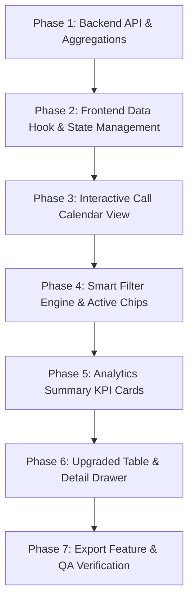

# Advanced Call Records — Calendar & Smart Filters
## Comprehensive Technical Architecture, Gap Analysis & Implementation Roadmap

> **Document Status:** Complete Architecture & Implementation Blueprint  
> **Target Module:** `frontend/src/modules/communication/call-recordings` & `backend/src/modules/management/live-tracking/recordings.js`  
> **Last Updated:** October 2026  
> **Constraint:** Preserves all existing features (Audio Player, Link Session Modal, Transcription Modal, Auto-matching) with zero breaking changes and no dummy data.

---

## 1. Executive Summary & Objective

The objective is to upgrade the existing **Call Records / Call Recordings Hub** in the AOTMS Telecommunication CRM into a high-performance, enterprise-grade **Advanced Call Records Center**.

### Key Deliverables
1. **Interactive Call Activity Calendar:** Day, Week, Month, and Agenda views with date jumping, call density badges, and click-to-filter mechanics.
2. **Expandable Smart Filter Engine:** Quick date presets, custom date/time ranges, call status, employee/agent dropdown, call duration tiers, recording file availability, and link categories (Normal Lead, Meta Lead, Campaign, Unlinked).
3. **Live Call Analytics Summary:** Server-aggregated KPI cards showing Total Calls, Completed/Connected Calls, Missed Calls, Total Talk Time, Average Call Duration, and Answer Rate.
4. **Upgraded Call Records Table & Detail Drawer:** Responsive table with column sorting, inline audio preview, status chips, quick actions, and a slide-over Call Detail Drawer.
5. **Server-Side Pagination & Optimization:** MongoDB aggregation pipelines, indexed date-range queries, and filter-aware CSV export.

---

## 2. Current State Audit & Gap Analysis

A deep architectural inspection of the codebase revealed the current state versus the required target:

| Dimension | Current Implementation | Target Requirement | Gap to Bridge |
| :--- | :--- | :--- | :--- |
| **Frontend Location** | `frontend/src/modules/communication/call-recordings/CallRecordings.jsx` (~1,834 lines) | Modular component hierarchy under `frontend/src/modules/communication/call-recordings/` | Split monolithic file into clean, maintainable sub-components without losing existing logic. |
| **Calendar View** | **None** (Only Card Grid and simple Table view exist). | Full interactive Calendar (Day, Week, Month, Agenda/List) with daily activity indicators. | Implement interactive Calendar component displaying daily call counts and click-to-filter. |
| **Filters** | Basic client-side text search and a 3-way radio toggle (`All`, `Matched`, `Unmatched`). | Multi-dimensional expandable Smart Filters (Date Presets, Custom Range, Status, Agent, Duration, Link Type, Recording Availability). | Build dedicated Filter Panel with active chip badges, reset actions, and URL query persistence. |
| **Analytics / KPIs** | Basic stats: Total, Linked Sessions, Unlinked Calls. | Live analytics: Total Calls, Completed Calls, Missed Calls, Total Talk Time, Average Duration, Answer Rate. | Implement server-side aggregation metrics and dynamic KPI cards. |
| **Pagination** | Hardcoded client-side limit (`.limit(500)`) with all records kept in browser memory. | Server-side pagination (`page`, `limit`), sorting (`sortBy`, `sortOrder`), and count metadata. | Update backend `GET /api/recordings` to return `{ recordings, pagination: { page, limit, total, totalPages } }`. |
| **Backend Route** | `backend/src/modules/management/live-tracking/recordings.js` (`GET /` with basic `userId` and `phone` filters). | Enhanced `GET /` with `from`, `to`, `date`, `status`, `duration`, `search`, `page`, `limit`. | Upgrade query parser, Mongoose query builder, and add `/calendar-summary` endpoint. |
| **Call Details UI** | View modes only render cards or rows; transcripts open in a modal. | Full Slide-over Call Detail Drawer with complete audit timeline, lead details, notes, and playback. | Build `CallRecordDetailsDrawer` component. |
| **Export** | **None** on this page. | Filter-aware CSV/Excel export respecting user permissions and active date/status filters. | Add server-side or frontend export mechanism streaming filtered records. |

---

## 3. Database Schema & Backend Architecture

### 3.1 Existing `CallRecording` Schema (`backend/src/database/models/CallRecording.js`)
The existing schema already possesses the following foundational fields:
- `user`: ObjectId (Ref: `User`) — Agent / Caller
- `lead`: ObjectId (Ref: `Lead`) — Linked Normal Lead
- `metaLead`: ObjectId (Ref: `MetaLead`) — Linked Meta Lead
- `campaignRef`: ObjectId (Ref: `Campaign`) — Linked Marketing Campaign
- `linkType`: Enum (`'lead'`, `'meta_lead'`, `'campaign'`, `null`)
- `phone`: String (10 digits normalized)
- `originalName`, `storedName`, `filePath`, `url`, `cloudinaryUrl`, `fileAvailable`, `size`, `mimeType`
- `recordedAt`: Date — Exact timestamp of the call
- `callDate`: String (`"YYYY-MM-DD"`) — Indexed date representation
- `callTime`: String (`"HH:mm:ss"`) — Indexed 24-hour time representation
- `transcript`, `transcriptStatus`, `lastCallIqReport`

### 3.2 Required Schema Enhancements (Non-Breaking)
To support advanced call analytics and status filtering seamlessly:
```javascript
// New non-breaking fields to add to CallRecording Schema:
{
  duration: { type: Number, default: 0 }, // Call duration in seconds (extracted from audio metadata or app upload)
  callStatus: { 
    type: String, 
    enum: ['completed', 'connected', 'missed', 'failed', 'busy', 'no_answer', 'rejected', 'in_progress', 'unknown'],
    default: 'completed',
    index: true
  },
  direction: {
    type: String,
    enum: ['outbound', 'inbound', 'unknown'],
    default: 'outbound',
    index: true
  }
}
```

> **Note on Existing Records:** For legacy records without explicit `duration` or `callStatus`, the backend query logic will safely treat records with valid audio files as `completed` and fallback to audio file size estimation or `0` duration, preventing any null pointer exceptions.

### 3.3 Optimized MongoDB Indexes
To ensure sub-100ms response times across tens of thousands of call recordings:
1. `callRecordingSchema.index({ callDate: 1, user: 1 });` — Accelerates calendar day and month lookups.
2. `callRecordingSchema.index({ recordedAt: -1, user: 1 });` — Accelerates reverse chronological list queries.
3. `callRecordingSchema.index({ callStatus: 1, recordedAt: -1 });` — Accelerates status-filtered queries.
4. `callRecordingSchema.index({ phone: 1, recordedAt: -1 });` — Instant phone search lookup.

---

## 4. API Endpoint Contracts

### 4.1 Enhanced `GET /api/recordings` (Server-Side Filtered & Paginated)
**Query Parameters:**
- `from` (`YYYY-MM-DD`): Start date (inclusive).
- `to` (`YYYY-MM-DD`): End date (inclusive).
- `date` (`YYYY-MM-DD`): Single date filter (for calendar day click).
- `status` (`string`): e.g., `completed`, `missed`, `connected`, `failed`, or `all`.
- `direction` (`string`): `outbound`, `inbound`, or `all`.
- `userId` (`ObjectId`): Filter by specific employee/agent.
- `phone` (`string`): Filter by 10-digit contact phone.
- `linkType` (`string`): `lead`, `meta_lead`, `campaign`, `unlinked`, or `all`.
- `durationTier` (`string`): `zero` (0s), `short` (1-60s), `medium` (61-300s), `long` (>300s).
- `fileAvailable` (`boolean`): Filter recordings with playable audio.
- `search` (`string`): Search across contact name, phone, employee name, filename, and campaign.
- `page` (`number`, default: `1`): Current page number.
- `limit` (`number`, default: `25`): Page size (options: 10, 25, 50, 100).
- `sortBy` (`string`, default: `recordedAt`): Sorting column (`recordedAt`, `duration`, `phone`, `userName`).
- `sortOrder` (`string`, default: `desc`): `asc` or `desc`.

**Response Contract:**
```json
{
  "success": true,
  "recordings": [
    {
      "_id": "6718a2...",
      "recordedAt": "2026-10-24T10:15:30.000Z",
      "callDate": "2026-10-24",
      "callTime": "15:45:30",
      "duration": 145,
      "callStatus": "completed",
      "direction": "outbound",
      "url": "https://res.cloudinary.com/.../audio.m4a",
      "fileAvailable": true,
      "phone": "9876543210",
      "leadName": "Kishore Kumar",
      "leadId": "66f4...",
      "linkType": "lead",
      "userName": "Ramanadham Jayaveer",
      "userEmail": "jayaveer@aotms.in",
      "userDesignation": "Telecaller",
      "transcript": "Hello, I am calling from AOTMS...",
      "transcriptStatus": "done"
    }
  ],
  "pagination": {
    "page": 1,
    "limit": 25,
    "total": 412,
    "totalPages": 17
  }
}
```

### 4.2 New `GET /api/recordings/analytics-summary`
Returns high-level statistics calculated strictly from the filtered dataset using MongoDB `$facet` aggregation:
```json
{
  "success": true,
  "summary": {
    "totalCalls": 412,
    "completedCalls": 350,
    "missedCalls": 42,
    "failedCalls": 20,
    "totalDurationSeconds": 58420,
    "avgDurationSeconds": 141,
    "answerRate": "84.95%",
    "hasRecordingCount": 388
  }
}
```

### 4.3 New `GET /api/recordings/calendar-activity`
Provides call volume distribution per day for calendar markers across a selected month/range:
```json
{
  "success": true,
  "month": "2026-10",
  "activity": {
    "2026-10-01": { "total": 34, "completed": 28, "missed": 6 },
    "2026-10-02": { "total": 45, "completed": 40, "missed": 5 },
    "2026-10-24": { "total": 52, "completed": 48, "missed": 4 }
  }
}
```

---

## 5. Frontend UI/UX Architecture

To maintain performance and code clarity, the monolithic `CallRecordings.jsx` will be decomposed into specialized modular components under `frontend/src/modules/communication/call-recordings/`:

```
frontend/src/modules/communication/call-recordings/
├── index.jsx                        # Export entrypoint
├── CallRecordings.jsx               # Master Orchestrator Page Container
├── components/
│   ├── CallAnalyticsCards.jsx       # 6 KPI cards (Total, Completed, Missed, Talk Time, Avg Duration, Answer Rate)
│   ├── CallCalendarView.jsx         # Month / Week / Day / Agenda interactive Calendar
│   ├── CallFilterPanel.jsx          # Expandable Smart Filter Drawer with Chips & Presets
│   ├── CallSearchBar.jsx            # Debounced Search with active filters counter
│   ├── CallRecordsTable.jsx         # Sortable, responsive data table with audio controls
│   ├── CallRecordDetailsDrawer.jsx  # Slide-over inspection drawer for call metadata & notes
│   ├── CallExportModal.jsx          # Filter-aware CSV/Excel download modal
│   ├── LinkSessionModal.jsx         # Preserved: Normal Lead / Meta Lead / Campaign linker
│   └── MemoizedAudioPlayer.jsx      # Preserved: High-performance HTML5 scrub player
└── hooks/
    ├── useCallRecordings.js         # API data fetching, query state, debouncing & cache
    └── useCalendarNavigation.js     # Calendar state (month/week/day navigation, date math)
```

### 5.1 Component Details

#### 1. `CallAnalyticsCards.jsx`
- Displays 6 key performance indicator cards at the top of the screen:
  1. **Total Calls:** All calls within the selected date range and filter criteria.
  2. **Completed Calls:** Connected calls with positive duration.
  3. **Missed / Failed Calls:** Unanswered or busy attempts.
  4. **Total Talk Time:** Formatted as `Xh Ym Zs`.
  5. **Average Duration:** Formatted as `Mm Ss` per completed call.
  6. **Answer Rate:** Percentage badge with visual success color code (`#16a34a`).

#### 2. `CallCalendarView.jsx`
- **View Modes:**
  - **Month View:** Traditional 7-column calendar grid. Dates with calls show a distinct badge and count dot (green for connected, orange/red for missed). Clicking any date filters the call table below to that exact day.
  - **Week View:** 7-column weekly schedule showing daily breakdown.
  - **Day View:** Hourly timeline for deep-dive inspection of a specific day's calling velocity.
  - **Agenda View:** Compact chronological list grouped by date.
- **Controls:**
  - `Today` button, `Previous (<)` and `Next (>)` navigation, and quick Date Picker jump.
  - Selected date indicator with an active ring highlight (`#1a73e8`).

#### 3. `CallFilterPanel.jsx`
- Clean, expandable accordion panel containing:
  - **Quick Date Presets:** Today, Yesterday, Last 7 Days, Last 30 Days, This Week, This Month.
  - **Custom Date Range:** From Date – To Date inputs with boundary validation.
  - **Call Status:** All, Completed / Connected, Missed, Failed, Busy, No Answer.
  - **Employee / Agent Dropdown:** Populated with team members (`User.find()`).
  - **Call Duration Tiers:** Any, Zero Duration (0s), Short (< 1m), Medium (1–5m), Long (> 5m).
  - **Audio Recording:** All, Available Only, Missing Audio.
  - **Link Category:** All, Normal Leads, Meta Leads, Marketing Campaigns, Unlinked.
  - **Active Filter Chips:** Visible below the filter bar with instant `(x)` remove buttons.
  - **Actions:** Primary `Apply Filters` and subtle `Reset All` buttons.

#### 4. `CallRecordsTable.jsx`
- Replaces the basic table with an enterprise responsive grid:
  - **Columns:** Contact / Lead Name, Phone Number, Agent / Caller, Date & Time, Duration, Status Badge, Audio Preview Player, Linked Category, Actions.
  - **Actions per Row:** Play Audio, View Details Drawer, Link/Edit Session, Copy Phone Number, Transcribe / View Transcript.
  - **Empty State:** Friendly graphic illustration with a "Clear all filters" call-to-action when 0 records match.
  - **Pagination Controls:** Showing `Page X of Y (Total Z records)` with configurable page size dropdown (`10`, `25`, `50`, `100`).

#### 5. `CallRecordDetailsDrawer.jsx`
- A sleek right-side slide-over drawer triggered by clicking any call row:
  - Full caller and lead profile (Name, Phone, Email, Campaign).
  - Call metadata (exact IST timestamp, file size, storage provider).
  - Full-width audio player with waveform seeking.
  - Complete AI Call Transcript conversation view with copy option.
  - Quick button to navigate to the Lead Details page (`/leads/:id`).

---

## 6. Implementation Phases & Step-by-Step Plan



### Phase 1: Backend API & Aggregations
1. Update `backend/src/database/models/CallRecording.js` to index `callDate`, `recordedAt`, `callStatus`, and `user`.
2. Enhance `GET /api/recordings` in `backend/src/modules/management/live-tracking/recordings.js`:
   - Parse query parameters: `from`, `to`, `date`, `status`, `userId`, `phone`, `durationTier`, `search`, `page`, `limit`, `sortBy`, `sortOrder`.
   - Apply Mongoose pagination via `skip((page - 1) * limit).limit(limit)`.
3. Add `GET /api/recordings/analytics-summary` endpoint utilizing MongoDB aggregation `$facet` for high-speed calculation of KPIs.
4. Add `GET /api/recordings/calendar-activity` endpoint returning daily call counts for the active calendar month.
5. Add `GET /api/recordings/export` endpoint generating CSV streams for filtered records.

### Phase 2: Frontend Data Hook & State Management
1. Create `useCallRecordings.js` hook to manage:
   - Filter state (`dateRange`, `status`, `agent`, `durationTier`, `linkType`, `search`).
   - Pagination state (`page`, `limit`).
   - Query debouncing (300ms on text search).
   - Server-side data fetching with caching.
2. Synchronize active filters with browser URL query parameters (`?from=...&to=...&status=...`) so users can share or bookmark filtered views.

### Phase 3: Interactive Call Calendar View
1. Build `CallCalendarView.jsx`:
   - Integrate Month, Week, Day, and Agenda view modes using date-fns or native Date utility.
   - Fetch daily call activity badges from `/calendar-activity`.
   - Handle date click events to filter the records table.

### Phase 4: Smart Filter Engine & Active Chips
1. Build `CallFilterPanel.jsx`:
   - Implement date preset pills (Today, Yesterday, Last 7 Days, This Month).
   - Add custom date picker inputs with date boundary validation.
   - Add status, agent, duration, and link category selectors.
   - Render removable filter chips showing currently applied parameters.

### Phase 5: Analytics Summary KPI Cards
1. Build `CallAnalyticsCards.jsx`:
   - Render 6 responsive cards (Total, Completed, Missed, Talk Time, Avg Duration, Answer Rate).
   - Add subtle loading skeleton placeholders while fetching.

### Phase 6: Upgraded Table & Detail Drawer
1. Build `CallRecordsTable.jsx`:
   - Render responsive columns with sortable header click events.
   - Integrate inline audio player controls using `MemoizedAudioPlayer`.
   - Add row action buttons (Open Detail Drawer, Link Session, Transcribe).
2. Build `CallRecordDetailsDrawer.jsx`:
   - Slide-over drawer with call details, audio playback, and linked lead summary.

### Phase 7: Export Feature & QA Verification
1. Add `CallExportModal.jsx` to export filtered call records to CSV.
2. Verify role-based access: Admin and HR have full access; Managers view team recordings; Employees view their own recordings.
3. Validate timezone handling (`Asia/Kolkata` IST) across all calendar dates and time displays.

---

## 7. Acceptance & Verification Checklist

- [ ] **Calendar Verification:**
  - [ ] Month view renders accurate day numbers and highlights current date.
  - [ ] Dates with calls display call volume badges.
  - [ ] Clicking a date filters the table strictly to calls on that date.
  - [ ] Navigation (`<`, `>`, `Today`) smoothly updates month and re-fetches activity dots.
- [ ] **Smart Filters Verification:**
  - [ ] Date presets (Today, Yesterday, Last 7d, This Month) accurately set boundary dates.
  - [ ] Custom date range prevents invalid ranges (e.g., From Date > To Date).
  - [ ] Multiple filters work together (e.g., Date + Status + Employee + Duration).
  - [ ] Clicking "Reset Filters" restores the default view.
  - [ ] Active filter chips can be removed individually.
- [ ] **Analytics Verification:**
  - [ ] Analytics cards update dynamically to reflect the filtered dataset.
  - [ ] Total talk time and average call duration calculations are mathematically accurate.
  - [ ] Zero/empty states display clean "0" or "0s" without throwing JavaScript errors.
- [ ] **Audio & Detail Drawer Verification:**
  - [ ] Audio player plays, pauses, scrubs, and adjusts volume reliably.
  - [ ] Detail Drawer opens with complete call metadata, linked lead details, and transcript.
  - [ ] Session linking modal (`LinkSessionModal`) remains 100% functional for Normal Leads, Meta Leads, and Campaigns.
- [ ] **Performance & Security:**
  - [ ] Server-side pagination loads quickly (< 200ms) regardless of total records.
  - [ ] Unauthenticated or unauthorized users are blocked via `protect` middleware and permission guards.
  - [ ] CSV export contains only authorized records matching active filters.